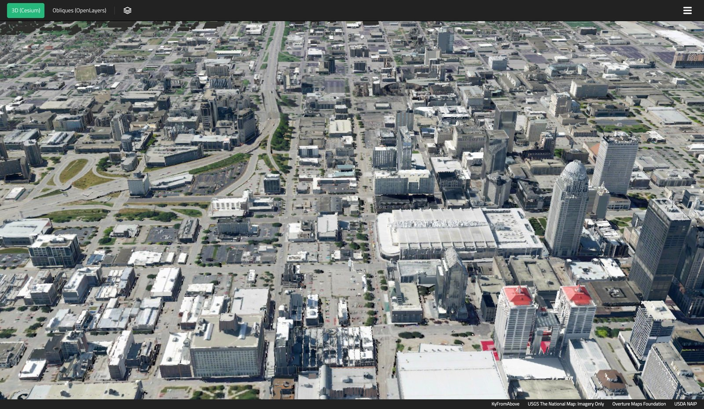
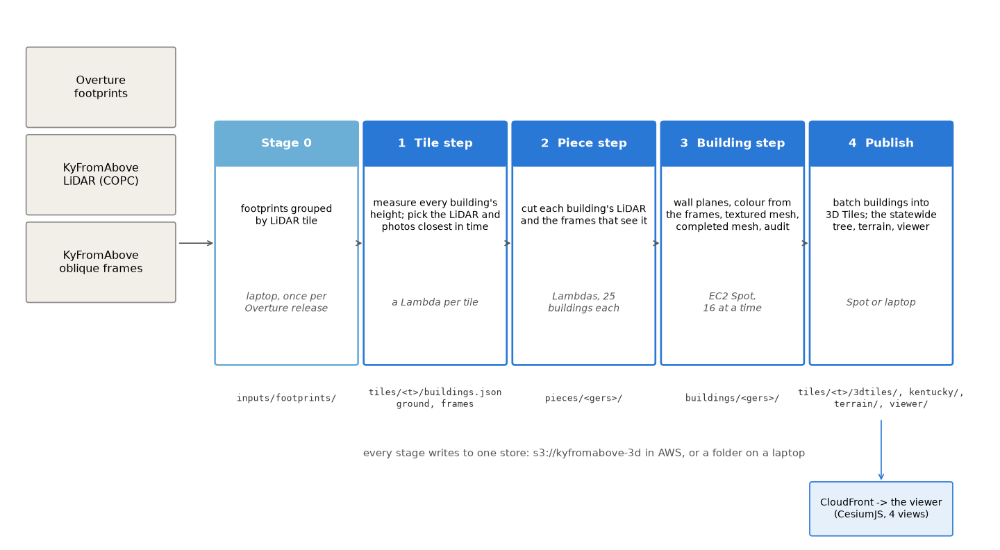

# kyfromabove-3d

[](https://github.com/mwkorver/kyfromabove-3d/actions/workflows/ci.yml)
[](LICENSE)

> [!NOTE]
> **Public prototype under the [MIT license](LICENSE).** Use, fork and adapt
> it freely. It comes as-is: no support, and issues and pull requests are not
> watched. It has been run for parts of Kentucky (Louisville, Covington and
> Newport, Lexington), not the whole state.

**Kentucky's buildings in 3D, from the state's own open data.** Each
building's shape comes from KyFromAbove's LiDAR, its color from KyFromAbove's
oblique aerial photos, and its outline from Overture's building footprints.
The result is published as 3D Tiles and viewed in a web browser.



*Downtown Louisville looking south in the VC Map page. Walls and roofs are
shaped from the LiDAR and colored from KyFromAbove's photos. The buttons at
the top left switch between the 3D map (Cesium) and the oblique photos
themselves (OpenLayers).*

[KyFromAbove](https://kyfromabove.ky.gov) is Kentucky's aerial imagery and
LiDAR program, published as open data on AWS. This is an independent project
built on that data; it is not part of the program or endorsed by it.

## What it makes

The same buildings, five ways. The viewers switch between them in place:

| View | Shape | Color |
|---|---|---|
| **Overture** | footprint raised to Overture's height | by where the height came from: Overture, floors × 3.5 m, or a 6 m guess |
| **LiDAR heights** (product 1) | footprint raised to the LiDAR's height | plain gray |
| **Measured** (product 2) | walls and roof from the LiDAR | from the photos, only where a photo saw the surface |
| **Completed** (product 3) | as Measured | the unseen parts filled in from the same building's photos |
| **Borrowed fill** (product 4) | as Measured | the unseen parts filled with patches copied from the building's seen walls; Covington, Newport and Lexington only |

The VC Map page also has the Completed and Borrowed fill views with the
filled-in parts tinted, so you can see what was invented. Nothing comes from
outside the building's own KyFromAbove data: no internet photos, no generic
textures. In the CesiumJS viewer, clicking a building shows which LiDAR and
photos it was made from, how many months apart they were taken, and where its
height came from. More in [`docs/PRODUCTS.md`](docs/PRODUCTS.md).

## How it works



The unit of work is one LiDAR tile, a square about 1.5 km across. Kentucky
has 46,167 of them, 41,566 with buildings. Every step reads from and writes
to one *store*: an S3 bucket for real runs, or a folder on a laptop for
testing. The code is the same in both.

| Step | What it does | Runs on |
|---|---|---|
| 0 | Groups Overture's footprints by LiDAR tile (`scripts/stage0_index.py`) | a laptop, once per Overture release |
| 1 · tile | Measures each building's height, splits outlines that hold more than one building, and picks the LiDAR and photos taken closest together in time | EC2 Spot machines, one tile a job |
| 2 · measure | Cuts out each building's LiDAR and lists the photos that see it | EC2 Spot machines, one tile a job |
| 3 · build | Fits walls and roofs to the LiDAR, colors them from the photos, checks the result | EC2 Spot machines, 8 to 16 nearby buildings a job |
| 4 · publish | Writes 3D Tiles, the statewide tree, the terrain and the viewers | a Spot machine or a laptop |

CloudFront serves the result to two public pages: the
[VC Map page](https://d2egs1bbelo373.cloudfront.net/viewer/vcmap/index.html)
([`viewers/vcmap/`](viewers/vcmap/)), which also shows the oblique photos, and a
[CesiumJS viewer](https://d2egs1bbelo373.cloudfront.net/viewer/index.html)
([`viewer/`](viewer/)). Setup, costs and what went wrong are in
[`docs/CLOUD.md`](docs/CLOUD.md).

## Where it stands (October 2026)

- **170,456 buildings published** on 119 LiDAR tiles, with terrain under them.
- **37,383 of them are textured meshes**, in downtown Louisville (4 tiles),
  downtown Covington and Newport (8) and downtown Lexington (9). The rest are
  boxes, on the 98 tiles around downtown Louisville.
- **AWS cost so far: about $47** (August to October 2026, tax included):
  $16 of early trials on Lambda, $15 of storage, $12 of Spot machines.
- **All of Kentucky** (2.79 million buildings) is estimated at about $440
  ($290-590) and five days on eight Spot machines, tile by tile from the two
  queue runs' measured jobs. A quarter of its buildings have LiDAR and
  oblique photos flown within six months of each other; the median pair is
  15 months apart ([CLOUD.md](docs/CLOUD.md), "What all of Kentucky costs").
  It has not been run.

## Limits

- A prototype, run for the areas above only. The live pages may be taken
  down without notice.
- Built and tested on one Mac and one AWS account; never tried on Windows.

## Why the LiDAR gives the shape and the photos only the color

The photos are much sharper than the LiDAR (3 inches a pixel, against a few
LiDAR points per square meter), but they are a poor source of shape. On a low
store in Grayson, points worked out from several photos land within 0.26 m of
the LiDAR. On a downtown Louisville tower they miss by 1.8 m: a glass wall
repeats the same window every meter or so, so a match that slips one window
looks right and is wrong.

So depth always comes from the LiDAR. Each wall is fitted to the LiDAR points
on it, and colored from the photo that sees it best, with trees and
neighboring buildings tested for blocking the view
([`docs/BUILDING_MESH.md`](docs/BUILDING_MESH.md)).

## What Overture is for

Footprints, and the GERS id that every file is keyed on. Its heights are
shown only in the Overture view, for comparison. In downtown Louisville, 264
of 378 footprints have no Overture height, and most of the heights it does
have come from a machine-learning model that tops out at about 30 m (the
107 m Omni hotel is listed at 16 m)
([`docs/BUILDING_MESH.md`](docs/BUILDING_MESH.md)). Its `roof_shape` field is filled for under 0.5% of
buildings ([`docs/SURVEY_ZONES.md`](docs/SURVEY_ZONES.md)).

## Running it

### Set up

```bash
uv sync --extra overture --extra cloud && source .venv/bin/activate
```

The LiDAR tile grids come from KyFromAbove's public bucket (no AWS account
needed):

```bash
mkdir -p data/raw && for p in 2 3; do aws s3 cp --no-sign-request s3://kyfromabove/elevation/PointCloud/TileGrids/kyfromabove_phase${p}_pointcloud_5k_grid.gpkg data/raw/; done
```

PROJ downloads the geoid grids that set building heights on first use.
Without them PROJ quietly puts buildings 1.2 m or 34 m too high or low, so the
code stops instead.

### Test

```bash
pytest -q
```

About 450 tests, a few minutes, no network. CI also runs `ruff check`.

### One tile on a laptop

A corner of downtown Louisville: 72 buildings in tile N076E229, five of them
built as meshes and the rest as boxes. About three minutes:

```bash
python scripts/stage0_index.py --bbox -85.764 38.25 -85.75 38.26 --store outputs/one_tile --tiles N076E229
python scripts/queue_run.py local --run one --store outputs/one_tile --tiles N076E229 --limit 5
python scripts/publish_step.py --inputs outputs/one_tile --tiles N076E229 --tree --terrain --viewer --start -85.7522 38.25 700
python -m http.server -d outputs/one_tile 8000
```

Then open <http://localhost:8000/viewer/index.html>. The LiDAR and photos are
read straight from KyFromAbove's public bucket.

### In AWS

The AWS CDK stacks are in [`deploy/`](deploy/): the queue run (an SQS queue
and Spot machines that run the same jobs as the laptop), the CloudFront viewer
and a budget alert. `scripts/queue_run.py` sends a run's jobs and follows it;
[`docs/CLOUD.md`](docs/CLOUD.md) walks through a full run.

Before deploying your own copy:

- Pass your own bucket name with `-c bucket=<name>` or `KFA_BUCKET=<name>`
  (and `--store s3://<name>`). The default, `kyfromabove-3d`, is taken.
- The Spot machines stop taking jobs after 10 hours and shut down after
  12 hours 40 minutes, but there is no spending cap. Deploy the budget stack
  too.
- A deployed viewer is public unless the password is turned on. See
  [SECURITY.md](SECURITY.md).

### Checking a change

A change to the meshing or coloring code is checked against 10 buildings that
have broken before:

```bash
python scripts/audit_reference.py rebuild && python scripts/audit_reference.py compare
```

It fails, naming the building and what got worse
([`docs/AUDIT.md`](docs/AUDIT.md)).

## Documents

| Document | Covers |
|---|---|
| [`docs/CLOUD.md`](docs/CLOUD.md) | The pipeline in AWS: costs, the pilot, the bugs it found, serving the views |
| [`docs/PRODUCTS.md`](docs/PRODUCTS.md) | Products 1 to 4: what is measured, what is invented, and how it is labeled |
| [`docs/BUILDING_MESH.md`](docs/BUILDING_MESH.md) | How a building becomes a textured mesh |
| [`docs/AUDIT.md`](docs/AUDIT.md) | Checking a change against buildings that have broken before |
| [`docs/DOWNTOWN_RUN.md`](docs/DOWNTOWN_RUN.md) | All of downtown Louisville, built on a laptop |
| [`docs/LIDAR_SOURCES.md`](docs/LIDAR_SOURCES.md) | KyFromAbove's LiDAR phases, their density and dates |
| [`docs/SURVEY_ZONES.md`](docs/SURVEY_ZONES.md) | Which buildings have roofs and walls worth more detail, statewide |
| [`docs/CASE_COMPLEXITY.md`](docs/CASE_COMPLEXITY.md) | Three Louisville towers measured on one scale |
| [`docs/CAMERAS_AND_ORTHOS.md`](docs/CAMERAS_AND_ORTHOS.md) | Checking KyFromAbove's camera models and orthophotos |
| [`docs/history/`](docs/history/) | The first phase's reports: camera checks, the first tower, finding a roof |

## Layout

```text
src/kyfromabove_3d/   the pipeline: steps 1 to 4, the mesh, coloring, fill, publishing
  stages/             one building's steps, each with a command line (scripts/<step>.py)
scripts/              command lines: the steps, the queue run, the audit, local viewers
deploy/               the AWS stacks (CDK), the container image, cost models
viewer/               the CesiumJS viewer
viewers/vcmap/        the VC Map page (3D and oblique photos)
viewers/s3_compare/   a side-by-side compare page that needs no server
tools/                local viewer pages
configs/              landmark buildings, the audit's reference set, places
tests/                no network needed
docs/                 the documents above and their figures
```

## License and credits

The code is MIT; see [LICENSE](LICENSE). The data has its own terms:

- **[KyFromAbove](https://kyfromabove.ky.gov/)** LiDAR and aerial photos:
  public domain. Read from the `kyfromabove` bucket in the
  [AWS Registry of Open Data](https://registry.opendata.aws/kyfromabove/):
  the Phase 2 and Phase 3 LiDAR, and the 2022 to 2024 oblique photos with
  their camera positions.
- **[Overture Maps](https://overturemaps.org/)** building footprints: mostly
  under the [Open Database License](https://docs.overturemaps.org/attribution/),
  which has a share-alike condition. The published tiles contain Overture's
  footprints, so anything you publish from them likely carries the same
  terms. Check before reusing; this is not legal advice.
- **Base maps:** [OpenStreetMap](https://www.openstreetmap.org/copyright)
  contributors in the CesiumJS viewer; USGS The National Map and USDA NAIP
  imagery (public domain) in the VC Map page.

KyFromAbove is credited even though it needs no credit, because few states
publish oblique photos openly, and fewer publish the camera positions that
make them measurable. Kentucky publishes both, with statewide LiDAR, free. In
2025 it became the
[first state to complete statewide oblique aerial coverage](https://www.kentucky.gov/Pages/Activity-stream.aspx?n=FinanceandAdministrationCabinet&prId=266).
Errors here are ours, not KyFromAbove's.

## Built with

- [GDAL](https://gdal.org/) and [Rasterio](https://rasterio.readthedocs.io/):
  reading parts of KyFromAbove's Cloud-Optimized GeoTIFFs (COGs) over HTTP,
  through an [nginx](https://nginx.org/) cache on each machine.
- [PROJ](https://proj.org/) and [PyProj](https://pyproj4.github.io/pyproj/):
  coordinate and height conversions (Kentucky Single Zone, WGS84, the
  GEOID99 and NADCON5 grids).
- [GEOS](https://libgeos.org/), [Shapely](https://shapely.readthedocs.io/) and
  [GeoPandas](https://geopandas.org/): footprints and GeoPackage files.
- [DuckDB](https://duckdb.org/): querying Overture's GeoParquet on S3 and
  writing the published tile index.
- [laspy](https://laspy.readthedocs.io/) and [lazrs](https://github.com/laz-rs/laz-rs):
  reading the LiDAR (COPC) over HTTP.
- [CesiumJS](https://cesium.com/platform/cesiumjs/), [VC Map](https://vc.systems/en/products/vc-map/)
  and [OpenLayers](https://openlayers.org/): the viewers, showing
  [3D Tiles](https://www.ogc.org/standards/3dtiles/),
  [glTF](https://www.khronos.org/gltf/) meshes, terrain and the oblique photos.
- [Basis Universal](https://github.com/BinomialLLC/basis_universal): compressed
  (KTX2) textures.
- [OpenCV](https://opencv.org/), [NumPy](https://numpy.org/),
  [SciPy](https://scipy.org/) and [Pillow](https://python-pillow.org/): fitting
  walls and roofs, deciding what each photo can see, and filling unseen parts.
