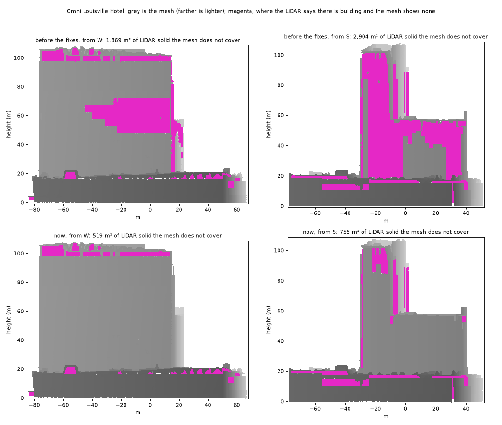
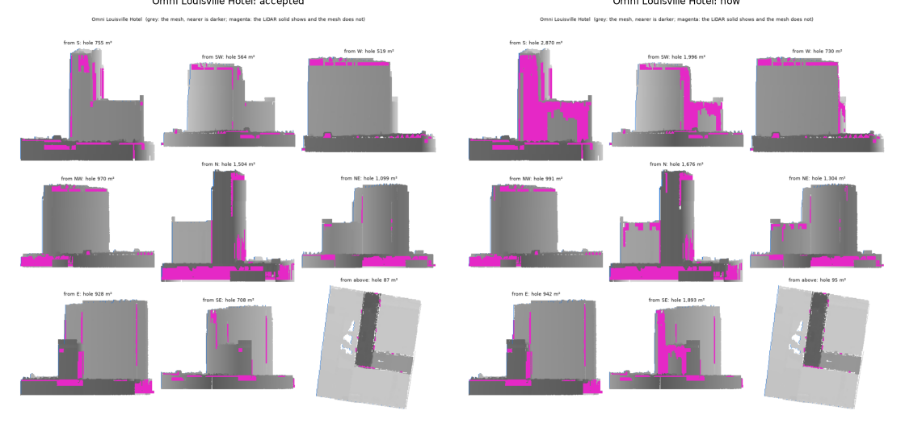

# The audit: checking a code change without looking at it

Until September 2026 every serious fault in the meshes was found by a person
looking at the viewer: a 60 m wide hole in the Omni's west tower wall, the
Omni's south wing with almost no south wall, wall panels standing on Kentucky
Home Life's roof, a building's height taken from its neighbour's wall, walls
covered in round dots and then in straight lines. The unit tests are small
made-up cases written *after* each report; they stop a fixed fault coming
back but cannot find a new one. The texture check (`check_building.py`)
scores walls that exist against frames they were not coloured from; a wall
that does not exist has nothing to score.

The audit measures each building against evidence it was not built from,
mostly the LiDAR taken as a solid, and puts a number on each kind of fault
seen so far. A code change is then checked by comparing numbers on a set of
buildings that have broken before.

## What it measures

`scripts/audit_building.py --building <dir>` writes `audit.json` and
`audit.png` into the building's directory (`src/kyfromabove_3d/audit.py`
holds the measures). It needs no frame crops.

**Holes.** Each roof cell of the LiDAR (0.75 m, as the mesh step uses) is
made a column from 1.5 m above the ground up to its height: the LiDAR as a
solid. The mesh and the solid are both drawn straight on, in 0.5 m pixels,
from eight sides (every 45°) and from above. A pixel is a hole where the
solid is there and the mesh is not, or where the mesh is more than 6 m behind
the solid's front: looking through a missing wall at the back of the
building. A shallow recess (a loggia 3 m deep) is not a hole. Each hole is
put down to the face most of it lies on, among the faces that view looks at,
so a sliver at a corner seen edge-on does not count against a face. Reported:
the hole area of the worst view, and the largest hole on each face, with its
height range.



**Wall on a flat roof.** Near-vertical mesh more than 2 m inside the outline,
standing on a part of the LiDAR roof that does not step by more than 1.5 m
within 2 m of it. A tower on its podium, a penthouse, a lantern each stand on
a step and are not counted; Kentucky Home Life's panels stood on flat roof.

**Heights.** The mesh's top against the 99th percentile of the LiDAR returns
more than 1.5 m inside the outline (a neighbour's wall spills over the edge),
and product 1's height against the same.

**Texture.** From product 2's record of where each wall texel's colour came
from (`3dtiles_complete/fill_faces.npz`): the share of wall left blank, and
two faults of the small-gap fill. A *dot* is a roughly round patch 0.5–4 m
across, standing in blank wall, less than a tenth of it seen by a frame:
colour grown round a lone speck. A *line* is a strip of filled texels at most
two texels wide and at least 1 m long with blank wall on both sides: colour
bridged between specks. The texture check's agreement is copied in.

**Outline.** The sharpest corner and the thinnest width of the footprint (or
split part): 39a33bd6-a had been squashed to a point.

## Running it

- **Every building, in the downtown run.** `run_downtown.py` audits each
  building after its mesh and check (`--no-audit` skips it); an audit that
  fails never fails the building. At the merge it writes
  `outputs/downtown/audit_summary.json`: each building's headline numbers,
  and the 20 worst buildings for each measure, by name — review starts there
  instead of browsing the viewer.
- **A code change, on the buildings that broke before.**
  `configs/audit_reference.yaml` lists 19 of them, each with what went wrong:
  400 West Market, PNC Tower, the Omni, Kentucky Home Life, the Seelbach,
  the three parts of 39a33bd6, 9947f2b0, the Marmaduke, and nine towers on
  podiums.

  ```bash
  python scripts/audit_reference.py rebuild     # the set with the current code, about 10 minutes
  python scripts/audit_reference.py compare     # exit 1 if anything got worse
  python scripts/audit_reference.py accept      # the current audit becomes the baseline
  ```

  Two landmarks are in the set too, built like every other building: 400
  West Market, whose domed crown came out right and must stay so, and PNC
  Tower.

  A hole can be put down to a neighbouring face, or to a corner, from one
  build to the next while staying the same hole. So a face counts as worse
  only when a view that shows its hole got worse as a whole; each view's
  total is in the baseline. (The crown rule first read as six buildings
  worse; measured view by view with the rule on and off, five had less hole
  from every side.)

  `compare` names the building, the face and the measure of every change
  beyond its tolerance (a hole up by more than 10 m² or 10%, wall on a flat
  roof up by 5 m², the top 1.5 m further off the LiDAR's, blank wall up by 3
  points, any new dot or line, an outline newly sharper than 30° or thinner
  than 4 m), lists what got better, and draws the accepted and the current
  picture of each building that changed (`outputs/audit_compare.png`). The
  baseline, `tests/data/audit_baseline.json`, is small and kept in git; a
  change that makes things better is accepted, and the new numbers become
  the bar.
  Tried on purpose: with the south-wing fix undone (the roof height read on
  both sides of an edge again) and the Omni rebuilt, `compare` failed within
  two minutes, naming face 1001 (a 2,361 m² hole, was 150) and face 1000
  (1,589 m², was 44); with the fix back, it passed. Rebuilding with no change
  moved no number.

  

- **As a test.** `pytest -m data` runs the comparison, and two known answers:
  the Omni as it was (its mesh kept in `tests/data/audit/`) has both holes and
  the Omni as it is has neither; the Seelbach's textures under the old gap
  rule have lines. The plain `pytest` stays fast and needs no outputs.

## Exceptions

The solid assumes the LiDAR's roof stands on walls all the way down. A
colonnade, a driveway under a podium, a void under an overhang are real and
will read as holes. After looking at one, add it to `exceptions` in
`configs/audit_reference.yaml` — building, face, the area allowed, and the
reason — so it is allowed without being forgotten.

## What it does not do

It finds missing and misplaced geometry reliably. It judges texture only
roughly: blank wall, dots and lines can be counted, but "this facade looks
wrong" still needs the frame comparison or a person. It runs on real data,
locally, not in a quick unit test: it needs the LiDAR and the meshes.
