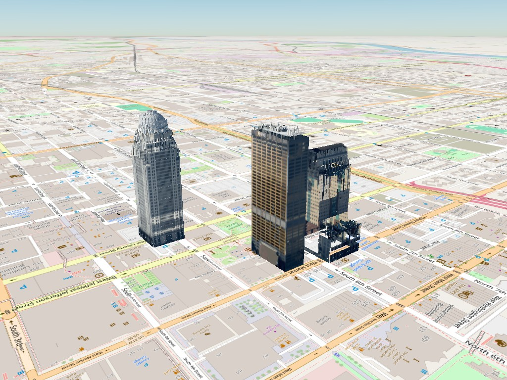
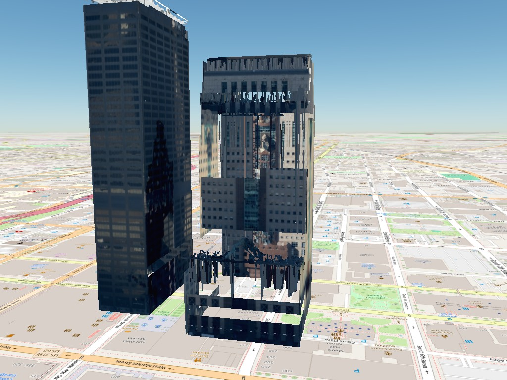
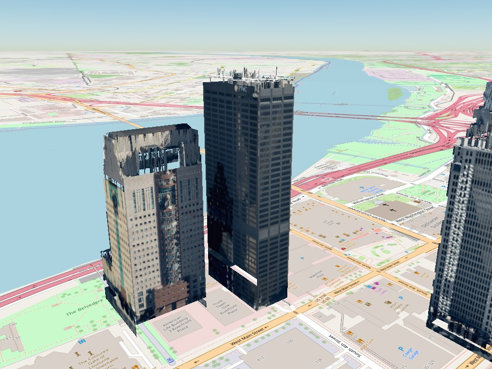
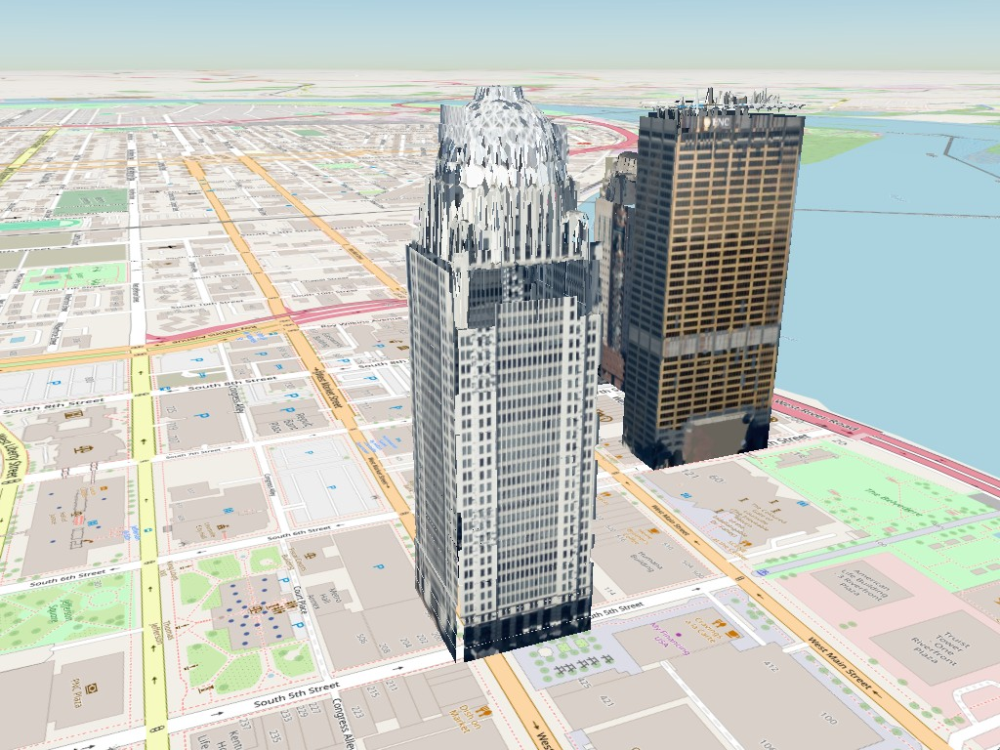
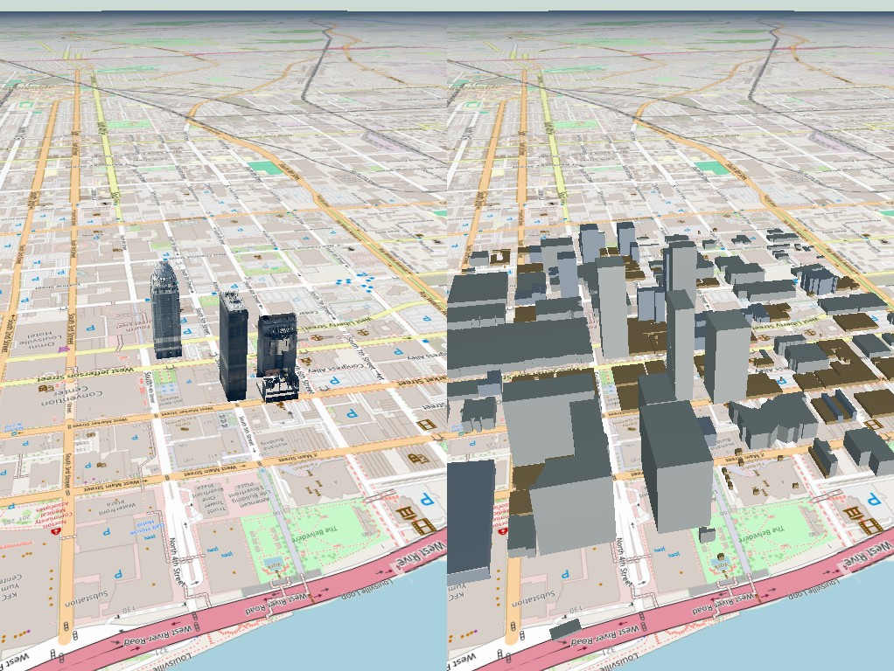
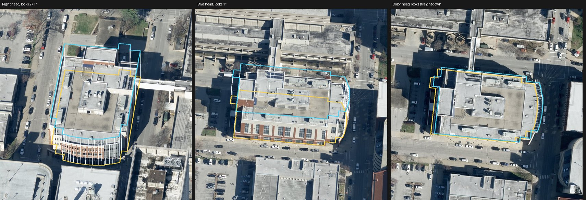
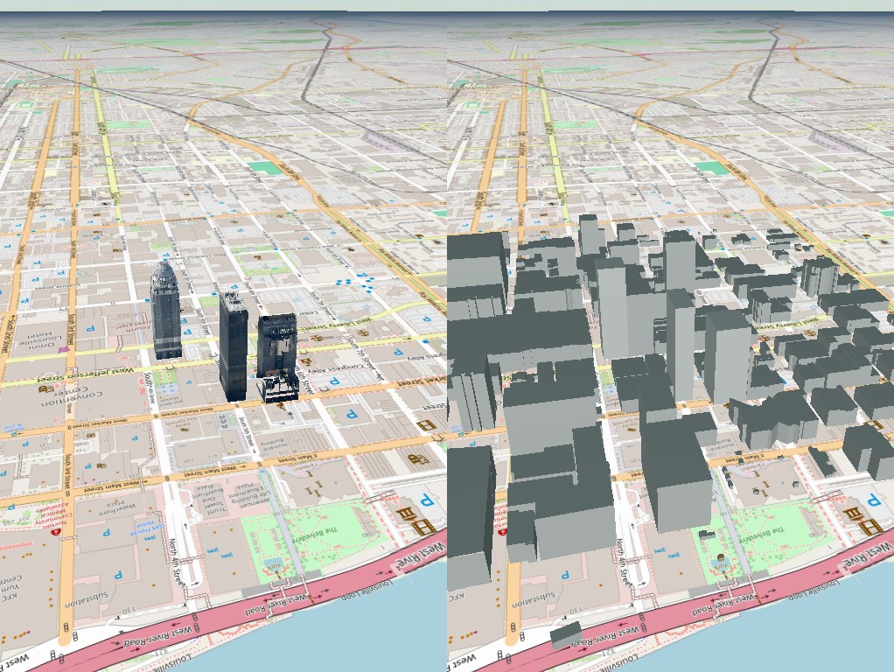
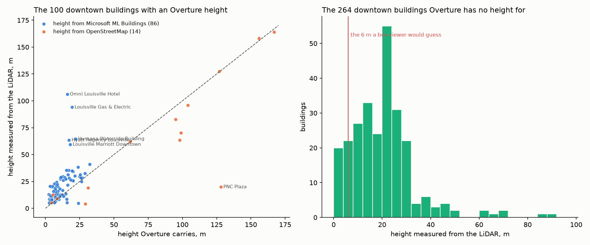
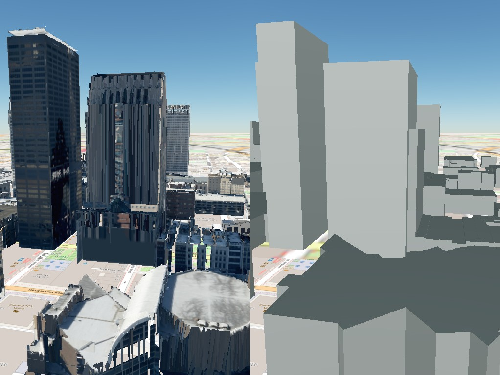
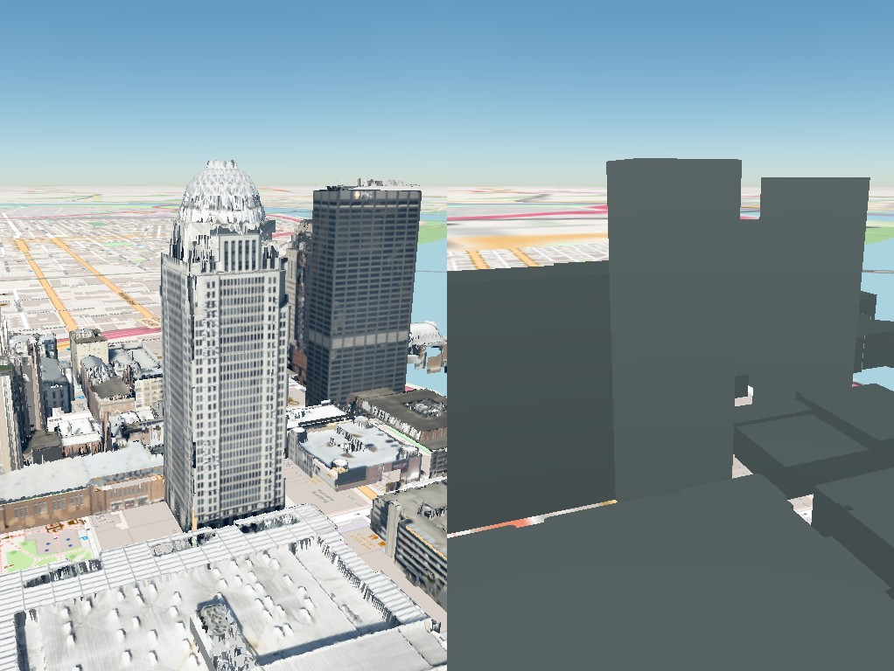

# Buildings as surfaces: a textured glTF from the LiDAR, the footprint and the aerial frames

The point export draws a building as it was sampled. `scripts/build_mesh.py`
draws it as surfaces, from the same evidence, and wraps the result as 3D
Tiles so it sits on the same globe as the points (`/tiles?all=1&mesh=1`).
Three downtown Louisville buildings, 20,376 textured triangles between them:



*Left to right: 400 West Market, PNC Tower, the Humana Building, seen from
the north-east. Every surface here is either a plane the LiDAR verified, a
band of the wall profile, a locally fitted wall tile, or a cell of the roof
height field; every color is a pixel of the state's aerial frames. No
internet photograph reaches the mesh.*

## What the mesh is made of

Four kinds of surface, in the order the script builds them, each one a thing
the colorize (`colorize_building.py`) already computed:

1. **Wall rectangles from the profile bands.** `wall_profiles.json` holds,
   for each face of the footprint and each 5 m of height, where the LiDAR
   says the wall is: its offset from the footprint edge, how far along the
   edge it runs, whether it was observed, bridged, extended, mirrored from
   the face opposite, open (a loggia) or unknown. Each band with a wall
   becomes a vertical rectangle at its offset, split where the profile found
   a recess or a projection, with a short return wall at each such edge and
   a horizontal ledge wherever the band above stands further in or out than
   the band below — a set-back tower on its podium. A face whose plane was
   verified by fitted tiles is the whole face at that plane, in the same
   height steps, minus the open bands and beyond the corner clips, exactly
   as the colorize extruded it.
2. **Fitted wall tiles.** The 12 m squares the colorize fits to the wall
   returns and keeps where they lie on a plane (within 0.35 m). These are the
   wall where the LiDAR saw it directly, at the LiDAR's own position, and
   each is a rectangle in its own plane with its own small texture.
3. **The roof as a height field.** The top of the returns in each 0.75 m
   cell inside the footprint (their 80th percentile, so a cantilever keeps
   its roof rather than the podium's), two triangles per cell. The steep
   cells — more than 75° from flat — are a step in the roof or a wall the
   LiDAR saw that no band models, such as the bulge of Humana's north side.
   They are dropped where a wall rectangle already stands (within 1.5 m) and
   where they stand *outside* the wall the profile puts at that height (the
   underside of an overhang that a 2.5-D surface has filled in), and kept
   otherwise as LiDAR-shaped wall, one color per triangle from whichever
   aerial frame faces it.
4. **Textures, from the aerial frames only**, at 0.15 m per pixel. Each
   flat section of a wall is painted whole from the one frame that sees it
   best, and what that frame cannot see from the next
   (`mesh/paint.py`; [PRODUCTS.md](PRODUCTS.md), "How walls are colored").
   Curved walls, and sections no frame sees, are rasterized from an
   aerial-only colored cloud — `colorized_aerial.laz` (`.ply` in older
   runs), the colorize run with no photograph cameras, which `build_mesh.py`
   makes for itself and checks (it refuses a cloud with a single
   photo-colored point). The point view (`colorized.ply`) may still carry
   admitted photographs; the mesh never does. The roof is sampled straight
   from the aerial frames through each camera model; the nadir frame (the
   `Color` head) wins wherever it sees the roof because it is the most
   face-on. What blocks a frame's view, for walls and roof alike, is a depth
   map of every LiDAR return within 250 m, trees included, with each
   neighbor standing as a solid prism. A stretch of wall nothing saw reads
   plain: the median color of its own floor.

The glTF is unlit (`KHR_materials_unlit`): the imagery already carries the
sun, and a second lighting pass in the viewer darkened every face the
viewer's sun was behind. The node's `extras` carry the name and the GERS
id. The tileset is 3D Tiles 1.1 with the glTF as content and a root
`transform` that places the building's local meter frame (east, north, up
at the state-plane origin, converted through the geoid as for the points)
on the Earth.

## What it looks like, building by building



**Humana from Main Street.** The tower's north wall stands where the profile
found it, 24.5 m behind the footprint edge, with its central glass ribbon;
the top of the 25th-floor porch that cantilevers over it is the roof surface
above. The podium's front is open — the profile reads the colonnade and the
loggia as open bands, not wall, and the mesh draws nothing there rather than
a wall that is not. The hanging fringe along the podium's top edge is the
LiDAR's own clutter at the porch roof, kept as steep cells.



**PNC Tower and Humana from the south-west.** PNC is five verified planes
and a flat roof; the crown's mechanical floor is the height field. Humana's
south face is its pink granite from the obliques; the west face shows the
glass ribbon; its east face, in PNC's shadow, wears the west face's texture
through the mirrored bands.



**400 West Market.** The shaft is 116 profile rectangles across the four
faces with 60 ledges and returns at its setbacks. The dome is where a height
field is weakest: it is an open steel lattice, the returns on it are
scattered, and the 80th percentile of a scattered cell makes a spiky
surface. A dome wants a fitted surface of revolution, not a grid.

## Against the alternatives

| | Cesium OSM Buildings | Google photorealistic tiles | this mesh |
| :--- | :--- | :--- | :--- |
| height | a tag, missing on about half the large downtown footprints | measured | measured from the LiDAR |
| shape | a box | a photogrammetric blob, good at a distance | planes, setbacks, ledges, the roof's steps |
| facades | none | textured, smeared on the sides | textured from the state's obliques where seen; mirrored, or plain, where not |
| identity | OSM id | none | GERS id on every feature |
| open | yes | display only | yes |
| coverage | worldwide | metro areas | where the state flew |
| triangles per building | ~12 | ~10⁵ | ~7,000 |

It is better than OSM Buildings on every row but coverage. Against
Google's mesh it trades photographic completeness for clean geometry, ids,
an open license, and an honest gap where the evidence stops.

### Side by side with Overture

`/compare` puts two globes under one camera: this project's meshes on the
left, and on the right every Overture building in the 1.2 km downtown box
(release 2026-08-19.0, 378 buildings) pulled up to its height, the way
Cesium OSM Buildings and its kind draw a city (`scripts/overture_boxes.py`).



What Overture holds for downtown Louisville: every one of the 378
footprints is OpenStreetMap's; 100 carry a height, and 86 of those heights
come from **Microsoft ML Buildings** (the machine-learned height model
behind the Microsoft footprint releases), the other 14 from OSM tags — the
three landmarks among them, PNC Tower 156 m, Humana 127 m, 400 West Market
167 m. 50 more have only a floor count (drawn at 3.5 m a floor) and 228 —
six in ten — have neither and are drawn at a 6 m guess. The box color says
which: gray, blue-gray, orange. So the honest comparison is not the three
landmarks, where OSM contributors typed the height from the building's own
literature, but the block around them, where the LiDAR knows every roof
and Overture knows one in four.

### The frames behind a building, from where you are looking

Click a building on either pane and a panel opens with the aerial frames
that textured it, the one whose look direction is nearest the viewer's own
first — orbit the building and, with *follow the camera* on, the frame
swaps to the head now facing you; a steep view down picks the nadir. The
footprint is drawn on each frame — the base at the LiDAR ground in
yellow, the roof at the building's height in cyan, the corners joined — so
the pixels that became each wall are in plain sight, and the same outline
is drawn on the ground of both globes.



The crops themselves were deleted after the run, but every building keeps
`crop_manifest.json`: for each frame, the window that was cut and the
crop's camera. The server (`/frames?gers=`, `/crop?gers=&frame=`) projects
the footprint through that camera, and re-cuts the crop from the frame on
S3 when asked — half a second for a 1,500 px window, then cached under
`crops_cache/` — so the panel costs nothing on disk until a building is
looked at. A click on a mesh reads the building from the tile; a click on
a box or the ground asks `/building_at?lon=&lat=`.

### The same footprints at the LiDAR's heights

`overture_boxes.py lidar-heights` measures every footprint from the LiDAR:
the returns inside the polygon (Phase 2 tiles, read at 0.5 m resolution,
vegetation, noise and water classes left out), the roof at their 99th
percentile above the ground, the ground the median of the ground-classified
returns within 15 m. 364 of the 378 downtown footprints get a height this
way in about a minute; 14 hold too few returns. `/compare` shows these
boxes by default (`?heights=overture` shows Overture's own).



How the two sets of heights compare, on the 100 buildings that have both:



* **Microsoft's heights stop at about 30 m.** The 86 Microsoft heights
  agree with the LiDAR to within 6.5 m for half the buildings, and to
  within 18 m for nine in ten — but every tall building among them is
  wrong the same way: the Omni hotel is 107 m and Microsoft says 16; LG&E's
  tower 94 m against 19; the Hyatt, the Marriott and Humana Waterside all
  about 60 m against 17–22. The model has never been shown a tower.
* **OSM's heights are right when they are right and wrong when they are
  wrong.** PNC Tower, Humana and 400 West Market agree to 2, 0.4 and 3 m
  (the LiDAR's 99th percentile stops just under 400 West Market's dome
  tip). "PNC Plaza" carries 128 m on a polygon the LiDAR measures at 20:
  the tag belongs to the tower next door. Galt House is tagged 98 m and
  measures 64.
* **The 264 buildings Overture has no height for are not small.** Their
  median height is 20.5 m; 138 of them stand over 20 m, and 237 of them
  over the 6 m a box viewer would draw them at.

Fetch, measure and build with:

```bash
python scripts/overture_boxes.py fetch --bbox -85.764 38.25 -85.75 38.26 --out data/derived/louisville_downtown_overture.json
python scripts/overture_boxes.py lidar-heights --buildings data/derived/louisville_downtown_overture.json --frame outputs/downtown/buildings/d2786314-4fb3-4da6-8f81-621873d40c08 --out data/derived/louisville_downtown_overture_lidar.json
python scripts/overture_boxes.py build --buildings data/derived/louisville_downtown_overture_lidar.json --frame outputs/downtown/buildings/d2786314-4fb3-4da6-8f81-621873d40c08 --out outputs/overture_boxes/downtown_lidar
```

## A review of the three landmarks, and what it changed

Looking hard at the three originals after the downtown run turned up five
things, all now in the code:

* **They floated 34 m.** A rebuild had run without the GEOID grid, and
  PROJ quietly dropped the vertical shift, handing back the NAVD88 height
  as if it were ellipsoidal. `to_ecef` now takes PROJ's best transform
  only when PROJ says it is available (`TransformerGroup.best_available`;
  asking for `only_best=True`, the first fix, did not catch every case:
  DOWNTOWN_RUN.md) and stops, naming the missing grids, when it is not;
  and the downtown merge refuses any building placed more than
  20 m from the frame's height — which immediately caught the arena, whose
  batch build had hit the same silent fallback during a transient fetch.
* **One tile out of twelve was enough to unverify a face.** Dropping 185
  noise returns nudged one tile of PNC's west face from 3.4° to 4.4° off
  the plane, the face lost its verification, and the two short faces lost
  their prism completion. A plane is now verified when three quarters of
  its tiles hold the limit.
* **A verified plane keeps its band over a blank height field.** The
  roof-behind-the-wall clip distinguishes "no roof here" from "no cell
  here"; a plane the tiles verified is not clipped where the field has no
  data (PNC's crown is thin in the returns along its short faces).
* **An open band gets its back wall.** The profile records the deeper of
  a loggia's two surfaces; the mesh draws the wall there, so Humana's
  Main Street front has its base behind the colonnade instead of a hole.
* **The crowns are no longer hairy.** A nan-aware 3×3 median over the roof
  height field, and a steep cell must drop 2 m before it counts as wall:
  400 West Market's lattice dome is a smooth cap, PNC's mechanical floor a
  clean box. The landmarks were then textured at 0.10 m per pixel; since
  October 2026 they are built like every other building, at 0.15 m.




Every downtown building has been rebuilt with these rules since.

## What it does not do yet

* **A dome, a curved bay, a sloped roof** are height-field cells, not
  fitted surfaces. The profile already marks sloped bands; a surface fitted
  to the returns there is the next step.
* **An open ground floor** — Humana's colonnade — is drawn as its back
  wall, with nothing in front. Drawing the columns needs the returns inside
  the band, which are there.
* **Textures are coarser than the photos.** Walls are textured at 0.15 m a
  pixel; the best oblique sees a typical wall at about 0.10 m
  ([WALL_VISIBILITY.md](WALL_VISIBILITY.md)).

Build one with:

```bash
python scripts/build_mesh.py --building outputs/downtown/buildings/d2786314-4fb3-4da6-8f81-621873d40c08 --name "Humana Building"
```

The intake server serves the result at `/tiles?target=<gers>&mesh=1`, and
`/tiles?all=1&mesh=1` shows every building that has one.
