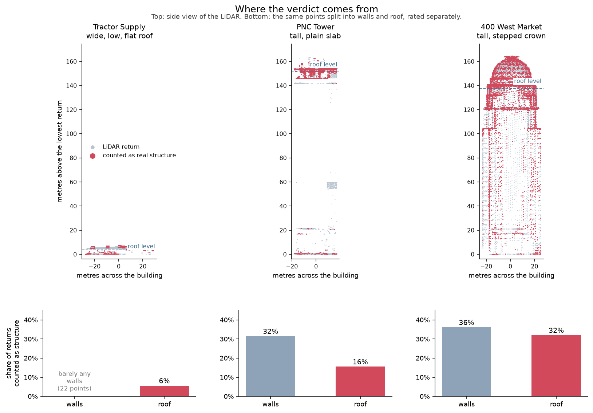

# The three case buildings, measured on one axis

`scripts/measure_case_complexity.py` runs `features.assess_surface_complexity`
over the buildings this project reconstructs, clipped to their Overture
footprints — the same function and the same clip as the statewide survey in
`scripts/survey_building_complexity.py`, so the case numbers and the
distribution are finally on one axis.

They were not before. The earlier pilot and tower figures (14.2% and 31.3%) were
measured over the *fitted building volume* with a 6 m pad, which on the pilot is
nearly three times the Overture footprint area — Tractor Supply's canopy and
fenced yard came in with it.

## Why a third case

400 West Market read as the most complex surface in the project, and it is also
by far the tallest. Those are two explanations for one number, and nothing
separated them: a 165 m building is mostly facade, facade is seen at grazing
incidence, and grazing-incidence returns are both sparse and noisy. "Complex" and
"tall" were confounded.

**PNC Tower** breaks the confound. It is 300 m from 400 West Market, on the same
LiDAR tile (`N076E228`), in the same oblique collection, 156 m tall against
167 m — and it is a plain rectangular slab with a flat roof where 400 West
Market carries a stepped crown.

Simplicity is asserted from evidence that never touches the measure under test.
Selecting a "simple" building by its low structure fraction would prove nothing.

| evidence | independent of coherence because | 001 | 002 | PNC |
|---|---|---|---|---|
| footprint vertices | Overture polygon, 2D | 4 | 4 | 5 |
| rectangularity | polygon ÷ its own bounding rectangle | 1.00 | 1.00 | 1.00 |
| **plateau fraction** | share of returns within ±0.5 m of the modal elevation | **71.5%** | **19.7%** | **63.5%** |
| plate RMS | plane fit to that band | 0.03 m | 0.09 m | 0.11 m |

The plateau fraction is the one that matters. Two thirds of PNC Tower's returns
lie on a single horizontal plane 153 m up — the same signature as the pilot's
warehouse roof at 5 m. 400 West Market has a third of that, and its most
populated elevation band is not even its roof: it is a setback at 140 m, 25 m
below the crown.

Footprint shape says nothing useful here. All three buildings are effectively
perfect rectangles, 400 West Market included. A 2D footprint cannot see a crown.

## Results

Clipped to the Overture polygon, no buffer:

| case | height | rough | **structure** | noise | plateau |
|---|---|---|---|---|---|
| `building_001` Tractor Supply | 5 m | 11.5% | **7.7%** | 2.1% | 71.5% |
| `building_002` 400 West Market | 167 m | 70.0% | **34.3%** | 20.4% | 19.7% |
| `pnc_tower` PNC Tower | 156 m | 31.9% | **18.1%** | 7.2% | 63.5% |

For context, the survey's large-building medians, on roof returns only:
**3.4%** statewide, **2.8%** urban. See `docs/SURVEY_ZONES.md` — the survey rates
roofs separately, for the reason the next section gives, and keeps a second list
for facades.



### Splitting walls from roof changes the answer

The whole-building fraction hides which part of the building produced it. Split
the same points at the roof line and the picture is not the one the summary
number suggested:

| | walls | roof |
|---|---|---|
| | *share of that zone's returns counted as structure* | |
| Tractor Supply | barely any wall returns (22 points) | **6%** |
| PNC Tower | **32%** | **16%** |
| 400 West Market | **36%** | **32%** |

**On the walls the two towers are the same.** 32% against 36% — a plain flat
slab and an articulated crown-and-setback facade score alike. Whatever the wall
number is measuring, it is not how much is on the wall. It is the grazing angle:
a scanner looking down at a vertical surface gets sparse, noisy returns, and
roughly a third of them read as structure whether or not there is any.

**On the roof they separate by 2×** — 16% against 32% — and the pilot's flat
warehouse roof sits well below both at 6%. That comparison is doing real work.

So the height effect is real, but it lives almost entirely in the wall returns,
and it scales with how much wall the scanner catches: 0% of the pilot's returns,
15% of PNC Tower's, 39% of 400 West Market's. **The fix is to judge the roof and
ignore the walls**, which this measure does not currently do.

### PNC Tower is less simple than its shape suggests

Its roof rates 16%, nearly three times the pilot's 6%, and that is not a wall
artifact — the roof zone is 79% of its returns. Looking at the side view, the
reason is visible: the top is not one plate but a main roof at 153 m with a
mechanical penthouse and setbacks above and below it. Forty stories need lift
machine rooms and cooling plant, and they go on the roof.

So the control is not a perfectly simple building. It is a building that is
simple *in its walls and its footprint* and moderately complex on top. That is
enough to break the height/complexity confound, but the claim it supports is
narrower than "the measure tracks structure": on roofs it does, by 2×; on walls
it does not discriminate at all.

### The pilot's number is the fragile one

| clip | 001 | 002 | PNC |
|---|---|---|---|
| bbox (old behavior) | 13.8% | 33.1% | 17.6% |
| polygon −1 m | 4.7% | 33.4% | 16.3% |
| **polygon** | **7.7%** | **34.3%** | **18.1%** |
| polygon +1 m | 9.6% | 34.0% | 19.3% |

A ±1 m error in the pilot's footprint moves its structure fraction over a **2×
range**, 4.7% to 9.6%. The towers barely move — ±1 m on 33-34% and 16-19%.

The reason is what the boundary is worth in each case. The pilot is a flat plate,
so almost all of its rough points are at the roof edge; move the edge and you
take or leave most of the signal. The towers are mostly wall, and a meter of wall
looks like the rest of the wall.

This is the same effect that made the bbox survey overstate: the bbox reaches
past the wall onto the ground, and the wall-to-ground transition is coherent, so
it reads as structure. It is worst exactly where the building is simplest.

Since Overture's Kentucky footprints are largely ML-derived, a meter of footprint
error is ordinary. **Footprint accuracy is the dominant error term for
flat-roofed buildings**, which are the majority.

## What limits these numbers

**The wall rate is close to the floor, and may be entirely it.** See below.

**There is a false-positive floor.** A rough point can read coherent by chance:
the inner neighborhood also contributes to the wide plane it is compared
against, so the deviations are not independent. Measured on pure noise at
KyFromAbove's density it is under 20% of rough points, so the contribution scales
with `rough_frac` — about 1 point of the pilot's 7.7%, about 7 of 400 West
Market's 34.3%, about 3 of PNC Tower's 18.1%. It narrows the 002-to-PNC gap from
1.9× to about 1.8×, and does not change any ordering. `tests/test_surface_complexity.py`
locks the floor in so it cannot drift unnoticed.

**Neither tower is in the survey population.** Both footprints are ~1,800 m²,
below the survey's 5,000 m² cut, and they are compared against its medians for
scale rather than as members of it.

That cut is now what it says. The building list's `area_m2` column was the
axis-aligned **bounding box**, not the footprint, so the population described as
"12,363 buildings over 5,000 m²" had a median true footprint of 2,180 m² and
took in buildings under 700. Measured on the polygon, 4,708 clear 5,000 m².

Both towers *are* on the **facade** list, which selects on wall area rather than
footprint — 400 West Market at a wall-to-roof ratio of 15.6, PNC Tower at 16.3,
Tractor Supply correctly absent at 0.5. The two lists share 9 buildings out of
3,640 and 4,708. See `docs/SURVEY_ZONES.md`.

**Overture height is reported for orientation only** and is not used in any
measurement here. The pilot's 5.3 m is close to the 5.8 m the LiDAR puts between
its lowest return inside the footprint and its roof plate; both towers' heights
are OSM-sourced and land within a meter of the LiDAR's vertical span.

## Reproducing

```bash
python scripts/measure_case_complexity.py
```

Footprints are fetched from Overture release `2026-08-19.0`, pinned in the
script, and cached to `configs/case_footprints.json` with their GERS ids.
Overture revises footprints between releases and the clip is the dominant error
term, so the release is part of the measurement, not an implementation detail.
