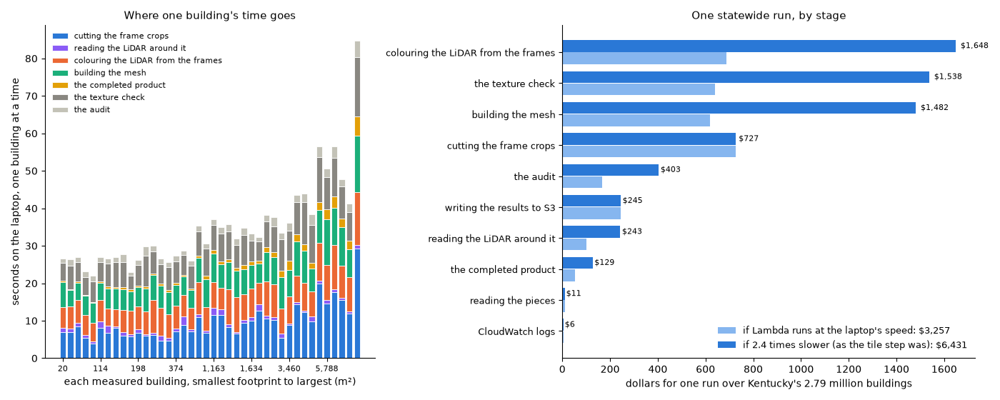
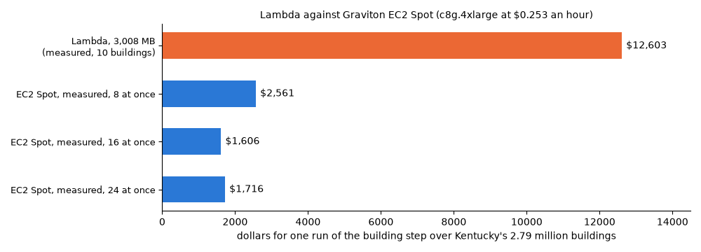
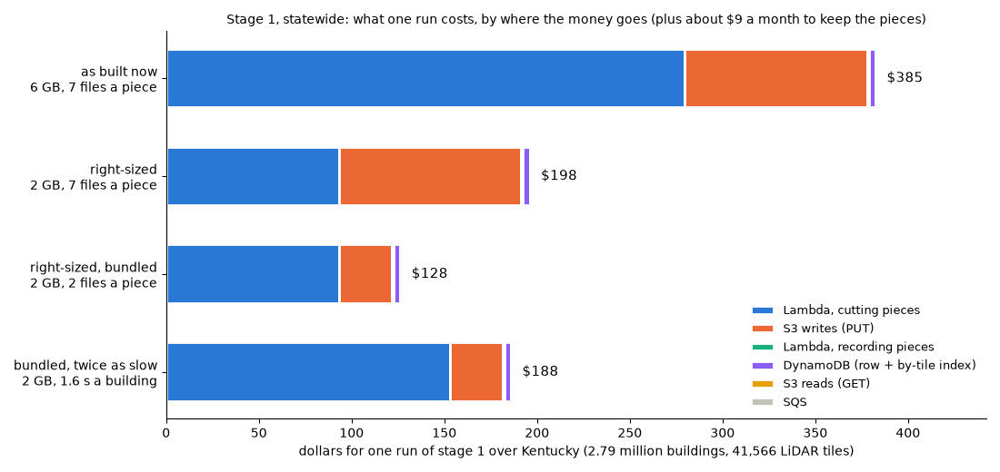
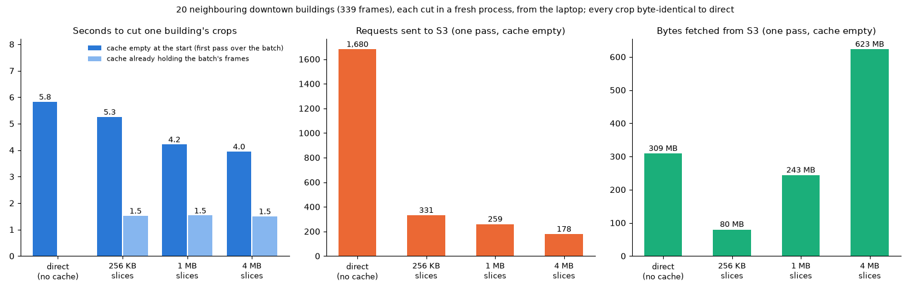
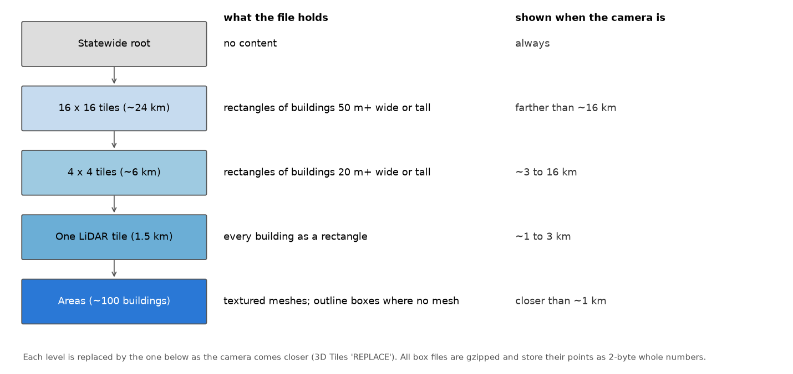
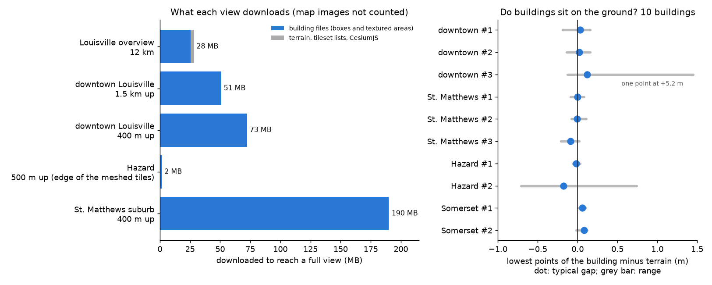
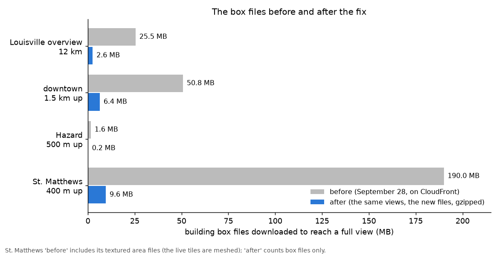

# The pipeline in AWS

The goal is all of Kentucky. Every step reads from and writes to one private
bucket, `s3://kyfromabove-3d` (us-west-2, beside the KyFromAbove and Overture
buckets). The buildings are made by the same code as on the laptop (the one
pipeline, `kyfromabove_3d.pipeline`), run as jobs on EC2 Spot machines that
take them from a queue (refactor step 4, October 2026).

```
stage 0 (laptop, once per Overture release)
  Overture footprints ──> inputs/footprints/tile=<name>.json
                                   │
tile jobs        (EC2 Spot, one job per tile)    scripts/queue_run.py tile
  tiles/<name>/buildings.json, frames.gpkg        product 1 heights, frames listed
                                   │
measure jobs      (EC2 Spot, one job per tile)    scripts/queue_run.py measure
  pieces/<gers>/ ... piece.json last              LiDAR clip, frames, class, outline, levels
                                   │
build jobs        (EC2 Spot, 8-16 buildings)      scripts/queue_run.py build
  buildings/<gers>/: 5 objects, building.json last   meshes, check, audit
                                   │
step 4, publish   (a Spot machine, or a laptop)   scripts/publish_step.py
  kentucky/, tiles/*/3dtiles/, terrain/, viewer/ ──> CloudFront ──> the viewer
```

The queue run (`QueueRunStack` in `deploy/stack.py`, deployed as
`kyfromabove-3d-queue` with `-c queue_run=<name>`): one SQS queue of jobs with
a dead-letter queue, and a group of Spot machines that grows with the
messages waiting and shrinks to none when the queue is empty. Each machine
runs `scripts/queue_worker.py` (`kyfromabove_3d.queue_worker`): one job at a
time per slot, in a process of its own, its message kept hidden while it
runs, and on the Spot two-minute notice the job handed back to the queue.
A run's progress is kept under `runs/<run>/` (done, failed, parked).

Every step can be rerun safely. A piece's marker carries a hash of its
inputs; a building's `building.json` carries its fingerprint (the code, the
measured files, the settings and the neighbours' measured levels), and a
build job skips a building whose fingerprint matches the one published.

**Removed 2026-10-16** (cleanup after refactor step 4): the Lambda piece
and building steps, the event chain that was designed but never deployed
(`PiecesStack`, `make_pieces`, `record_piece`, `start_tiles.py`), the Spot
bench (`Ec2BenchStack`), their runners (`run_piece_step.py`,
`run_building_step.py`, `run_spot_build.py`, `run_ec2_bench.py`,
`migrate_buildings.py`) and `scripts/piece_step.py`, `building_step.py`,
`make_pieces.py`. The sections below that describe September's runs name
them as they were then.

## Built so far, step by step (September 2026)

**Step 1, the tile step, runs in AWS.** One Lambda per LiDAR tile,
invoked directly (no queue, no events), writing only to the project's
bucket `s3://kyfromabove-3d` (us-west-2, private, encrypted, HTTPS only):

| What | Name |
|---|---|
| Lambda (ARM, 3,008 MB — this account's ceiling, 15 min) | `kyfromabove-3d-tile-step` |
| Its role / logs / stack | `kyfromabove-3d-tile-step-role`, `/aws/lambda/kyfromabove-3d-tile-step`, `kyfromabove-3d-tile-step` |
| Run it | `python deploy/run_tile_step.py --tiles N076E228 N076E229 N077E228 N077E229` |

For each tile it reads Overture's outlines (`inputs/footprints/tile=<name>.json`,
from `scripts/stage0_index.py`), the LiDAR around them at full resolution,
measures every building (product 1) and splits outlines holding two or
three, lists the oblique frames over the tile (pointers to KyFromAbove's
GeoTIFFs with each camera's position and model, no pixels), and writes
`tiles/<name>/buildings.json`, `frames.gpkg`, `summary.json`.

On downtown's 2x2 block (2,307 Overture outlines, 2,361 buildings once
split): four Lambdas at once, about 2 minutes; the busiest tile ~100-150 s
(1.5 GB peak); results **byte-identical** to the laptop's
(`scripts/tile_step.py`). Getting there: points sorted into 10 m cells once
(each building had scanned all 12 million points: 444 s -> ~100 s); split
outlines written to 7 decimals (1 cm), a corner within 1 cm of a straight
edge dropped (Linux and macOS differed at the last bit), and the image's
libraries pinned to the laptop's (`deploy/requirements-lambda.txt`).

**Step 2, the piece step, runs in AWS too.** `kyfromabove-3d-piece-step`
(ARM, 2,048 MB), one invocation per batch of 25 nearby buildings of a tile,
all batches at once (`python deploy/run_piece_step.py --tiles ... --batch 25`,
at most 20 batches of one tile at a time). For each building it cuts the
LiDAR clip at full resolution, picks the frames that see it, and writes
`pieces/<gers>/` as separate files — `footprint.json`, `coordinates.json`,
`lidar_local.laz`, `clip.json`, `check_features.json`, `frame_coverage.csv`,
`frames.json` (each chosen frame self-contained: GeoTIFF URL, direction,
the building's pixel window, the camera's full index record) and
`piece.json` last. No pixels are copied.

On the 2x2 block: 2,361 pieces (510 MB), 95 Lambdas, about a minute of
wall-clock time; 0.48 s a building, 23 s a batch (1.5 s of set-up: ~8%
overhead, so 25 stays), 0.6 GB peak. A re-run writes nothing. Laptop and
Lambda agree on every piece's `inputs_hash`, which now hashes values rounded
to a millimetre (a thousandth of a foot or pixel), not bytes: Linux and macOS
differ in the 16th digit of a local origin.

What the first runs taught: 45 Lambdas reading one tile's COPC file at once
drew S3 "503 Slow Down" on 7 buildings. Now each Lambda opens a COPC file
once and reuses it (it had re-read the header and hierarchy for every
building — also 0.61 -> 0.48 s a building), transient errors are retried
with back-off (`lidar.with_retries`), and a tile's batches are capped at 20
at once.

**Step 3, the building step, as first built for Lambda.** (It later ran on
Lambda for a calibration and then moved to EC2 Spot; both are below.)
`kyfromabove-3d-building-step` (ARM, 3,008 MB, 10 GB of /tmp) is defined
(`BuildingStepStack`) and not deployed. It is invoked with a few nearby
buildings (`{"gers": [...]}`). For each one it reads the piece, rebuilds the
chosen cameras from `frames.json`, cuts the crops into /tmp, and runs the
laptop's own scripts: `build_mesh.py --complete` (which runs the colourise),
`check_building.py` and `audit_building.py`. It writes
`buildings/<gers>/` (the measured and completed 3D Tiles, the audit, the
texture check, the wall profiles) with `building.json` last. That summary
records the piece it was built from, and the seconds, peak memory and size of
every stage; a building already built from the same piece by the same code is
skipped. The LiDAR within 250 m, which hides what a frame cannot see, is read
once per call for all its buildings. The neighbours stand as prisms: product 1's
outlines at their LiDAR heights, from the tile's `buildings.json` and its
neighbouring tiles'. The image carries `basisu` 2.50 (built for ARM) and the
two grids that place a building (`us_noaa_g1999u07.tif`,
`us_noaa_nadcon5_nad83_1986_nad83_harn_conus.tif`), with PROJ's network off.
Inside the image, a downtown origin lands on the laptop's longitude,
latitude and height to the last digit (the geoid 34.55 m below).

## What the building step costs (measured on the laptop, September 2026)

*Superseded by the next section. The Lambda turned out slower than both ends
of the bracket below.*



40 buildings from the 2x2 block, eight from each of five footprint sizes
(from a 20 m² shed to a 24,000 m² warehouse and a 94 m tower), were built on
the laptop by `scripts/building_step.py`, which runs the same code as the
Lambda. All 40 built. They ran four at a time. Rebuilding four of them one at
a time showed that this made the computing stages 1.68 times slower and the
crops 1.08 times slower, and those slowdowns are taken out.

One building at a time, a house takes about 26 seconds: about 7 s cutting
the crops (waiting on KyFromAbove's GeoTIFFs), 5 s colouring, 5 s the mesh,
6 s the texture check, 1-2 s the audit, and 1 s reading the LiDAR around
it. A building over 5,000 m² takes about 53 s, and the slowest took 85 s. The
most memory any one script used was 1.1 GB, well inside the 3 GB Lambda. Kept
per building: 0.1 MB for a house, 4 MB for the largest. That is about 18 files.

`deploy/building_cost.py` prices this. It counts buildings by size: for the
block, the tile step's 2,361; for Kentucky, Overture's 2.79 million over the
Phase 2 grid, whose bounding boxes are scaled to footprint area by the
block's own ratio of 1.40 (`deploy/ky_area_hist.json`). The one number not
measured yet is how much slower a 3 GB Lambda is than the laptop. The piece
step ran at the laptop's speed and the tile step about 2.4 times slower, so
both ends are priced:

| | if Lambda runs at the laptop's speed | if 2.4 times slower |
|---|---|---|
| the 2x2 block, 2,361 buildings | about $3 | about $6 |
| Kentucky, 2.79 million buildings | about $3,300 | about $6,400 |
| Kentucky, hours with 890 Lambdas at once | about 24 | about 49 |
| kept afterwards | 651 GB, about $15 a month | the same |

Nearly all of it is Lambda time. At the slow end, statewide: colouring
$1,650, the texture check $1,540, the mesh $1,480, the crops $730 (time spent
waiting on the network is billed too), the audit $400, and writing 18 files a
building to S3 $245. The completed product adds only $130. Where it could
come down:

- **The texture check is quality control.** Running it on one building in
  twenty, not on every one, would save about $1,450 at the slow end.
- **Memory.** A Lambda gets one full vCPU at 1,769 MB and about 1.7 at 3,008
  MB. If the work is mostly one thread, 1,769 MB would be as fast for 40% less.
  The calibration run should try both sizes.
- **Files.** Fewer, bundled files a building (the tinted copy, the audit
  picture and `fill_faces.npz` are for review) would cut the S3 writes.

No sampled building came near Lambda's 15 minutes, even at 2.4 times slower
(the calibration below found one that did).

One difference from the downtown run: the neighbours' traced levels (a
tower on its podium) are not known to the building step, so a neighbour
stands as its whole outline to its LiDAR height. On 7 of the 8 sampled
buildings the downtown run also built, the audit is identical. On the eighth
(`8c073582`, a parking structure), 81% of its wall area got no colour from a
frame, against 65% in the downtown run. The texture check reports that share
as "blank". Rebuilt with the downtown levels, it is back to 65%. Reading
neighbours' published `levels.json` from `buildings/` would fix it, at the
cost of an order: the neighbour built first.

Not built yet: events and queues, and finding buildings Overture lacks.

## Measured in AWS: Lambda against Graviton EC2 Spot (September 2026)



**Lambda, 10 buildings.** The building step was deployed and run on 10
buildings, 2 from each size band, twice, with one Lambda each
(`deploy/run_building_step.py`).
- A house took 100-115 s, against about 26 s on the laptop.
- The colouring, the mesh and the texture check each ran 4-5 times slower
  than on the laptop; the crops ran 1.5-3 times slower.
- A container reused from the first run saved only 10-15%.
- The 24,000 m² warehouse used 2.8-2.9 GB of the 3,008 MB allowed. On the
  second run it hit the 15-minute limit.
- Priced from these times, one statewide run costs about $12,600.

**EC2 Spot, one machine.** A c8g.4xlarge (Graviton4, 16 processors, 32 GB)
ran at $0.253 an hour Spot, using the same image
(`Ec2BenchStack`, `deploy/run_ec2_bench.py`).
- One building at a time, a house took about 77 s. The colouring, the mesh
  and the check take about 22 s each whatever the building's size. Most of
  that is hiding the building from the LiDAR within 250 m, which is the
  same work for a shed as for a tower.
- The machine's worth is running many at once. The 40-building sample
  finished in:

| Buildings at once | Time for the 40 | Kentucky, one run | Machine-hours |
|---|---|---|---|
| 8 (2 threads each) | 509 s | about $2,560 | 8,960 |
| **16 (1 thread each)** | **298 s** | **about $1,610** | **5,240** |
| 24 (1 thread each) | 317 s | about $1,720 | 5,670 |

One building per processor is best. The EC2 figures include:
- 5% of the work redone after Spot interruptions;
- 5 minutes to start each machine;
- the disk;
- the same S3 writes as Lambda.

**The answer: EC2 Spot is about 8 times cheaper than Lambda for the
statewide run (about $1,600 against $12,600).** It also removes the memory
ceiling: 32 GB is shared by 16 buildings. Running it needs:
- **A quota increase.** The account allows 32 Spot processors, which is 2
  machines and about 110 days for Kentucky. At 1,000 processors (62
  machines) it takes about 3.5 days.
- **A way to hand out the work.** AWS Batch on Spot with this image, or
  machines each taking batches of nearby buildings from an SQS queue. Each
  machine runs `scripts/building_step.py --workers 16 --threads 1`.
- **Retries** for a batch lost to a Spot interruption. `building.json` makes
  this safe: a building already built is skipped.

The bench cost about $0.34: 45 minutes of the Spot machine plus the Lambda
calibration.

## Watching the spend

Every stack, and what it makes (the Lambdas, the Spot machines and their
disks, the CloudFront distribution), carries the tag `project=kyfromabove-3d`,
so the bill can be split by it. `BudgetStack` adds a monthly AWS Budget on
that tag: an email when 80% of the limit is actually spent, and another when
the month is forecast to pass it. It warns; it stops nothing, so the Spot
runner's own cap stays. It is deployed only when an address is given:

```bash
cd deploy && npx aws-cdk deploy kyfromabove-3d-budget -c budget_email=you@example.com -c budget_usd=20
```

The limit is $20 a month unless `budget_usd` says otherwise; raise it before
a statewide run (about $450 for the building step). Two steps the stacks
cannot do, once per account:

- **Tag the bucket.** It was made by hand, so no stack tags it, and its
  storage and requests are a large share of the bill. This replaces any tags
  the bucket already has:

  ```bash
  aws s3api put-bucket-tagging --bucket kyfromabove-3d --tagging 'TagSet=[{Key=project,Value=kyfromabove-3d}]'
  ```

- **Switch the tag on for billing.** A budget can filter only on a cost
  allocation tag. The tag appears in Billing up to a day after something
  first carries it; then:

  ```bash
  aws ce update-cost-allocation-tags-status --cost-allocation-tags-status TagKey=project,Status=Active
  ```

  Costs count from that moment, not before.

## What a building leaves behind

A build job stores each building as five objects plus its marker
(`building.publish_building`), in one folder per building; a rebuild
overwrites it:

```
buildings/<gers>/
  3dtiles_mesh.zip       the measured product: tileset.json, building.glb, textures/*.png
  3dtiles_complete.zip   the completed product: the same
  review.zip             the audit and its picture, the texture check, classification,
                         wall planes and profiles, the mirror and coverage reports,
                         the tinted copy, the fill test's data, the build log
  levels.json            the building's traced levels
  building.json          its fingerprint, what it was built from, each file's size; written last
```

Why these five and not one or twenty:

- **Every upload is charged** (half a cent per 1,000), and most of a
  building's files are a few KB. About 20 uploads a building became 5;
  statewide, S3 requests go from about $262 to $81.
- **Step 4 reads only the mesh products**, so each is its own zip: publishing
  the measured view downloads one small zip a building, not the review files.
- **`building.json` stays separate and last**: a rerun reads it to skip a
  building whose fingerprint has not changed.
- **`levels.json` stays separate**: it is small, and a neighbour's levels are
  the known fix for a tower drawn as its whole outline (see "What the
  building step costs" below), which would read them one building at a time.
- **The zips are deterministic** (`archive.zip_bytes`: sorted members, one
  fixed timestamp), so the same files always give the same bytes.

**One folder per building, no versions.** Until October the buildings were
kept under a folder per version of the building step
(`buildings/stage3-2/<gers>/`, the pilot's); those stay in the bucket as
they are, and step 4 now reads `buildings/<gers>/`
(`building.BUILDINGS_PREFIX`). To compare two methods, run them into two
stores (`STORE` for the queue run), not two folders of one.

**A rebuild does not read any of this.** It starts again from:

- the building's piece, `pieces/<gers>/` (the measure job: the LiDAR clip,
  the frames chosen, the local frame, the class, the outline and levels);
- the tile's `tiles/<tile>/buildings.json` and its neighbours' (the
  neighbouring buildings, standing as prisms);
- the LiDAR within 250 m and the aerial frames themselves, read again from
  KyFromAbove's bucket. Crops are never stored (806 MB for the largest
  warehouse), so a rebuild depends on that bucket staying where it is.

So `pieces/` and `tiles/` are the project's real inputs and must be kept. If
lifecycle rules are ever added to clean up scratch folders, they must not
touch those two.

## What a piece is

Everything the building step needs that comes from the LiDAR and the frame
indexes, without the pixels (`prepare.prepare_piece`): the building's local
frame, its footprint with product 1's LiDAR height (and, for a footprint
holding two or three buildings, its part), the LiDAR clip (the footprint
plus 90 ft, from 10 m below ground to 30 m above the roof), and the frames
chosen to texture it. The crops are cut later, by the building step.

**How a piece is stored** (October 2026): one `piece.zip` (the piece's files
and what measuring added: the class, the LiDAR outline, the levels) and the
marker `piece.json` last, which says `"layout": "zip-1"` -- two uploads a
building instead of about twelve, and two downloads to build it instead of
about twenty-two (`building.publish_piece`, `pull_piece`; a piece without the
layout, a file each, is still read). Each tile's buildings' local frames and
measured levels are also kept together in `tiles/<tile>/measured.json`: a
build batch reads its own tile's and its eight neighbours' instead of two
small objects for each of the 300-600 buildings within 450 m. On one trial
tile (50 buildings) the stored pieces went from 500 objects to 100 and the
buildings came out byte for byte the same.

## Why a tile is the unit

- **The LiDAR is already cloud-optimised.** Phase 2 is 46,167 tiles, each a
  COPC file on `s3://kyfromabove`, and `lidar.extract_lidar_for_aois` reads
  any box by HTTP range requests, across tile edges.
- **Each building is cut once.** It belongs to the tile holding its
  footprint's centroid (`pieces.owner_tiles`).
- **Party walls across tile edges still work.** Footprints of other tiles
  within 30 m are measured with the tile (its *halo*), so a building on the
  edge knows its neighbour and the neighbour's height.

## Incremental by construction

`piece.json` carries an `inputs_hash`: the footprint and its product 1
record, the clip's box and origin, the frames chosen, the clip's point
count, and `pieces.CODE_VERSION` (bump it when the way pieces are cut
changes). A building's fingerprint (`pipeline.fingerprint`) reads its
measured files, so a build job rebuilds exactly the buildings whose pieces,
settings, neighbours or code changed, and skips the rest.

## The code

| Where | What |
|---|---|
| `src/kyfromabove_3d/store.py` | `LocalStore` (a folder) and `S3Store` (a bucket; `endpoint_url` for LocalStack or moto) |
| `src/kyfromabove_3d/pieces.py` | tile ownership and halo, `run_tile_step` (step 1), `piece_step` (a tile's pieces) |
| `src/kyfromabove_3d/product1.py` | product 1's measures, shared with `scripts/overture_boxes.py`: heights inside the edge, the roof-step splits |
| `src/kyfromabove_3d/pipeline.py` | the one pipeline, laptop and cloud: measure, then build; the fingerprint |
| `src/kyfromabove_3d/cloud_jobs.py` | the queue's two jobs: `measure_job` (a tile's buildings) and `build_job` (a batch) |
| `src/kyfromabove_3d/queue_worker.py` | a Spot machine's loop over the queue (heartbeat, retries, the Spot notice) |
| `src/kyfromabove_3d/building.py` | a piece fetched, the neighbours, the LiDAR around a batch, a building packed and published |
| `scripts/stage0_index.py` | footprints by tile, to a folder or `s3://` |
| `scripts/queue_run.py` | a run's jobs sent (`measure`, `build`), its progress (`status`), its failures again (`retry-failed`) |
| `scripts/queue_worker.py` | the worker a Spot machine starts |
| `deploy/building_cost.py`, `deploy/ec2_cost.py`, `deploy/cost_model.py` | what a run costs, from measurements |
| `deploy/` | the CDK app (`stack.py`), the image (`Dockerfile`, ARM, Python 3.12), the tile step's handler, `run_tile_step.py` |

## Running it

In AWS (after `aws login`; the CDK CLI runs through `npx`), on downtown's
2x2 block:

```bash
python scripts/stage0_index.py --bbox -85.773 38.238 -85.735 38.269 --store s3://kyfromabove-3d --tiles N076E228 N076E229 N077E228 N077E229
cd deploy && npx aws-cdk deploy kyfromabove-3d-queue -c queue_run=r2 && cd ..
export QUEUE_URL=$(aws cloudformation describe-stacks --stack-name kyfromabove-3d-queue --query "Stacks[0].Outputs[?OutputKey=='QueueUrl'].OutputValue" --output text)
python scripts/queue_run.py tile --run r2 --tiles N076E228 N076E229 N077E228 N077E229
python scripts/queue_run.py measure --run r2 --tiles N076E228 N076E229 N077E228 N077E229
python scripts/queue_run.py build --run r2 --tiles N076E228 N076E229 N077E228 N077E229
python scripts/queue_run.py status --run r2
```

The machines start when the jobs arrive and stop when the queue has been
empty a while. Send each kind once `status` shows the one before done: a
building is measured against the records of the tiles around its own, and
built against its neighbours' measured levels.

The tile step can still run as one Lambda per tile instead
(`npx aws-cdk deploy kyfromabove-3d-tile-step`, then
`python deploy/run_tile_step.py --tiles ...`); both run
`pieces.run_tile_step`, as `scripts/tile_step.py` does on this machine.

## What has been checked

- **Parity with the downtown run** (4 tiles, 392 pieces, 6 minutes on the
  laptop): the same 392 buildings and split parts; heights identical to the
  centimetre; the same frames chosen for all 389 compared; the same LiDAR
  clip box for 386. The other three differ harmlessly: two split parts whose
  outlines moved by centimetres because the split is now measured in the
  tile's frame, and one building without its own ground, whose fallback is
  now the tile's median ground (13 cm different).
- **The Lambda image, locally.** Built for ARM (1.85 GB), run under the
  Lambda runtime emulator against a moto server standing in for S3,
  EventBridge, SQS and DynamoDB: the smallest downtown tile made 37 pieces
  in 59 s; exactly 37 events reached the queue, all markers; `record_piece`
  in the same image wrote 37 rows; the same tile again wrote nothing and
  raised no event.
- **Tests** (plain `pytest`, no AWS): the stores agree (folder and mocked
  S3); tile ownership and halo; the marker written last and an unchanged
  piece skipped; the handlers; the whole chain on mocked AWS with the
  stack's own rule pattern; the synthesised stack (the rule, the queues and
  their dead-letter queues, the Lambdas' size and architecture, the table).

## What it costs

Stage 1 (steps 1 and 2) on Lambda, priced by `deploy/cost_model.py` from
measured inputs: 2.79 million Overture
buildings on 41,566 of the 46,167 Phase 2 tiles (median 28 a tile, the
busiest 4,647; `deploy/ky_buildings_per_tile.npy`); 0.8 s a building and
30 s a tile (laptop and Lambda image, downtown); 0.6 GB peak memory for
downtown's densest tile; 0.15 MB a piece for buildings under 12 m.



| | one statewide run | then, a month |
|---|---|---|
| the event chain's Lambda as designed (6 GB, 7 files a piece) | about $385 | $9 storage |
| right-sized (2 GB) and bundled (2 files a piece) | about $128 | $9 storage |
| the same, if Lambda runs twice as slow as measured | about $188 | $9 storage |
| the downtown pilot (4 tiles) | about 2 cents | — |

Lambda time and S3 writes are nearly all of it. Free: reading the
KyFromAbove COPC tiles (a public bucket, same region), S3 events to
EventBridge (AWS-service events), DynamoDB storage under 25 GB. Traps that
would change the answer: putting the Lambdas in a VPC (a NAT gateway charges
for every byte of LiDAR read — terabytes statewide), or running outside
us-west-2 (cross-region transfer for the same terabytes). 317 tiles would run
past Lambda's 15 minutes; they are split into chunks of about 800 buildings.

## Not yet

- **A statewide run.** The pilot (below) ran every step for four areas. All
  of Kentucky needs a larger Spot quota (the account allows 32 Spot
  processors) and a way to hand out work that does not depend on a laptop:
  AWS Batch on Spot, or machines taking batches from a queue.
- **The frame index as a stage 0 file**: each tile reads the 1 GB remote
  frames index by bounding box (range requests); a per-tile extract in the
  bucket would take that off every tile.

## Faster building step: what changed and what was measured (September 2026)

Profiling one small house found where the fixed ~22 s per script on
Graviton went. Every change below gives byte-identical outputs (meshes,
completed product, wall planes and profiles, texture check, audit) on six
sample buildings from a house to the 24,000 m² warehouse, and the reference
set's audit is unchanged.

- **The coordinate converter is made once per script.** The neighbour
  prisms converted 2,433 outlines a script, each through a new WGS84 ->
  state plane transformer (1.6 ms each on the laptop, 2.8 ms in the ARM
  image). Colourise, mesh and check on a house: 8.4 + 7.4 + 6.5 s -> 3.1 +
  3.0 + 2.1 s on the laptop (`footprints.wgs84_to_state_plane`).
- **Occlusion maps are made once and 4x faster.** About 2% of the ~840,000
  returns within 250 m land on a crop; a single-precision cull with a
  32 px margin drops the rest before the exact projection (identical maps,
  0.66 -> 0.16 s). The colourise saves the maps as `occlusion.npz` under a
  fingerprint of every input; the mesh and the check reuse them only when
  their inputs give the same fingerprint (`colorize_building.occlusion_maps`).
- **Crops are not cut in threads.** Tried: byte-identical and 6x faster on
  the laptop, but GDAL in the Lambda image deadlocked inside a window read on
  the third try (one thread waiting on a lock, the other seven idle), with
  every thread holding only its own handles. Removed.

### A shared frame cache (nginx), after mwkorver/mapserver-docker-cloudnative



A frame's header is needed by about 59 of a downtown tile's buildings (84
frames serve 270 buildings), and each 512 px tile by 3.5. `deploy/cog_cache`
puts nginx between GDAL and S3 on a machine: an on-disk cache of aligned
1 MB slices (the `slice` module; neighbours ask for overlapping but different
ranges, so the client's exact range would miss), `proxy_cache_lock`, HEAD
kept a HEAD, and connections to S3 kept open (a new HTTPS connection costs
about half of a small request). GDAL reads through it when
`COG_CACHE_URL=http://127.0.0.1:8001` is set (`imagery.cog_url`).

On 20 neighbouring downtown buildings (339 frames), each cut in a fresh
process, from the laptop (`deploy/cog_cache/bench.py`):

| | seconds a building's crops | requests to S3 | from S3 |
|---|---|---|---|
| direct | 5.8 | 1,680 | 309 MB |
| cache empty at the start, connections reused | 3.6 | 259 | 244 MB |
| cache holding the batch's frames | 1.5 | 0 | 0 |

Every crop was byte-identical to direct. The MapServer project's GDAL
settings (32 KB header read, 64 KB chunks, merged ranges) changed nothing
here: the 16 KB header already holds these frames' tile index and GDAL
already merges a tile row. Laptop latency to us-west-2 (110-160 ms a request)
exaggerates the seconds; the in-region test on a Spot machine is the one to
trust.

### Measured in-region, on a Spot machine (September 2026)

One c8g.4xlarge Spot machine (16 cores, $0.254 an hour), 16 buildings at a
time, the same image as the Lambda:

- **The frame cache saves requests, not time, in-region.** 50 neighbouring
  downtown buildings: 81 s direct, 81 s through an empty cache (90% hits,
  377 requests to S3 instead of about 3,700), 77 s through a full one. S3
  answers quickly in-region, and with 16 buildings at once one building's
  wait is filled by another's work: the machine is limited by its processors.
  Kept in `deploy/cog_cache` for fewer requests and for resilience, not for
  speed.
- **Crops are written as uncompressed PNG** (`prepare.CROP_PNG_LEVEL`, 0;
  `CROP_PNG_LEVEL=6` restores the old default). They are read back by three
  scripts on the same machine and never published; PNG is lossless, so the
  pixels, and all 94 outputs of six test buildings, are unchanged. On the
  machine, alternating the two on the same runs: the 40-building sample
  164 s -> 94 s (twice), 50 neighbours 77 s -> 54 s; a sample building's
  crops 15.8 s -> 6.1 s. The price is disk: 2-2.6 times as much, 806 MB for
  the warehouse's crops.

The 40-building sample, 16 at a time: 298 s with the code as it was, 170 s
with the coordinate converter and the shared occlusion maps, 94 s with
uncompressed crops as well. One statewide run on EC2 Spot was then about $612
at that day's Spot price ($0.2541 an hour), about 22 hours on 1,000
processors; the account allows 32 Spot processors today. Of that, $262 was S3
requests: about 20 uploads a building. Storing each building as five objects
(see "What a building leaves behind") brings the same run to about $430
(`deploy/ec2_cost.py`: computing $345, disks $4, S3 requests $81), rounded up to about $450 as the working figure. The three Spot runs cost about $0.16 in all.

## The pilot: four areas in a browser (September 2026)

Before running Kentucky, a pilot of every stage end to end, under a $10 cap:

- **Meshes for 9,252 buildings in four areas, 16 LiDAR tiles:** downtown
  Louisville (N076-N077 x E228-E229), St. Matthews, a suburb (N077-N078 x
  E235-E236), Hazard in the eastern hills (N148-N149 x E378-E379) and near
  Somerset, rural (N157-N158 x E290-E291).
- **Boxes only (product 1) for the 255 tiles around Louisville:** 315,970
  buildings, so the zoomed-out view and the flight into the meshed areas
  have real content.
- **Terrain** under all of it (3,003 heightmap files, 25 MB), the statewide
  tree, and the viewer page, served by CloudFront behind a password.

Which data each tile uses is the pair of LiDAR phase and oblique collection
**closest together in time** (`sources_choice.py`), recorded on every
building and shown when one is clicked. None of the four areas has Phase 3
LiDAR: downtown and St. Matthews pair Phase 2 (December 2022) with the 2024
Season 1 photos, 15 months apart; Hazard and Somerset pair Phase 2
(February-March 2023) with 2023 Season 1, the same season.

### How it is served



- One copy of each file in `s3://kyfromabove-3d`, which stays private.
  CloudFront reads it through origin access control, and the bucket's policy
  lets that one distribution read only `viewer/`, `kentucky/`,
  `tiles/*/3dtiles/` and `terrain/` (`deploy/viewer_policy.py` adds that
  statement and keeps the bucket's HTTPS-only rule). Audits, logs, pieces
  and the per-building files are not reachable (403).
- A CloudFront Function asks for a user name and password (basic auth) on
  every path. The password is a random string in the git-ignored
  `deploy/viewer_password.txt`, switched on with
  `npx cdk deploy kyfromabove-3d-viewer -c viewer_password=on`.
- The page (`viewer/index.html`, CesiumJS with OpenStreetMap's map tiles)
  can be opened as `https://kentucky:<password>@<host>/viewer/index.html`: it
  reloads itself at the same address without the password, because browsers
  refuse `fetch` from a page whose address carries one. Safari does not
  accept a password in the address at all.
- Files are named by a hash of their contents, so a changed file gets a new
  name and needs no cache clearing; `tileset.json` files are cached for 5
  minutes. The old files stay behind: `deploy/s3_orphans.py` lists what the
  live trees no longer reach (after the box republish: 574 files, 1.46 GB)
  and deletes exactly that list with `--delete`.

### What it cost

| | |
|---|---|
| Tile step on Lambda (twice: the second records the data choice) | $1.31 |
| Image pushes | $0.05 |
| Piece step on Lambda, 6,891 pieces | $0.46 |
| Building step and publishing: two c8g.4xlarge Spot machines | $3.37 |
| S3 requests for building and publishing | $1.15 |
| Republishing the lighter box files (one Spot machine, 29 minutes) | $0.28 |
| The Overture and LiDAR-heights views, published from the laptop | $0.11 |
| **Pilot** | **$6.73** |

About $1.30 of the machine time was wasted: the first run failed at once
(below), the machines then sat idle about three hours while the session was
paused, and a hang (below) stalled them for about 70 minutes. CloudFront and
its function are inside the free tier. The ledger is
[`docs/data/pilot_ledger.json`](data/pilot_ledger.json).

### Three bugs the pilot found

1. **Every building failed in its first second.** The runner did not pass
   `--raw /opt/data/raw`, where the image keeps the LiDAR tile grids, so no
   building could find its LiDAR. `building_step.py` now stops at once when
   the grid is missing, instead of failing 9,252 times.
2. **All 16 workers hung about 35 minutes in.** Each was asleep in
   `getaddrinfo`, the C library's host-name lookup, waiting on a lock that
   no living thread held (stacks in [`docs/data/pilot_deadlock_stacks.txt`](data/pilot_deadlock_stacks.txt)).
   rasterio's bundled libcurl 8.16 stops its lookup threads from outside
   (`pthread_cancel`), which can leave that lock held for good; after that
   every connection in the process waits: the frame reads and the S3
   uploads alike. The fix: frames are read through the machine's nginx frame
   cache at `127.0.0.1`, a numeric address libcurl never looks up. The
   runner also restarts a build when no building finishes for 8 minutes;
   buildings already published are skipped.
3. **984 buildings failed with `'CopcReader' object has no attribute
   'close'`.** Each worker keeps its 16 most recent LiDAR files open; laspy
   2.7 closes a reader through `__exit__`, not `close`, so the 17th file
   crashed every later building in that worker (`lidar._close_reader`, with
   a test). Earlier runs used short-lived processes and never opened 17.

Two other things happened. AWS reclaimed one Spot machine at 00:58 UTC (a
Spot interruption); each building is written to S3 as soon as it is built,
so its 1,113 were kept and the rest finished on the other machine. And the
laptop's AWS login expired mid-run; the machines carry on without the
laptop, and `deploy/run_spot_build.py --resume-after` picks up watching.
The runner can also mount the checkout's code over the image's
(`--code-from-laptop`), which is how the fixes reached the running machine
without rebuilding the image.

### What the browser check found



On the CloudFront site, before the password went on:

- **It draws at 60 frames a second** in every view, fully loaded in 2-5 s.
- **Buildings sit on the ground.** For 10 buildings across the four areas,
  their lowest points against the published terrain at the same spot: the
  typical gap is under 0.2 m everywhere. The widest spread (±0.7 m) is on a
  Hazard slope, where the terrain samples every 5 m.
- **It downloaded far too much:** 28 MB for the overview from 12 km (where
  no building is visible), 51-73 MB downtown, 190 MB over St. Matthews from
  400 m. Nearly all of it was the grey box files.

### The box files, made lighter



The box files held every building's full outline, stored as 4-byte
floating-point numbers, and a view loaded many tiles' worth. Now:

- **Each distance gets only the detail it can show.** A tile's own file,
  seen from about 1 to 3 km where a house is a few pixels, holds each
  building as a rectangle (the smallest one around its footprint, at any
  angle). Outline boxes, simplified to within 1 m, come only in the ~100
  building area files, which load within about 1 km. Tiles without meshes
  are split into areas the same way as meshed ones.
- **The group levels keep only what shows from there:** a building whose
  footprint width (the square root of its area) or height reaches 20 m for
  the 4 x 4 level and 50 m for the 16 x 16 level (10% and 0.6% of the
  buildings around Louisville). The old rule kept anything 15 m tall, and
  about 15% of buildings measure that tall, probably trees over houses.
- **Smaller files for the same shapes:** the roof shares the outline's
  corner points instead of three new ones per triangle; points are stored
  as 2-byte whole numbers scaled to the file (`KHR_mesh_quantization`, about
  2 cm steps across a tile), directions as 1-byte ones, and triangle
  indices in 2 bytes, with the geometry cut between buildings into pieces
  under 65,536 points.
- **Gzipped on S3** (`Content-Encoding: gzip`): the browser unpacks them
  itself; the stores unpack them when the code reads them back.

For all 255 pilot tiles (the Measured product), what a browser downloads:

| | before | after |
|---|---|---|
| tile box files, all | 577 MB | 44 MB |
| the biggest tile box file | 8.4 MB | 0.6 MB |
| group files, all | 152 MB | 4.8 MB |
| the biggest group file | 15.9 MB | 0.5 MB |
| outline boxes in area files (new; tiles without meshes) | - | 79 MB in 6,716 files, 60 KB at most |

The new files pass the 3D Tiles validator with no errors or warnings. The
views in the chart were measured on the laptop, on the same views as the
CloudFront check.

**What is left:** the textured area files are now the biggest part of a
close view over a meshed area. St. Matthews' meshed tile is 48 MB of them,
about 23 MB gzipped (the KTX2 textures are already compressed; the
geometry halves). Storing the meshes' points, texture coordinates and
directions as whole numbers too, as the boxes now are, is the next step.

### Four views of the same buildings

The viewer's buttons show what each stage adds, on every building:

1. **Overture**: the footprints at Overture's own heights, what Cesium OSM
   Buildings and the like show. The colour says where the height came from
   (`overture_boxes.height_of`, `COLOURS`): grey for Overture's height,
   blue-grey for floors x 3.5 m, orange for a 6 m guess where Overture has
   neither. In St. Matthews that is about a third of the buildings (957 of
   2,672).
2. **LiDAR heights** (product 1): the same footprints at KyFromAbove's
   LiDAR heights.
3. **Measured** (product 2): the meshes, photo colour only where a frame
   saw the wall.
4. **Completed** (product 3): unseen parts filled from the building's own
   photos.

Every view stands on the LiDAR ground, so all four sit on the same terrain.
Clicking a building says where its height came from; in the Overture view
it shows the LiDAR height beside Overture's (downtown, one building Overture
guesses at 6 m is 31 m tall, one drawn at 11 floors, 38.5 m, is 47 m).

The first two are boxes only (`publish.PRODUCTS`: no mesh folders), laid out
like the others (rectangles per tile, outline boxes per area, the group
levels), and need only the tiles' building lists, so they publish from a
laptop in about 15 minutes for the pilot's 255 tiles. The meshed views show
LiDAR boxes where a building has no mesh. The page opens on Measured
(`config.json`'s `default`).
