# Downtown Louisville, every footprint: the batch run

Three buildings were made by hand — a config each, a preparation with its
QA, a colourise, a mesh. The other 375 Overture footprints in the 1.2 km
downtown box were run by `scripts/run_downtown.py` from LiDAR, obliques and
nadir frames alone, and gathered into one tileset that `/compare` shows
beside Overture's boxes at LiDAR heights.

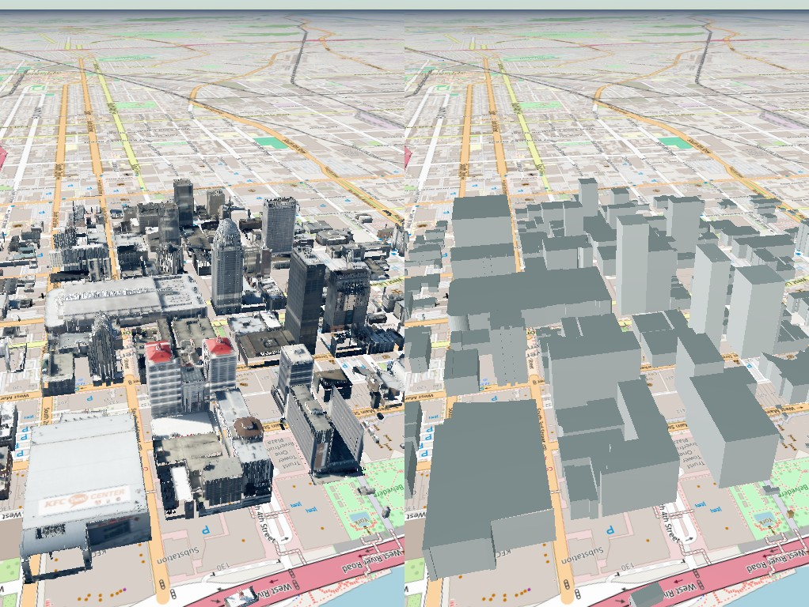

**378 buildings, 1,274,253 textured triangles, 128 MB of glTF, 42 minutes
on this Mac** (four workers; a median of 22 s per building, 90 % under
36 s, the slowest — the arena — 114 s). Every one of the 375 footprints got
a mesh: 345 by the profile path and 30 by the box path (too few returns, or
the colourise declined); none failed after one resume, which re-ran five
buildings that a first-pass bug or an S3 hiccup had stopped.

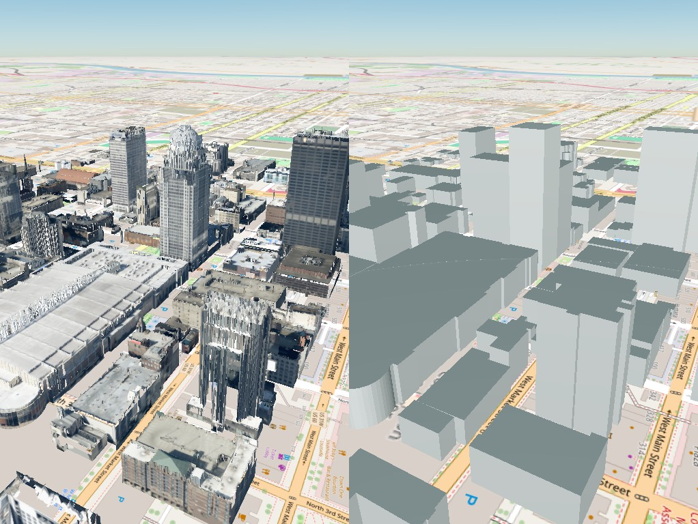

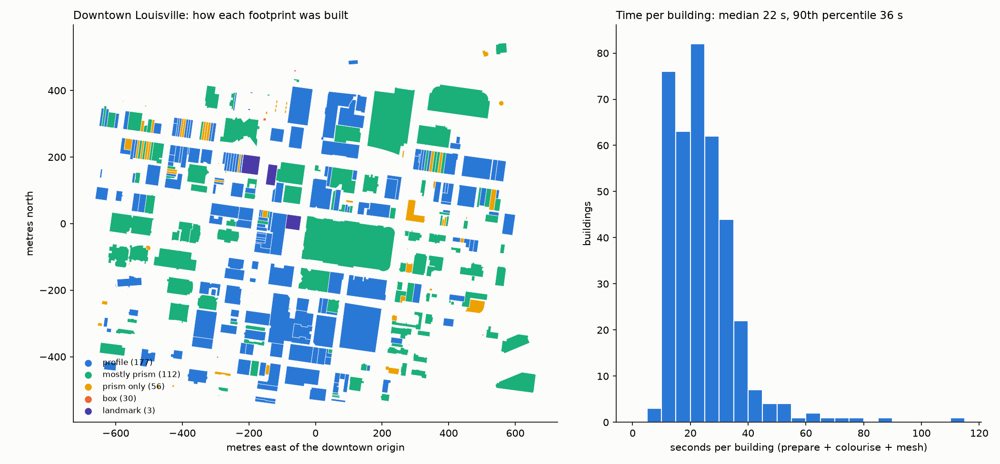

By face rather than by building: 177 buildings have most of their faces
from the profile bands, 112 more prism faces than profile faces, 56 only
prism faces (the LiDAR reached the roof but no wall band met the 30-return
floor), 30 are boxes. 127 buildings have at least one party wall — 285
edges in all — drawn plain because nothing sees a shared wall. Every
building had at least 12 aerial frames (median 18) after the per-head cap;
none was blind.

## What runs, per building

`run_downtown.py run` takes the footprint JSON that `overture_boxes.py
lidar-heights` wrote (GERS id, footprint, LiDAR ground and height for each
building) and, four buildings at a time in their own processes:

1. **prepare** (`kyfromabove_3d.prepare`): a local frame at the footprint's
   centroid with z = 0 at its LiDAR ground; the LiDAR clip (footprint ± 90 ft,
   10 m below ground to 30 m over the roof) by COPC range read; the aerial
   cameras that see the building — from a frame index read once for the
   whole area, the best four per camera head by how far the building sits
   from the sensor edge, all eight corners of the footprint's volume on the
   sensor, relaxed to six or four when fewer than three frames pass — and
   their crops; a `footprint.json` carrying the record and the neighbouring
   footprints within a metre. About 5–15 s.
2. **colourise** (`colorize_building.py --out colorized_aerial.laz`): as for
   the landmarks, with the occluder cloud windowed from one cached downtown
   cloud instead of range-read per building, vegetation and noise classes
   left out, and the neighbours' returns cut out of the profile. When it
   declines — no camera, too few returns to split ground from wall from
   roof — the building takes the box path and it is not a failure.
3. **mesh** (`build_mesh.py`): profile bands where the returns gave them; a
   prism face at the roof's edge height (the median height-field cell within
   2 m of the edge, so a podium edge is not pulled up to the tower) where
   they did not, textured straight from the frames through the camera
   models; a party wall — an edge lying mostly within half a metre of a
   neighbour — drawn plain, because nothing sees it; the roof as the height
   field, or flat at the building's height on the box path; every texture
   of the building packed into one atlas page, so a building is a few draw
   calls rather than one per face.
4. **cleanup**: the crops are deleted (they are the bulk of a building's
   directory and can be re-cut from S3 in seconds); `state.json` records the
   path taken, the counts and the timings.

`merge_downtown_tileset.py` then places every building's glTF as a child of
one root, grouped into 150 m cells for culling, each child with its
transform relative to the downtown frame, and the boxes as the root's own
content so a far view shows grey prisms that the meshes replace up close.

## What was learned

* **The whole downtown costs less than one landmark used to.** The
  landmarks' preparation spent three of its four and a half minutes on a
  reprojection QA the mesh never reads; without it, and with the frame
  index and the occluder cloud read once for the area, a building is
  20 s. The 1.2 km box is 42 minutes; a city is hours, a state is days on
  one machine and hours on a few.
* **Row buildings are the common case, not the landmark.** 127 of 375
  buildings share a wall. The profile has nothing to say about a wall no
  return reaches and no camera sees, and the mesh must know not to paint
  it with the neighbour: the neighbours ride in each building's
  `footprint.json` for exactly that.
* **The fallback does most of the small buildings.** The profile bands
  need 30 returns per 5 m band in an 8 m window; a 40 m² shop front under
  a taller neighbour rarely has them. A prism face at the roof's edge
  height, textured through the cameras, is the honest answer there, and
  it is what 168 of the 375 buildings are mostly made of.
* **What still goes wrong.** Steep height-field cells on a busy roof (an
  arena's ribs, a tower's crown) come out as a fringe of small vertical
  triangles; a curved facade is a run of flat prism faces at 0.3 m edge
  resolution; a footprint that Overture draws across two buildings gets one
  roof at the taller one's height. Each is visible on `/compare`, and each
  is a rule to add, not a run to redo: the run is 42 minutes.

## A wall needs a roof behind it, and a tower on a podium is two bodies

RIVUE Tower showed the run's worst habit. Overture's footprint is the
whole 6,858 m² block — a one-storey base with the 70 m tower well inside
it. The profile found the tower's west wall 12.3 m inside the block's edge
and, through the "read a hidden face from the face opposite" rule, copied
it onto the short faces opposite and the 104 m south edge: a full-length
sheet of wall at tower height, floating at the edge of the envelope, where
the tower is 30 m wide. The base itself was not modelled at all.

Two rules, both now in the run:

* **No wall may stand where there is no roof behind it.** Every band —
  observed, mirrored, prism — is clipped to the stretch of its edge where
  the roof height field, sampled 1–4 m inside the wall line, reaches the
  band's bottom. The sheet on RIVUE's south edge had a 9 m roof behind it
  and vanished above 10 m. Prism faces follow the roof beside the edge
  stretch by stretch, so a one-storey base gets its 13 m wall and a step
  where the base ends.
* **A distinct upper level is its own body.** From the roof returns inside
  the footprint: when the cells above 40 % of the top height cover 5–70 %
  of the footprint and stand 12 m or more above the rest, each connected
  patch of them is traced to a polygon (simplified to 16 corners at most, a
  rotated rectangle when it will not simplify) and becomes a level of its
  own — faces numbered from 100 — profiled from the returns of its own
  height range, mirrored and clipped among its own faces, while the
  footprint's faces stop at the podium's top. RIVUE became a 9 m base of
  6,858 m² and a 2,300 m² tower from 9 to 70 m with four observed faces;
  Humana a 37 m podium and its tower; PNC Tower and 400 West Market stayed
  one body. Two patches on one footprint are two towers.

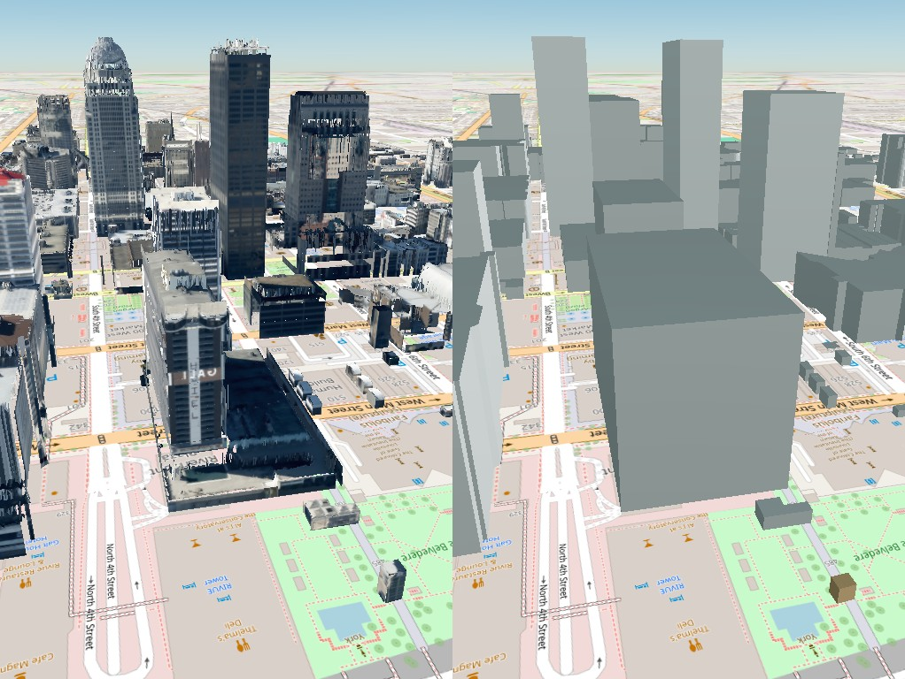

Across the downtown, ten footprints split into levels: the Omni (17 m base,
106 m tower), LG&E (10 / 93), Truist Tower (12 / 83), RIVUE (9 / 70), the
Hyatt (11 / 64), the Marriott (16 / 59), Chase Bank Plaza, the Hampton Inn
and two unnamed blocks. The rest are one body, PNC Tower and 400 West
Market among them. The re-run over all 375 took 106 minutes — a minute a
building rather than 22 s, because the crops deleted after the first run
had to be cut again from S3 for the textures.

## A curved wall is one face, and a roof step is two buildings

Two more of the run's habits, fixed on twelve buildings before any run
too big to look at.

**A curved wall used to come out as slats.** Overture draws a curve as a
chain of edges under 3 m; `wall_planes` dropped edges that short, so the
colourise never profiled them, and the mesh drew each one as its own
rectangle at the roof's edge height, textured on its own — a fan of slats
with a seam at every edge. Now a run of four or more consecutive edges no
longer than 4 m, turning the same way by 3–35° at each vertex and by 35°
in all, whose vertices fit a circle within 0.3 m, is one face: an
`ArcWall` (`features.py`). Its trick is to change the *coordinates*, not
the fifty places that use a face's frame: the arc is handled **unrolled**
— `x` is distance along the arc, `y` is minus the outward offset — so the
profile, the bands, the roof-behind clip, the wall rectangles and the
texture are computed by exactly the code a straight face uses, and only
the finished rectangles are rolled back onto the circle, cut every 1.5 m
so they follow it. A curved prism face is textured as one image sampled
along the curve rather than one per piece. A rounded corner of a metre or
two (an arc under 6 m long) stays a corner; a traced tower outline never
grows arcs (its corners are rounded by the tracing, not by the building).

Nine downtown footprints have such runs; six were rebuilt: a round kiosk
(a full circle of 25 edges, one face now instead of 25), the round tower
on a block at 4bacf443 (252° of arc, radius 8 m), Papa John's semicircular
end, One Innovation Center's rounded end, the two 22 m-radius corners of
the Witherspoon garage and the convention centre's curved corner. Only the
convention centre's arc found wall bands in the returns (the others are
glass, or deck edges, and stay prism faces at the roof's edge) — but on
every one the slats are gone.

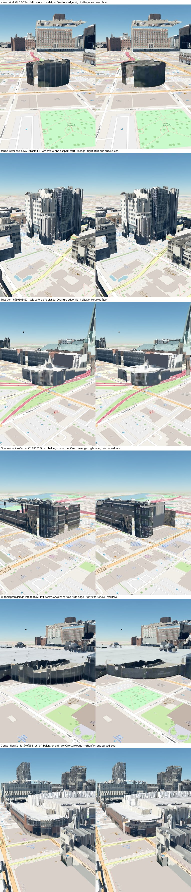

**One outline around two buildings used to be one body.** Overture's
outlines come from a machine-learning pass over imagery and often draw a
single outline around a tall building and the short one attached to it.
The pipeline works on "one outline = one building": one height, one set
of walls; the podium-and-tower rule only fires for a step of 12 m or more
with the tower inside the outline. Now `overture_boxes.py split` looks at
the roof cells of every footprint with at least 200 returns: when they
fall into two heights, each holding a quarter or more of the outline (and
40 m²), each spread under 1.5 m, at least 3 m apart, each one patch, and
the cells where they meet lie on a straight line within a metre, the
outline is cut along that line into two buildings. A tower on a podium is
told apart because its high patch is enclosed by low cells on most of its
boundary; a second building meets the first along one side and the
outline everywhere else.

Twelve of the 378 downtown outlines split. Each part is a record of its
own with its own LiDAR height, ground and return count; the runner
prepares, colourises and meshes it like any building, and the two parts
are each other's neighbours, so the wall between them is a party wall.
Party walls changed with this: they are plain only **up to the
neighbour's roof** and textured from the cameras above it, stretch by
stretch along the edge — the tall part's wall over the short part's roof
is exactly that, and so is every row building taller than its neighbour,
which until now was plain to the top.

**Ids.** A GERS id names one Overture entity, and a piece of it is not
that entity, so the parts are `<gers>-a` (the taller) and `<gers>-b`,
with `parent_gers` on the record, in `footprint.json`, in `state.json`
and in the glTF and tileset extras, so a piece traces back to the
outline it came from. The parent's directory stays — its cameras still
serve the obliques panel for a click on the unsplit box on the right
pane — with `state.json` marked `split` and its parts listed, and the
merge leaves its mesh out once every part has one. The boxes tileset
keeps Overture's outlines as they are: that pane is what Overture says.

Six of the twelve were rebuilt as parts: 5 m beside 14 m, 6 beside 14, 7
beside 25, 10 beside 20, 13 beside 20 and 17.5 beside 29.4 m. Seen from
the street the change is modest on these six — the profile path already
followed the roof field cell by cell, so the roofs were right — and shows
mainly at the wall between the parts, which now stops at the short roof
and is textured above it, and in the building record, where each part
has its own height. Where the split matters most is the box path and the
grey boxes: a footprint with too few returns for a profile gets its roof
at the taller building's height across both.

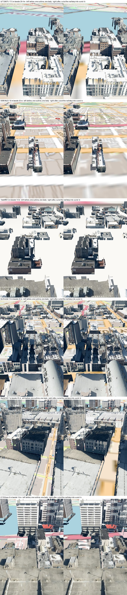

```bash
python scripts/overture_boxes.py split --buildings data/derived/louisville_downtown_overture_lidar.json --frame outputs/humana/humana --out data/derived/louisville_downtown_overture_split.json
python scripts/run_downtown.py run --footprints data/derived/louisville_downtown_overture_split.json --only <gers>-a <gers>-b ... --force-step prepare colorize mesh
```

The remaining two curved buildings (a ninth candidate's arc is under 6 m
and stays a corner) and the other six split footprints were then run the
same way, and then the whole downtown once more with every rule in place
(arcs, splits, party walls to the neighbour's roof, KTX2 textures, LAZ
clouds): **387 buildings in 38 minutes**, none failed, a median of 18 s
a building (the crops re-cut where they had been deleted), 68 MB of glTF
for the lot. The downtown tileset holds **390 buildings** — 378 outlines
less the 12 that split, plus their 24 parts — 360 by the profile path and
30 boxes, 1.30 million triangles. The arcs and splits of every other city
take the same commands over the whole list.

### Three roofs in one outline: parts A, B and C

The roof-step rule cut an outline once, into two parts. 39a33bd6 holds
three buildings in a row — roofs at 12, 8.5 and 4.6 m, stepping down along
its length, each step at a notch in the Overture outline — and the single
fitted line ran *along* the building from its west corner, leaving a long
triangle (part b) and a part a that ended in an 11° wedge: one end of the
mesh squashed to a point.

Two changes (`scripts/overture_boxes.py`). A split that would leave a
corner sharper than 30° is refused. And an outline is now tried for three
roof heights before two (`roof_tiers`): three tiers, each flat to 1.5 m,
3 m apart, at least 40 m² and 15% of the roof, chosen as the natural breaks
of the roof heights; a seam wherever two tiers meet along more than a
corner (`_fit_seam`: along one of the outline's axes where it fits, at the
median of the boundary cells, snapped to a short step of the outline
within 2 m — the notch where the party wall meets the street); the outline
cut by every seam and each piece given to the tier whose roof it holds
(`cut_into_tiers`). The parts are `-a`, `-b`, `-c`, tallest first. Where
three tiers do not cut cleanly the two-building rule runs exactly as
before.

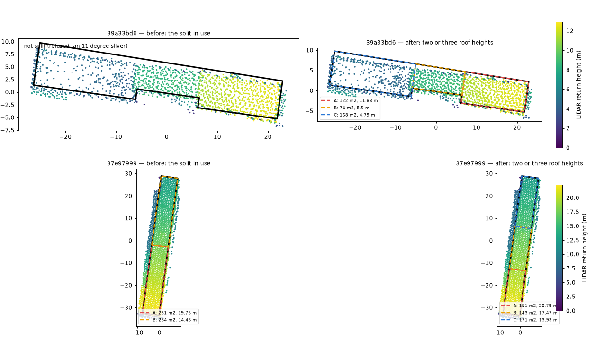

Over downtown it changes two outlines and nothing else: 39a33bd6 (not
split after the sliver guard; now 121, 73 and 168 m² at 12.0, 8.5 and
4.6 m) and 37e97999 (two parts before, now three bands at 20.8, 17.5 and
13.9 m). Every other split comes out identical, point for point. One
more footprint, b575ad92 (Red7e), finds two heights but is refused for a
3° sliver — it was not split before either.

### A neighbour's wall is not the roof: heights measured inside the edge

A footprint's LiDAR height is the 99th percentile of the returns above its
ground. An Overture outline overlaps its neighbour's wall by a few
decimetres, and a tall neighbour's facade returns land in that strip:
9947f2b0, an 18 m building beside 400 West Market, measured 115 m, and its
box on the right of `/compare` stood as a tower. Every one of its returns
above 30 m lay within 2 m of its edge. The height is now taken from the
returns more than 1.5 m inside the outline (`roof_returns`; the whole
outline when too few lie inside). Over downtown the median change is
2 cm; 35 footprints drop by more than 3 m and 12 by more than 10 m —
9947f2b0 to 17.7 m, cc3f65d1 (beside Humana) from 88.9 to 20.2 m — and
five rise by 1–4 m, where dropping the low eaves along the edge lets an
inside feature count for more (the Cathedral of the Assumption, 61 to
65 m, towards its spire). The same height caps the neighbour prisms in the
texturing and sets how high `build_mesh` draws a party wall plain; a
building's meshes pick the new heights up the next time it is prepared.

## Why the buildings floated over the map, and the ground they stand on now

Seen from the street, every building hung about a hundred metres above
the OpenStreetMap tiles. The buildings were not wrong: each sits at its
true height above the ellipsoid (the smooth mathematical globe that GPS
heights and Cesium's coordinates refer to), about 106 m in downtown
Louisville — the LiDAR's NAVD88 ground of ~140 m less the 34.5 m the
geoid lies above the ellipsoid there. The *map* was wrong: the viewer
drew it on the bare ellipsoid (`EllipsoidTerrainProvider`), a globe with
no terrain at all, so the tiles lay at height zero and the buildings
stood a hundred metres over them. From above the gap hides behind the
buildings; from a low angle it is the whole picture.

The fix is not to lower the buildings but to give the viewer the ground,
and the LiDAR has it: `scripts/ground_dem.py` grids the ground-classified
returns over the area (2 m cells, the median height in each, the gaps
under the buildings filled from the nearest ground cell) and writes the
heights as ellipsoidal metres; the intake server serves it as heightmap
tiles (`/terrain?x=&y=&level=`) that Cesium's
`CustomHeightmapTerrainProvider` reads, and both viewers use it. Checked
against every building's own recorded ground: the DEM at the footprint's
centre is within 0.14 m of it for half the buildings and within 0.74 m
for nine in ten (the rest are sloping lots). Outside the DEM the ground
is clamped to its edge, so the far globe is a plateau at the downtown's
height — fine for a downtown view, and the place to swap in a statewide
ground (the KyFromAbove DEM, also on S3) when the tileset grows.

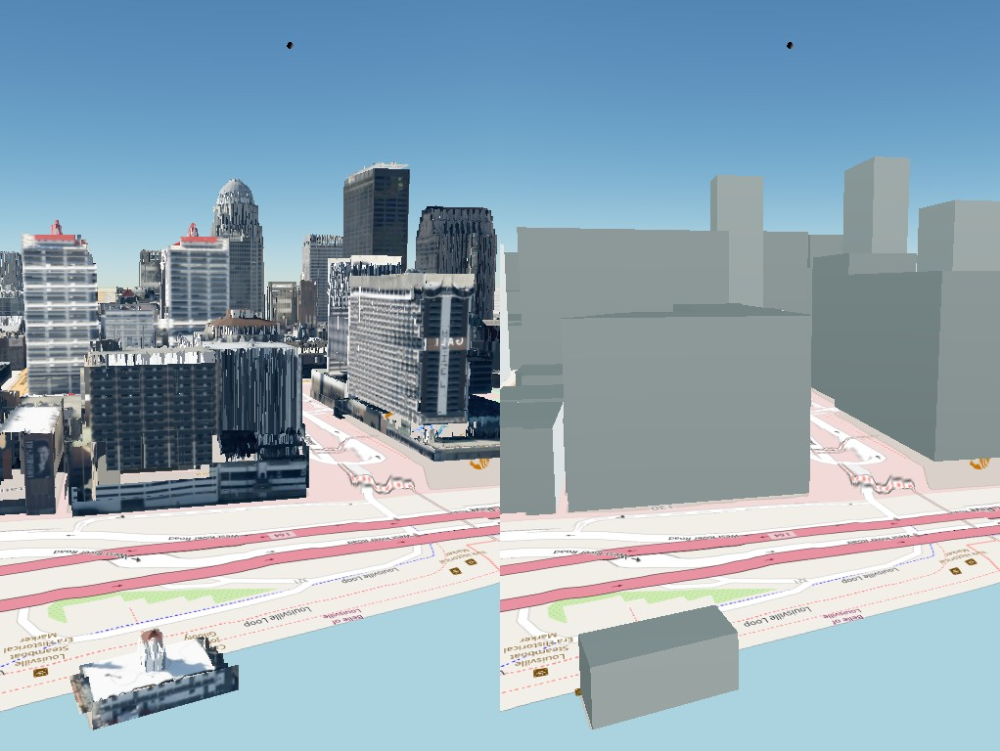

## Snapping corners to the edges the frames show

The LiDAR fixes each wall's plane — its offset, to about 0.10 m — but says
little about where a face *ends*: the corners come from Overture's
outline, a metre off as a matter of course, and from thin corner returns.
A building's edge, though, is a line the frames show crisply, on glass as
well as brick. So for every end of every straight face, a strip of the
wall's plane 6 m wide and up to 12 m tall is sampled from **one frame at
a time** through its camera; past the wall's true end the strip holds
sky, ground or the neighbour, and the silhouette is a strong vertical
edge. Only a silhouette counts — the texture's structure must *stop* past
the edge, which rules out window jambs, piers and shadows, where it
continues. Each frame votes; an observation needs two frames agreeing
within 0.3 m (`kyfromabove_3d/corners.py`).

The corner between two faces is then moved to the observed end, and the
line beside it that the LiDAR did *not* verify is slid — its offset, not
its direction — to pass through the new corner; a verified line never
moves. Moving a line moves its other corner, so the pass repeats round the
outline until nothing moves more than 5 cm. A move over 2 m, or two faces
whose observed ends disagree by more than a metre, is refused; corners on
a party wall (nothing to see) or on a curved wall are left alone. It runs
in the colourise before any face is profiled, so the bands and the
textures use the snapped outline, and `corner_snap.json` records every
corner's status and its gap before and after.

Measured on the twelve arc and split buildings, 290 corners:

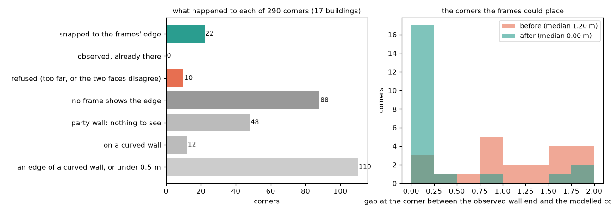

**Where a corner can be seen, it snaps: 22 corners, from a median gap of
1.20 m to 0.00 m.** The convention centre's south-east corner on
Jefferson Street moved 1.9 m; its wall had run on into the air past the
last window, as a grey untextured slab, and now ends where the windows
end:

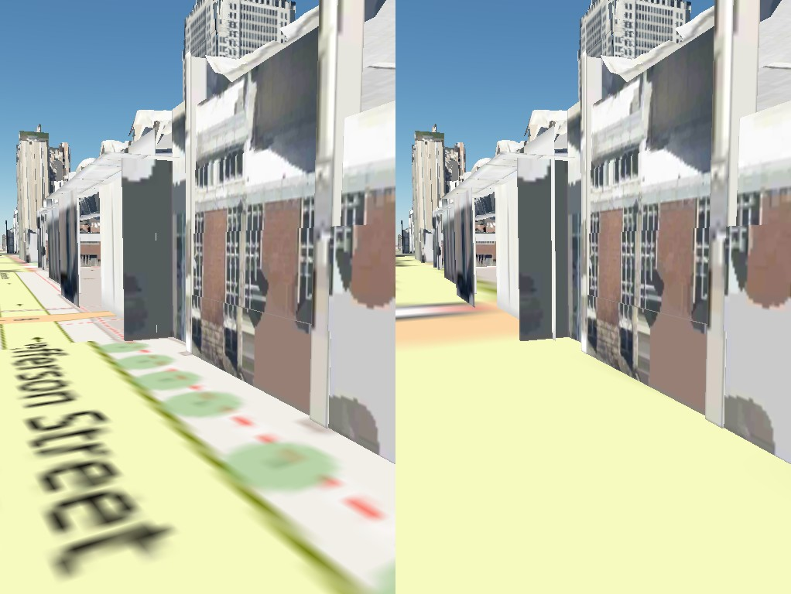

**But most corners in a downtown cannot be seen.** 48 are party-wall
corners — the twelve split parts are attached buildings, every corner of
theirs is one; 122 lie on curved walls or on edges too short for a plane;
88 had no frame that showed a silhouette, mostly the parking garage's open
decks and corners hidden behind neighbours; 10 were refused because the
two faces' edges disagreed. This is the honest shape of the result: the
rule is safe (nothing moved that should not have) and it fixes the
free-standing corners, which are the visible ones, and it has nothing to
say about the seam between two attached facades in the same plane, which
is the common case downtown and is invisible to a silhouette test by
construction. A different observation — the change of facade *rhythm* at
the seam — would be needed there, and is not attempted.

```bash
python scripts/run_downtown.py run --only <gers> ... --force-step colorize mesh --keep-crops
python scripts/plot_corner_snap.py --only <gers> ...
```

## A structure label is a label, and a metre of placement is not free

A later round of work added a *structure label* for every building —
`simple_box`, `tiered_box`, `complex_roof` or `sculpted_facade`, from the
roof's flatness, the walls' offsets, curved walls and open bands
(`classify_building_structure`) — and let the label choose the mesh:
a `simple_box` got a plain prism, without its roof height field, wall
profiles or fitted wall tiles. A review of that work measured what it did
and reversed three parts of it.

**The label chose the mesh for 29 buildings, and each lost its LiDAR
shape.** 42 buildings were labelled `simple_box`; 13 were already boxes
(the LiDAR barely touched them), and the other 29 went from hundreds or
over a thousand triangles to a dozen — a median of 85% of the triangles
gone. Every other building was unchanged. Now every building the LiDAR
covers is built from its returns again, and the label is written to
`classification.json` and the tileset's extras as information only:

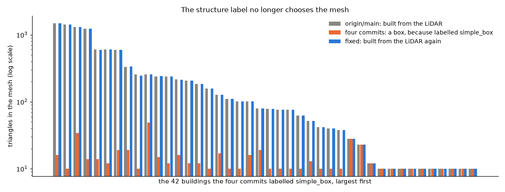

The reason is not that the label was wrong for those buildings; many of
them are near enough to boxes. It is that where the LiDAR is dense — and
downtown it is — the height field and the profiles already say what is
there, and a label drawn from the same returns can only throw some of it
away. One label per building is also too coarse to steer anything here:
three quarters of downtown falls in `sculpted_facade`, the catch-all,
because one building has a flat roof, a curved corner and a party wall at
once. Choosing a model by type belongs where the returns are too thin to
show the shape — a small rural building with a few returns per square
metre, whose gable is better fitted as two planes than read off a noisy
grid — and there per roof region or face group, checked on a before/after
sheet like the arcs and splits were. That has not been tried.

**One of the three flat-roof tests never ran.** The label counts a roof as
flat only if few of its cells slope like a pitched roof, but nothing
passed that share in; it defaulted to zero and the test always passed. It
is measured now (`roof_sloped_fraction`), and measuring it took a second
try. Counted cell by cell it called most downtown roofs sloped: the roof
grid is a per-cell percentile, smoothed, so a sheer step between two flat
roofs becomes a ramp one or two cells wide, and plant rooms and parapets
do the same — on 45 roofs whose returns lie within 0.2 m of one plate, a
fifth of the cells read as sloped. A pitched roof slopes over metres, so a
sloping cell now counts only inside a sloping patch at least 3 m across.
Over the 399 building records half the roofs now read 0–1.5% sloped;
149 have 5% or more of their roof in sloping patches, and the six highest
in a sample, looked at one by one, were gables, hips and Christ Church
Cathedral's nave. The labels now: 290 `sculpted_facade`, 89
`complex_roof`, 20 `simple_box`.
The "confidence" that came with each label was a constant per type (0.85
for every `complex_roof`, 0.90 for every `sculpted_facade`) and is gone.

**The whole downtown had moved 1.2 m up and 0.7 m aside.** The same work
switched PROJ's network off inside the placement. Without the network PROJ
cannot reach the geoid and datum grids, and it does not fail — even asked
for the best transformation only, it falls back to a "ballpark" one that
takes NAD83 for WGS 84. At downtown's origin that is a 33.36 m geoid shift
instead of 34.55 m. Every building moved together, so nothing looked wrong
among the buildings, but they stood 1.2 m above the LiDAR-ground terrain
the map uses. The placement now takes PROJ's best transformation only when
PROJ says it is available (`TransformerGroup.best_available`) and stops,
naming the missing grids, when it is not; the test pins the shift at
downtown's origin to 5 cm. The rebuilt root sits where it did before the
round of work, 0.00 m from it.

Three smaller repairs from the same review:
- A small tower or lantern in the middle of a roof (under 5% of the
  footprint) was cut off at the lower roof's height, as if it were a
  neighbour's wall spilling over the edge. Only upper returns along the
  footprint's edge are taken for spill now.
- A wall band with few coloured points borrowed any denser surface within
  4.5 m, in front of it too — a neighbour's facade across a party wall
  could be painted on. Only a wall up to 2 m *behind* the band, never on a
  party face, is taken now.
- The batch rebuild (`scripts/rebuild_downtown_meshes.py`) counted a
  failed building as built and merged regardless; it lists every failure
  and merges only when all built. The LiDAR clip is reused only when it
  was cut for the same box about the same origin (`clip.json`).

## Checking a mesh against the frames it was not textured from

The pipeline is one pass. Every texel takes its colour from the single
frame that faces it most squarely, and the building's other frames — about
nineteen per building, from five heads and several flight lines — go
unused. The texture check (`scripts/check_building.py`,
`kyfromabove_3d/texture_check.py`) puts them to work. It reads the finished
`building.glb` back, lays a grid over each face (a wall in its own
along-and-up frame, the roof in plan), and looks at every grid point through
every frame that sees it, with the same facing, crop and depth tests the
colourise uses. Two rules keep it honest:

- **A frame is scored only on the points it did not texture.** Comparing a
  texel with the frame it was copied from measures nothing; that
  comparison is kept only as the *ceiling* — how well a face can agree at
  all, given the texture and its compression.
- **It compares the pattern, not the colour.** The frames differ in sun,
  exposure and, on glass, reflections. Both images are reduced to
  brightness with the slow shading removed and compared by correlation
  (1 = the same pattern, 0 = unrelated); the shift, in metres on the face,
  that lines them up best is searched within 1.5 m. A shift at the edge of
  that search is not counted: on a curtain wall that repeats every metre
  and a half it is the next mullion lining up, not a measurement.

On a synthetic wall (`tests/test_texture_check.py`) the check behaves as
the geometry says it should: with the wall in the right place every other
frame agrees at 0.98 with no shift; with it 1 m in front, frames 35 m to
either side of the texturing camera agree at 0.1 and need a 0.6 m slide,
in opposite directions, to agree at 0.99 — the parallax a depth error
makes. That sign and size are what a later step can turn back into a
wall's depth.

**The first thing it found was the occlusion test's blind spot.** Humana
scored 0.14. Its sheet showed why: in a Right-looking frame Humana stands
behind PNC Tower, and the mesh was drawn — and scored — straight through
PNC's facade. The depth maps that decide what a frame can see are built
from LiDAR returns, and the LiDAR is flown from above: a tower's walls hold
few returns, so seen from the side its facade is mostly empty in the
depth map, whether that map is built from the building's clip or from the
whole area's cloud. The check now also puts every neighbour into each depth
map as a solid prism — its Overture footprint up to its LiDAR height
(`add_prism_occluders`). Humana went from 0.14 to 0.51, 400 West Market
from 0.37 to 0.53; the Omni, with nothing tall in front of it, stayed at
0.61. The texturing had the same blind spot; see "Solid neighbours in the
texturing" below.

Over sixteen buildings (the twelve curved and split ones, the Omni, PNC
Tower, Humana and 400 West Market — 22 meshes counting split parts):

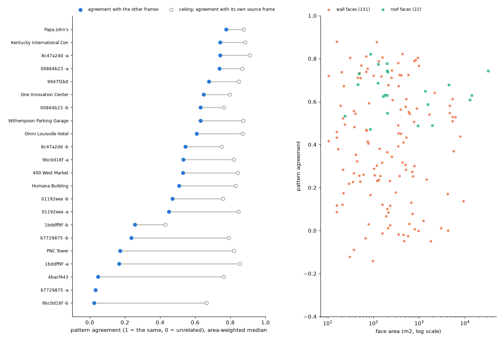

- Half the buildings agree at 0.53 or better, against ceilings of 0.8–0.9.
  The large, plain ones do best: Papa John's 0.78, the convention centre
  0.74, One Innovation Center 0.65, the Witherspoon garage 0.63.
- **Roofs agree well** (0.5–0.8 almost everywhere). **Walls are where the
  disagreement is**, from −0.1 to 0.9 at every size.
- Low scores so far have three kinds of cause, and a sheet tells which:
  a texture defect (the Omni's tower face has an untextured stepped patch
  where the frame shows it lit), a shape the model cannot be (a tower of
  open columns modelled as a solid cylinder, seen through by every other
  frame), and glass (PNC Tower's dark curtain wall reflects something
  different in every frame — only its roof agrees). Small split parts
  score low and noisily: a few hundred square metres seen by one or two
  frames.
- A face whose agreement is low (under 0.3) with no clear shift to explain
  it is flagged `low_without_shift` in `texture_check.json`: glass, a
  structure seen through, or an occluder the depth maps miss, rather than
  a wall in the wrong place. PNC's largest glass face (9,300 m²) is one.
  Agreement is also kept per flight line, since frames flown on one line
  share their sun and exposure.

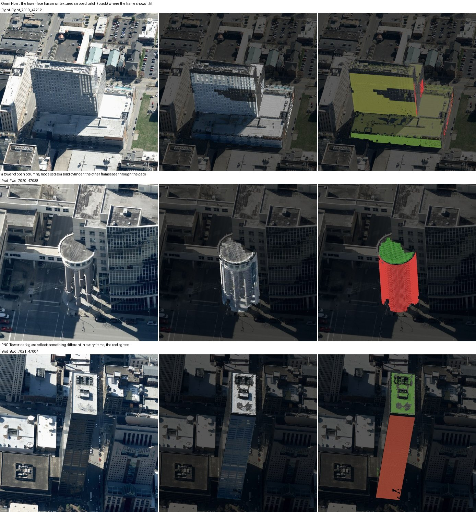

The check takes 2–12 s a building (median about 3 s), against about 25 s
for the rest of the run, and runs after the mesh in `run_downtown.py`
while the frame crops are still on disk (`--no-check` skips it,
`--check-sheets` draws the sheets). Nothing has been adjusted from it yet;
it measures.

### Solid neighbours in the texturing: the first adjustment

The colourise and the mesh's own frame sampling (prism faces, roofs) now
put the neighbours into every frame's depth map as solid prisms, as the
check does (`neighbour_prisms`, `add_prism_occluders` in
`colorize_building.py`; `--no-prism-occluders` turns it off). A neighbour
the colourise has seen stands as its levels — a podium at the podium's
height, a tower on its own outline above — and one it has not as its
footprint at its LiDAR height. `build_mesh`'s own sampling also moved from
the building's LiDAR clip (27 m past the footprint) to the area's cloud,
as the colourise already used.

Measured by building each mesh twice on the same code, once with and once
without, and checking both — 169 faces on the thirteen downtown buildings,
Humana and 400 West Market:

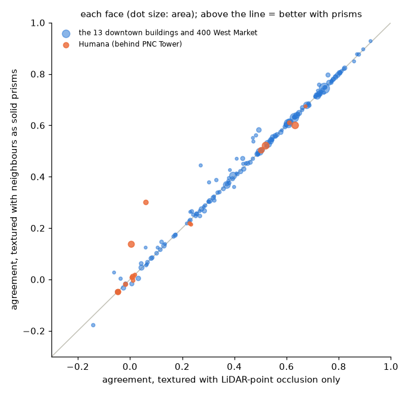

**12 faces are better by more than 0.05 (4,800 m²), none worse by as
much, and the rest do not move.** Humana's tower face towards PNC goes from
0.01 to 0.14, another Humana face from 0.06 to 0.30, nine faces of the
convention centre by 0.05–0.09, a split part from 0.27 to 0.44. In the
check's sheets Humana is no longer drawn through PNC Tower. The effect is
modest because few downtown walls stand behind something much taller;
where one does, it is the fix. It costs nothing measurable (2.4 against
2.5 minutes for the thirteen).

Two things this turned up. **Most neighbours' `levels.json` are stale**:
362 of 381 were written before the spill cap in `building_levels`, and
some hold the tall building next door — cc3f65d1, an 18 m building beside
Humana, has a level to 116 m, and its own mesh reaches 55 m. As prisms,
those levels hid Humana's walls (the check fell to 0.08), so a level is
now capped at the footprint's LiDAR height; re-colourising downtown will
rewrite them properly and fix that building's mesh. And **scores are only
comparable under the same check**: 400 West Market's old mesh scored 0.53
under the first version of the check and 0.37 under this one; rebuilt, it
scores 0.40, every face as good or better.

What the prisms do not fix is Humana's remaining red: its tower faces are
textured pale blue-white where the other frames show pink granite partly
in shadow — a choice of source frame, the next adjustment on the list.

**What building the check turned up about the downtown tileset.** A
mesh-only rebuild in the round of work reviewed above
(`rebuild_downtown_meshes.py`) ran after `run_downtown` had deleted the
frame crops, as it does after every mesh. With no crops, `build_mesh`
quietly textured every prism face and roof from the point cloud or left it
grey: on `origin/main` all 390 buildings were textured from the frames, in
the reviewed tileset 6 were. `build_mesh` now stops when a building's
frames are listed but their crops are gone. The sixteen checked here were
rebuilt with their frames (`run_downtown.py run --only ... --force-step
mesh`, which re-cuts the crops first); the rest of downtown needs the same
run.

```bash
python scripts/run_downtown.py run --only <gers> ... --force-step mesh --keep-crops --check-sheets
python scripts/check_building.py --building outputs/humana/humana --sheet
python scripts/plot_texture_check.py --dirs outputs/downtown/buildings/<gers> ... --out docs/figures/texture_check.png
```

## Three products: measured, measured, and invented

The run now makes three products, each labelled for what it is
([PRODUCTS.md](PRODUCTS.md)): Overture footprints at their LiDAR heights
(product 1); the measured 3D Tiles, colour only where a frame saw the
texel (product 2 — the twin-face colour copy, an invention, is no longer
part of it); and the completed 3D Tiles, product 2 with its unseen texels
invented from the same building's own frames (product 3,
`run_downtown.py run --complete`, merged into `outputs/downtown_complete/`
and a tinted copy that shows what was invented). Which invention runs on
which kind of texture was set by a held-out test on 16,759 rectangles of
facade the frames did see, over 342 buildings: the facade's own rhythm and
patches of itself beat the plain fill on walls, the twin copy failed badly
(its colour closer than plain in 13% of rectangles) and is off. The full
run (57 minutes, 389 buildings, no failures) also put the frame textures
back on every building of product 2.

## From downtown to the state: how long, and where

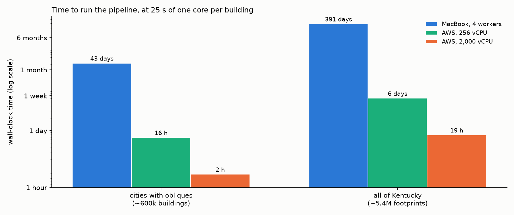

**What one building costs, measured.** The first downtown run spent 22 s
of worker time on the median building: 2 s reading the LiDAR clip, 15 s
cutting about 18 crops out of the aerial frames on S3, 5 s on the mesh
and the rest on the colourise. The re-run, which had to cut the crops
again, took 56 s. Downtown is the hard case (18 frames at 1,150 px,
6,900 m² blocks, 70 m towers); a house is one storey on 150 m² and needs
a quarter of that. The figure uses **25 s of one core per building** as
the average over a mix, on the conservative side.

**How many buildings.** Overture holds about 5.4 million footprints in
Kentucky, 3.7 million of them under 200 m² (houses, garages, sheds). The
obliques — the only thing that colours a wall — were flown over the
cities: Louisville, Lexington, Northern Kentucky, Frankfort, Paducah,
Owensboro, Bowling Green and a few more, roughly **600,000 buildings**.
Everywhere else the pipeline still runs on LiDAR and nadir (shape, roof,
plain walls), so there are two scopes: walls textured, and everything.

| | cities with obliques (600k) | all of Kentucky (5.4M) |
| :--- | ---: | ---: |
| **MacBook, 4 workers** | ~43 days, continuous | ~13 months |
| **AWS, 256 vCPU** (16 × c6i.4xlarge) | ~16 hours | ~6 days |
| **AWS, 2,000 vCPU** (Batch / Fargate Spot) | ~2 hours | ~19 hours |

**Why the MacBook loses beyond the arithmetic.** It is the home line, not
the CPU: each building pulls about 25 MB of frame windows and LiDAR from
S3 in Oregon, which at 1,200 buildings an hour is a steady 70 Mbit/s for
six weeks, and one S3 hiccup a night means babysitting a resumable run.
**Why AWS wins beyond the arithmetic.** The data already lives in S3
`us-west-2` (the `kyfromabove` bucket, the Overture parquet), so running
there means no egress, a gigabit per worker, and range reads that scale
to thousands of workers at once. The pipeline is one building per process
and the runner already writes per-building state, so a Batch job array
over the footprint list is a direct port.

**Cost, all of Kentucky:** 5.4M × 25 core-seconds ≈ 37,500 core-hours.
On Spot (~$0.015 per vCPU-hour) that is about **$560**; on-demand about
$1,500. Add a few hundred dollars for the one-off caches (frame indexes
per collection, occluder clouds per LiDAR tile — the same per-area caches
downtown used, done per 5,000-ft tile). Under $1,000 for the state,
repeatable for each new flight.

**What would need doing first** (days of work, none of it research):
batch by LiDAR tile rather than by building, so a tile's COPC read and
occluder cloud serve its hundreds of houses; a worker that takes a
footprint record from a queue and writes `state.json` and the glb to S3;
the merged tileset as a real quadtree rather than one 150 m level, since
five million children will not fit one JSON; and the two open quality
items below (curved facades; Overture footprints that span two
buildings), because at state scale nobody looks at individual buildings
afterwards. And before any of it: one 5,000-ft tile of Louisville suburbs
end to end on the MacBook, to measure the house case instead of
extrapolating from downtown.

## Output sizes: what to keep, and in what form

The source data is on S3 under the AWS Open Data programme, so the
question for a statewide run is what the pipeline itself would add.
Measured on the downtown directories, per building: the crops (about 19
windows cut from the aerial frames) ~65 MB, deleted after the mesh; the
LiDAR clip 0.95 MB as ASCII PLY; the coloured cloud 0.73 MB as binary
PLY; the mesh 0.11 MB (mean 0.33) with PNG textures; the building record
(planes, profiles, levels, footprint, state, coverage) ~30 KB; the
camera and crop manifests ~36 KB.

Kept everything, all of Kentucky would be ~18 TB of crops and ~5 TB of
LiDAR clips — a second copy of KyFromAbove, re-cut from the original in
15 s a building. Neither is kept. What is worth keeping, and how it is
now written:

* **The mesh** is the product: ~0.3 TB for the state with PNG textures,
  a third of that now. `build_mesh.py` writes its textures as
  **KTX2 / Basis Universal** (`--texture ktx2`, the default; `webp`,
  `jpeg` and `png` remain). A Basis texture stays compressed on the GPU —
  about an eighth of the memory of a decoded PNG, JPEG or WebP — and needs
  no decode on the main thread, which is what a city-scale view runs out
  of first; Cesium (`KHR_texture_basisu`) and three.js read it. The
  encoder is the `basisu` command (`brew install basis_universal`); the
  mesh stops with a clear message if it is missing rather than falling
  back. Texture pages are padded to multiples of four pixels, which
  block compression needs.
* **The coloured cloud** is the one intermediate worth keeping: it holds
  the camera choice per return and the occlusion test, i.e. all the
  imagery work, so a re-mesh with new rules costs 5 s a building and
  reads no imagery (the second downtown run took 106 minutes instead of
  42 precisely because the crops were gone). It is also a product of its
  own — the LiDAR coloured from the obliques — and insurance if a
  collection ever leaves the Open Data programme. It is now written as
  **LAZ** (`colorized_aerial.laz`, with `source` and `surface` as extra
  bytes); merged for the state it should become one COPC per LiDAR tile
  (PDAL's `writers.copc`, not in this environment), which viewers and
  later runs can range-read like the raw tiles.
* **The LiDAR clip** is written as LAZ too (`lidar_local.laz`, the full
  16-bit intensity kept) — a fifth of the text file — though it is only a
  convenience: it is a window onto the COPC on S3.
* **The building record** should become one GeoParquet table for the
  state: the same content is ~160 GB as JSON files and ~10 GB as a table,
  and it is what Overture or the state would most want back — heights and
  storey structure from LiDAR — and what a future drone update would
  register against.

Every reader takes either format (`kyfromabove_3d.clouds.find_cloud`
looks for the `.laz` and falls back to the `.ply`), so the 378 downtown
directories written before this change need no conversion; a directory is
converted when its building is next re-run.

Measured on the rebuilds:

| file | before | after | ratio |
| :--- | ---: | ---: | ---: |
| downtown block `00864b23`: `lidar_local` | 1.44 MB (ASCII PLY) | 0.29 MB (LAZ) | 5.0× |
| — `colorized_aerial` | 1.38 MB (binary PLY) | 0.56 MB (LAZ) | 2.5× |
| — `building.glb` (textures 98 KB → 46 KB) | 158 KB | 106 KB | 1.5× |
| PNC Tower: `colorized_aerial` | 20.3 MB | 3.0 MB | 6.7× |
| — `building.glb` (textures 2.44 MB → 0.57 MB) | 2.67 MB | 0.80 MB | 3.3× |

A small building's glb is mostly geometry — unshared vertices per
rectangle, 32-bit indices — which is the next thing to trim; a landmark's
is mostly texture. The wall texture itself at PNC Tower, before and after,
at twice its size: the mean difference over the page is 1.2 of 255, and
nothing is visible at street distance.

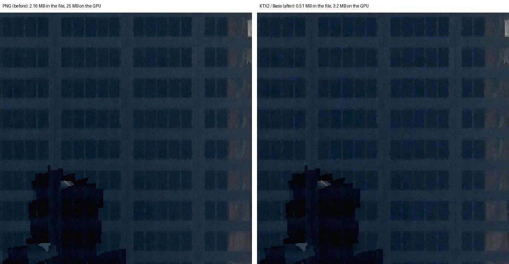

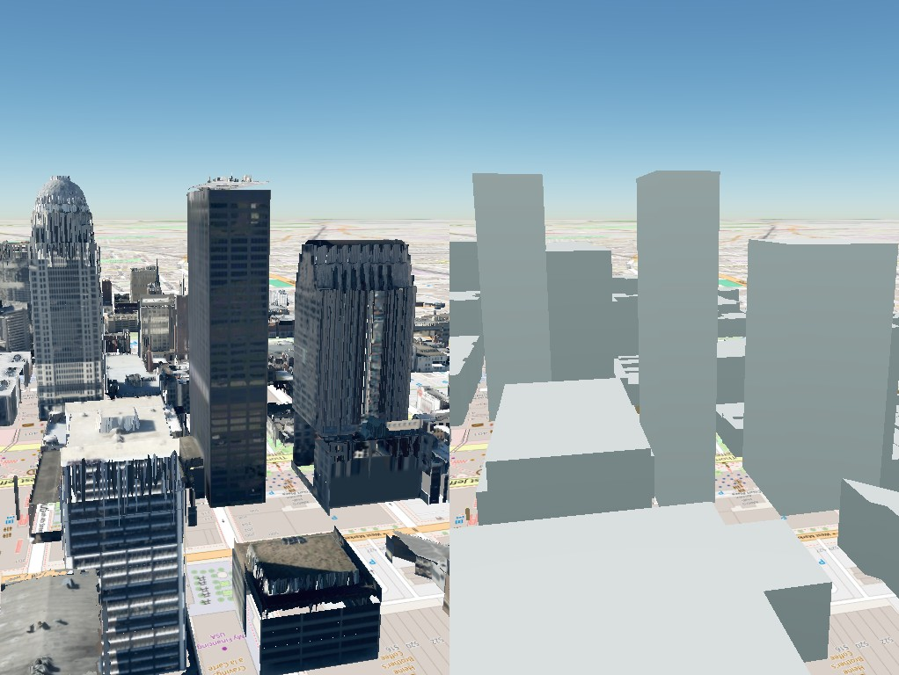

## Reproducing

```bash
python scripts/overture_boxes.py fetch --bbox -85.764 38.25 -85.75 38.26 --out data/derived/louisville_downtown_overture.json
python scripts/overture_boxes.py lidar-heights --buildings data/derived/louisville_downtown_overture.json --frame outputs/humana/humana --out data/derived/louisville_downtown_overture_lidar.json
python scripts/overture_boxes.py split --buildings data/derived/louisville_downtown_overture_lidar.json --frame outputs/humana/humana --out data/derived/louisville_downtown_overture_split.json
python scripts/run_downtown.py run --footprints data/derived/louisville_downtown_overture_split.json --workers 4   # resumable; --only <gers> for one, --keep-crops to inspect
python scripts/run_downtown.py report
python scripts/plot_downtown_run.py
python scripts/run_downtown.py run --force-step mesh    # rebuild every mesh; re-cuts the frame crops first
```

`/compare` (left = `outputs/downtown/tileset.json`, right = the boxes),
`/tiles?target=downtown` for the meshes alone.
