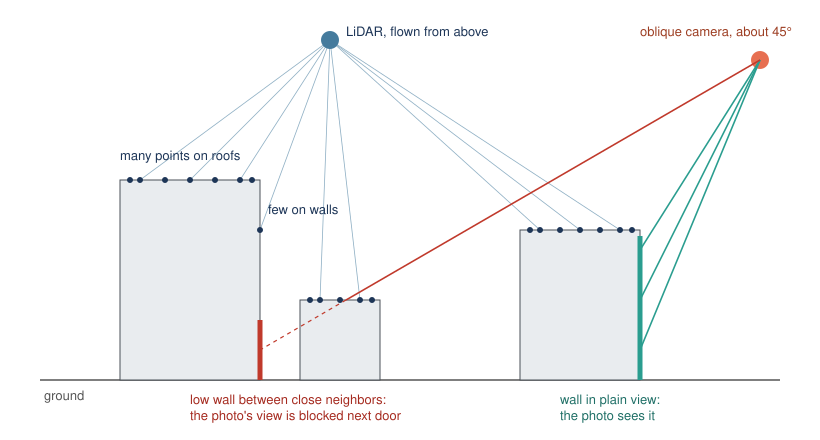
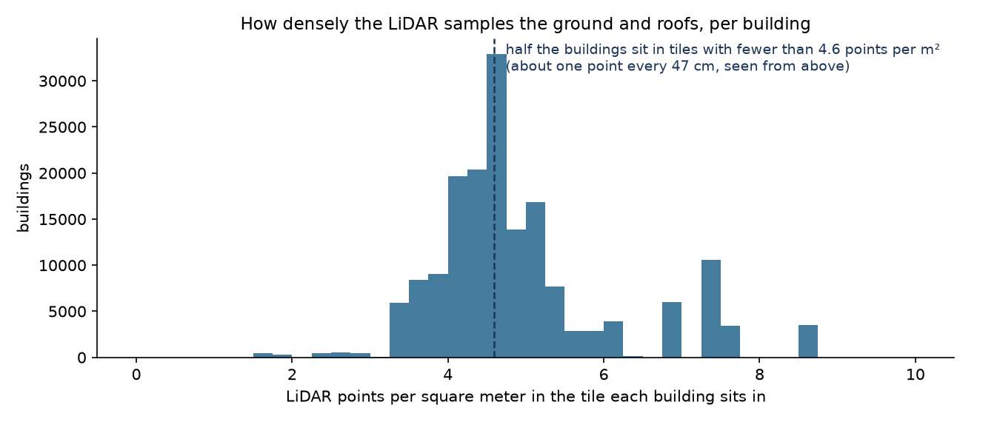
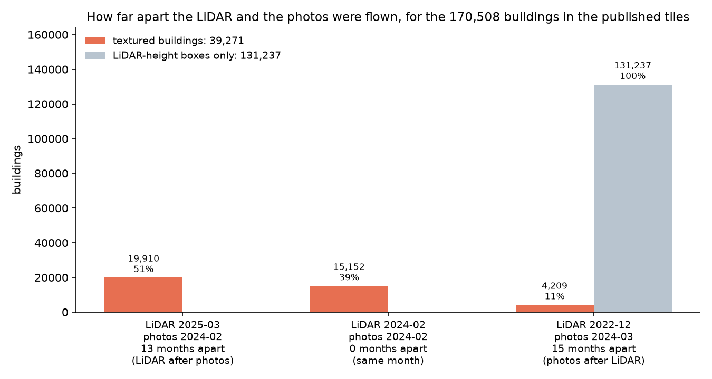

# What future collection could do for 3D buildings

KyFromAbove's LiDAR and aerial photos are open and analysis-ready, and that
is what made this project possible. Using the data at scale also shows what it
can and can't do. This document collects what the project measured about the
data's limits for one purpose: turning it into 3D buildings (3D Tiles). It is
written as findings that might help plan future flights. It is not a list of
demands. A statewide collection program serves many users and has to weigh
cost against all of them, and this project is only one.

Every number here comes from this project's own measurements, at one of
three scales: the 170,508 buildings in the published tiles, 168,716 of which
are footprints raised to a roof height measured from the LiDAR (product 1);
the 39,271 of those also built as textured 3D meshes (the measured, completed
and borrowed-fill products); or the 19 downtown Louisville buildings the audit
checks in detail. Each section says which.



## 1. More LiDAR on walls

**What we found.** The LiDAR is flown looking almost straight down, so it puts
plenty of points on roofs and very few on walls. The pipeline cuts each wall
into slices 5 m tall and asks what the LiDAR saw on each. Across downtown
Louisville, for **57% of the 13,192 wall slices the LiDAR returned nothing
usable**, and only **18% were actually measured**. The rest of each wall is a
guess: either a straight wall dropped from the edge of the footprint, or a copy
of the wall on the opposite side.

**What would help.** More overlap between flight lines, so that each wall is
seen from the side by at least one pass, or scanners that also look forward
and back instead of only side to side. Either puts points on walls directly.

Details: [`WALL_VISIBILITY.md`](WALL_VISIBILITY.md).

## 2. Denser LiDAR, for small buildings

**What we found.** Half of the 170,508 buildings in the published tiles sit
in LiDAR tiles with fewer than **4.6 points per square meter**, which is about one point every
47 cm when seen from above. A house roof 10 m across gets only a few hundred
points. That is enough for a big building's height and outline, but small
buildings come out noticeably rougher than big ones. Newer is not always
denser either: in the places compared, the Phase 3 re-flight was sparser than
Phase 2 ([`LIDAR_SOURCES.md`](LIDAR_SOURCES.md), section 4).



**What would help.** Higher point density in built-up areas, where most
buildings are small.

## 3. Points labeled as building and vegetation

**What we found.** The Phase 2 LiDAR labels points only as ground,
unclassified (everything above the ground), water, bridge deck or noise.
**No point is labeled as a building, and none as vegetation.** Trees and roofs
sit in the same "unclassified" bucket. This project had to write its own tree
detector, and before it did, trees overhanging houses were read as roofs: in
one St. Matthews tile, 494 of 3,252 buildings came out over 15 m tall.

**What would help.** Delivering the standard building (class 6) and vegetation
(classes 3–5) labels. Every user who wants buildings or trees from the point
cloud has to repeat this work today, and each does it differently.

## 4. LiDAR and photos flown close together, in leaf-off season

**What we found.** Each building takes its shape from one LiDAR flight and its
color from one photo flight. When the building changes between the two, its
shape and color don't match. Of the 39,271 textured buildings, **only 39%
had both flown in the same month**. For 51% the LiDAR came 13 months after
the photos, and for 11% the photos came 15 months after the LiDAR. (The
pipeline already picks, for each tile, the LiDAR and photos flown closest
together; these are the best pairings on offer.) The other 131,237 buildings
in the published tiles are LiDAR-height boxes only, and all of them sit where the LiDAR is
from December 2022 and the photos from March 2024, 15 months apart.



All of these flights were in leaf-off season (December to March), which
matters: trees in leaf hide low walls from the camera and put false "roof"
points into the LiDAR.

**What would help.** Flying the LiDAR and the photos in the same season,
ideally the same leaf-off season, and keeping both in winter and early spring.
The viewer shows the gap for each building when you click it.

## 5. Oblique photos: keep them, and add views in tight downtowns

**What we found.** The oblique photos, taken at about 45 degrees, already cover
most of what the LiDAR misses. On the 19 audited downtown buildings, **90% of
the wall slices the LiDAR missed are seen by two or more photos**, and the
photos show about 10 cm of wall per pixel, finer than the 15 cm the textures
are made at today. Kentucky completed statewide oblique coverage in 2024, which
very few states have done.

The weak spot is low walls between close neighbors. In the lowest 15 m of
downtown walls, **18% of the slices the LiDAR missed are seen by no photo at
all**, because the building next door is in the way.


**What would help.** In dense downtowns only, more viewing directions or more
overlap between photos, so that walls facing a narrow street or alley are seen
by at least one camera.

Details: [`WALL_VISIBILITY.md`](WALL_VISIBILITY.md).

## 6. Keep publishing camera positions, and fill in the metadata

**What we found.** All of the painting depends on knowing exactly where each
camera was and which way it pointed when each photo was taken. KyFromAbove
publishes those tables (the "exterior orientation"), and they are good: of
265 photos of the audited downtown buildings, half line up with the LiDAR to
within 24 cm, and nine in ten to within 57 cm (`scripts/camera_check.py`).
Very few states publish these tables at all
([`CAMERAS_AND_ORTHOS.md`](CAMERAS_AND_ORTHOS.md)).

One gap is easy to close: **the Phase 2 LiDAR tile grid ships with no
coordinate system set**, so every user has to work out which one it is
([`LIDAR_SOURCES.md`](LIDAR_SOURCES.md), section 2).

**What would help.** Keep publishing the camera tables with every photo
collection, and set the coordinate system on every delivered file.

## What this does not cover

- The wall numbers (sections 1 and 5) come from the 19 audited downtown
  buildings, the tallest and most crowded part of the state. Suburban walls are
  shorter and less crowded, so they are probably easier, but that has not been
  measured.
- The density and timing numbers (sections 2 and 4) cover the 119 published
  LiDAR tiles, which are mostly in and around cities. Rural Kentucky may look
  different.
- None of this is costed. Some suggestions, like scanners that look forward
  and back, may cost far more than they are worth to other users of the data.

## Redrawing the figures

```bash
aws s3 cp s3://kyfromabove-3d/tiles/ tiles/ --recursive --exclude '*' --include '*/buildings.json'
aws s3 ls s3://kyfromabove-3d/buildings/ --recursive > buildings_listing.txt
python scripts/plot_collection_findings.py --tiles tiles --meshes buildings_listing.txt --out docs/figures
```

The diagram at the top, `figures/collection_why_walls.svg`, is drawn by hand.
