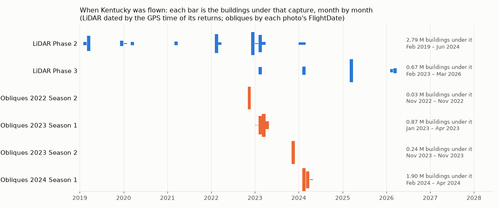
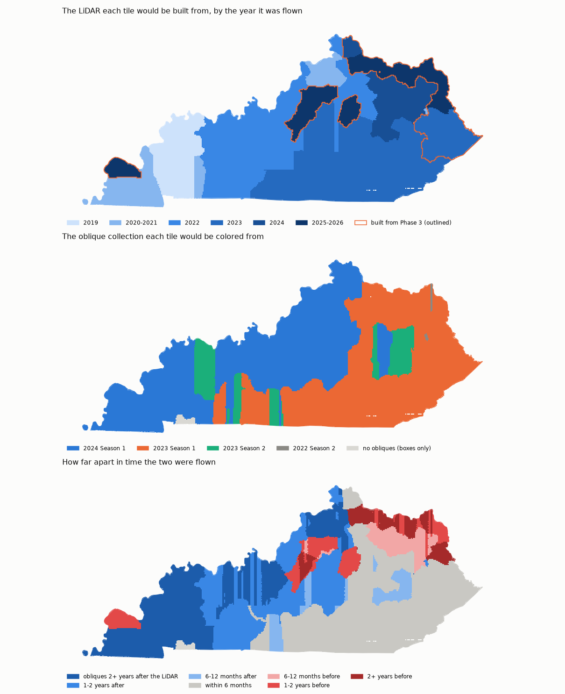

# KyFromAbove LiDAR: phases, COPC, and which one to read

Every number here was measured by `scripts/compare_lidar_phases.py` against the
published grids and the tiles themselves. Nothing is quoted from documentation.
Re-run it before trusting any of it — Kentucky is still flying Phase 3.

```bash
python scripts/compare_lidar_phases.py --headers --classes \
    --out outputs/phase2/lidar_phase_comparison.json
```

---

## 1. Why the phase choice is structural, not cosmetic

One building's AOI is **0.56% of a 5000 × 5000 ft tile**, and we keep **0.30%**
of the tile's points (25,955 of 8,759,469). The tile is 53.4 MB.

- **COPC** (Cloud Optimized Point Cloud) is a LAZ whose points are ordered into
  a clustered octree with an index. An HTTP range request fetches only the nodes
  covering the AOI.
- **Plain LAZ** has no such index. To read one building you fetch the whole file.

At one building that is an annoyance. At county scale it is the difference
between feasible and not, which is why the phase that offers COPC wins even when
another phase is newer.

> Measured caveat: the 0.30% figure is *points kept*, not *bytes transferred*.
> A range read pulls whole octree nodes, so the byte saving is real but smaller
> than 0.30%. It has not been measured here.

## 2. Inventory

| phase | tiles | format | declared CRS |
|---|---|---|---|
| Phase 1 | 46,103 | **plain `.laz`** — no COPC | EPSG:3857 |
| Phase 2 | 46,167 | **all COPC** — 45,269 `.copc.laz` + 898 `.copz.laz` | **none set** |
| Phase 3 | 8,664 | **all COPC** — `.copc.laz` | EPSG:3857 |

The Phase 3 row is KyFromAbove's tile list of 2026-09-15; the rest of this
document was measured on the list of 2025-12-14, when Phase 3 held 6,847
tiles. Both lists are kept in `data/raw/old_grids/`.

Three traps live in that table.

**`.copz.laz`.** 898 Phase 2 tiles use this spelling instead of `.copc.laz`.
Same format. Detecting COPC by matching `.copc.` alone misses 898 tiles and
silently degrades them to whole-file reads. `LidarTileIndex` matches both.

**And for about a tenth of them the grid is simply wrong.** Sampled with HEAD
requests:

| grid entries | sampled | 404 | recoverable |
|---|---|---|---|
| `.copz.laz` (898) | 80 | **8 (10%)** | **8 of 8** under `.copc.laz` |
| `.copc.laz` (45,269) | 60 | 0 | — |

So roughly **90 tiles statewide are published under a filename that does not
exist**, and every one is retrievable by swapping the spelling. `N072E392` is a
worked example: 404 as listed, 13,320,812 points under `.copc.laz`.
`lidar.open_copc()` tries both and is used by `extract_lidar_for_aois`. A job
composing URLs straight from the grid fails on ~2% of tiles, at whatever moment
it happens to reach one.

**The Phase 2 grid ships with no CRS.** Not a wrong CRS — absent. GeoPandas will
happily intersect an EPSG:3089 AOI against it and return **zero tiles, with no
error**. `LidarTileIndex.GRID_CRS` assumes EPSG:3857 and calls `set_crs` when
the field is missing. This cost real debugging time; it fails silently and looks
exactly like "no LiDAR here".

**The 2026-09-15 Phase 3 list has every outline at infinity.** The tile
names and URLs are right; the shapes are not numbers. Intersected with an
area, it returns nothing, again with no error. `LidarTileIndex` now refuses
a grid with non-finite shapes, and `scripts/repair_tile_grid.py` rebuilds
them from the Phase 2 tile of the same name, or from the name itself.

## 3. Coverage

```
phase2 only: 39,305    phase3 only:      1    shared:  6,846
phase1 only:      9    phase2 only:     57    shared: 46,094
```

**Phase 3 is a re-flight, not new ground.** 6,846 of its 6,847 tiles already
existed in Phase 2; it added exactly one tile of coverage statewide
(`N052E324`). It covered eastern Kentucky, roughly lon −85.49…−81.96, lat
37.16…39.13. On the list of 2026-09-15 it has grown to 8,664 tiles reaching
west to lon −89.19, still almost all re-flights: 8,657 share a name with a
Phase 2 tile.

Phase 2 is effectively statewide and is COPC throughout. That is the headline.

## 4. Density and vintage

Two different density measures appear below and they are **not interchangeable**:

- **tile density** — from the LAS header's own point count and bounding box, so
  a whole-tile average. One range request, no point data read.
- **window density** — points actually returned by a COPC query over an
  800 × 800 ft window at the tile center. Local, and can differ from the tile
  average by more than 2× in varied terrain.

### Tile density (LAS headers)

*Flown* is the GPS time of the tile's returns (from its COPC header, as
`sources_choice` and `scripts/survey_statewide_dates.py` read it); *file
written* is the header's creation date, which this table once called
"flown". The two are years apart: a file is written when it is processed.
Phase 1's plain LAZ is not read for its GPS time here.

| place | phase | tile | flown | file written | points | pts/m² | z span |
|---|---|---|---|---|---|---|---|
| Ashland | Phase 2 | N057E407 | 2019-03-20 | 2024-02-29 | 9,166,976 | **3.95** | 504 ft |
| Ashland | Phase 3 | N057E407 | 2025-03-18 | 2025-12-13 | 7,329,894 | 3.16 | 541 ft |
| Ashland | Phase 1 | N057E407 | — | 2013-05-17 | 3,646,044 | 1.57 | **1461 ft** |
| Pikeville | Phase 2 | N130E416 | 2019-03-07 | 2024-03-06 | 26,788,759 | **11.53** | 1633 ft |
| Pikeville | Phase 3 | N130E416 | 2023-02-16 | 2024-02-26 | 20,441,874 | 8.80 | 1480 ft |
| Pikeville | Phase 1 | N130E416 | — | 2017-10-10 | 7,458,909 | 3.21 | 844 ft |

Pikeville's large z spans are real — it is mountainous. Ashland's are not: a
**1461 ft** span in a Phase 1 tile whose Phase 2 twin spans 504 ft is blunder
retention, returns from birds and cloud that later phases filter.

On the pilot building's own tile (`N067E390`), Phase 1 spans **2,339 ft**
against Phase 2's **329 ft**, with local terrain at 550–870 ft. Phase 1 carries
points ~1,900 ft above the ground.

### Window density (COPC queries, built-up ground)

| place | Phase 2 | Phase 3 |
|---|---|---|
| Ashland | **4.37 pts/m²** | 2.68 |
| Pikeville | **4.83 pts/m²** | 3.79 |

**Phase 2 is denser than Phase 3 on every comparison, by both measures**, despite
Phase 3 being flown later. Newer is not better here.

> Sampling note: a tile center chosen blindly can land on water. An early sample
> of `N013E302` came back 69% class 9 and said nothing about buildings. The
> script now samples named built-up places for this reason.

## 5. Classification: there are no buildings in it

Across every sample, in both COPC phases:

| class | meaning | share |
|---|---|---|
| 2 | ground | ~59–69% |
| 1 | unclassified | ~30–39% |
| 9 / 17 / 18 / 20 / 7 | water, bridge deck, high noise, reserved, noise | <2% |

**Class 6 (building) does not appear.** Buildings live in class 1 alongside
vegetation, vehicles and everything else not on the ground.

The consequence is direct: **building footprints cannot come from the KyFromAbove
point cloud's own classification.** They need an external source (Overture GERS)
or segmentation on the imagery. That is not a preference — it is the only route.

## 6. Phase preference order

**The pipeline no longer uses this order.** Since September 2026 each tile
takes the LiDAR phase flown closest in time to its oblique photos
(`sources_choice.choose`; a tie goes to the newer LiDAR, and a tile with no
photos takes the newest LiDAR), so a building's shape and its colors come
from captures as close in time as the flights allow: statewide the median
building's two are 15 months apart, and only a quarter are within six
months ([CLOUD.md](CLOUD.md), "What all of Kentucky costs"). The choice is recorded on every building.





The order below is what `LidarTileIndex` falls back to when no such choice is
made, as in the diagnostic scripts.

`LidarTileIndex.PHASE_PREFERENCE = ("phase2", "phase3", "phase1")`

First match wins: the resolver returns tiles from the first phase that covers the
AOI at all, and does **not** merge phases. Merging would be wrong — Phase 1 and
Phase 2 are seven years apart, and a building can be built, altered or demolished
in between.

Ordering rationale, in priority order:

1. **Phase 2** — COPC, statewide, densest everywhere it overlaps the others.
2. **Phase 3** — COPC, so range-readable, but sparser and near-total overlap
   with Phase 2. Only reachable where Phase 2 is absent.
3. **Phase 1** — last. Plain LAZ (no range queries), 2013–2017, sparsest, and
   carries blunders the later phases filter.

This order was previously `(phase2, phase1, phase3)`, which put 2017 plain LAZ
ahead of 2024 COPC. It changes the answer for exactly **one** tile —
`N052E324`, the only tile with Phase 3 and Phase 1 but no Phase 2 — but it was
backwards on the axis that matters.

## 7. What the pilot uses

`building_001` (Tractor Supply, Grayson) resolves to:

```
phase2  N067E390  copc=True
https://kyfromabove.s3.us-west-2.amazonaws.com/elevation/PointCloud/Phase2/N067E390_LAS_Phase2.copz.laz
```

LAS 1.4, point format 6, flown 2024-02-05 (file written 2024-12-08), 8,759,469 points, 3.77 pts/m². Note
the `.copz.laz` spelling — one of the 898.

Point format 6 carries **no RGB**, and the intensity field is zero throughout, so
color is sampled from the imagery (median across contributing views) rather
than from the cloud.

## 8. Re-running and extending

`read_las_header()` in `lidar.py` parses a LAS public header from a URL by range
request or from a local path, without opening the file through laspy. It is the
cheap primitive that makes a statewide comparison practical: one request per
tile, no point data.

To sample different ground, edit `DEFAULT_PLACES` in
`scripts/compare_lidar_phases.py`. Choose built-up locations deliberately.

Things worth re-checking as Phase 3 continues:

- whether Phase 3 ever exceeds Phase 2 on density in later deliveries
- whether any phase begins publishing class 6
- how far Phase 3 has spread (it reached western Kentucky by 2026-09-15),
  and whether its density there differs
