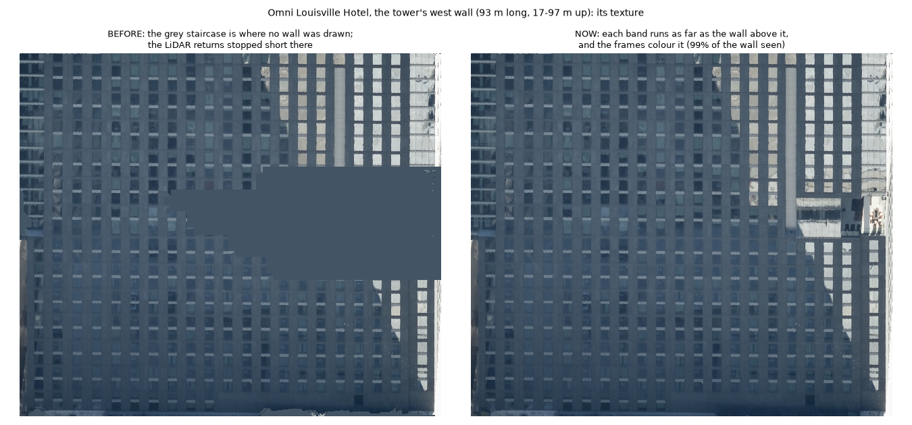
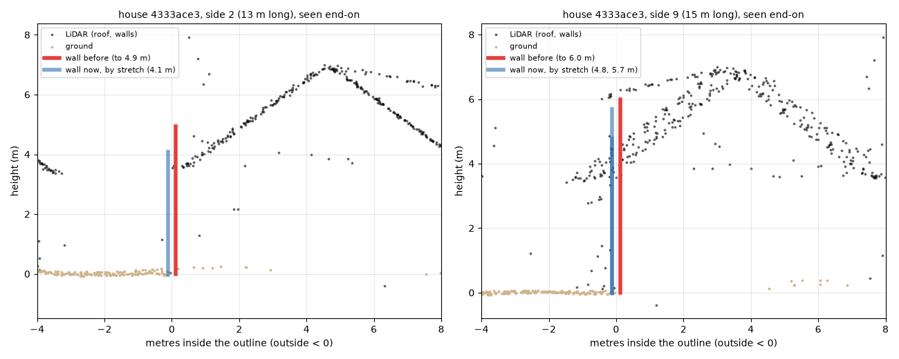
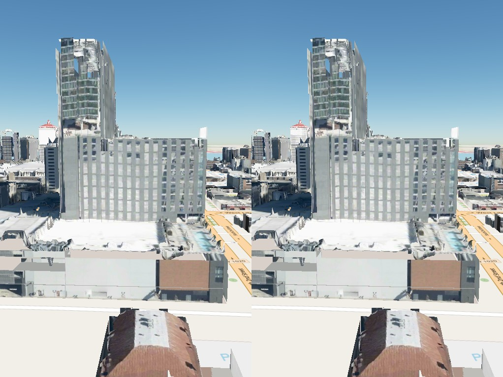
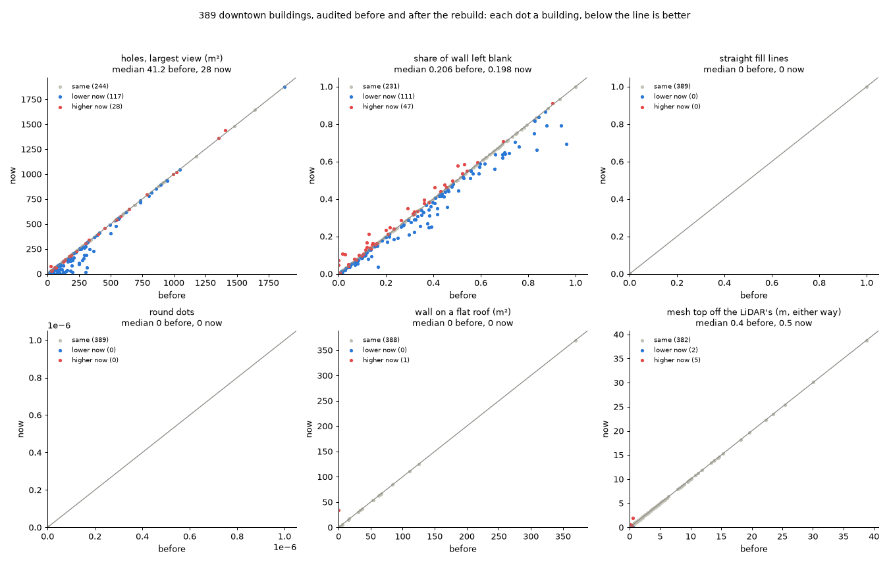
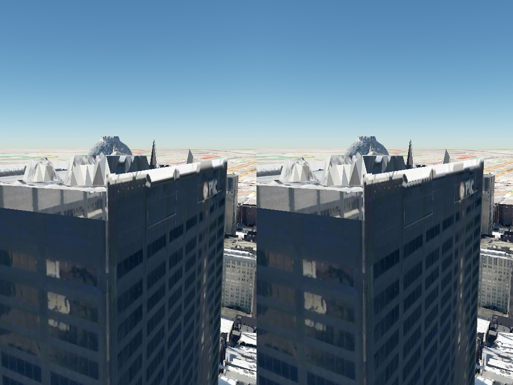
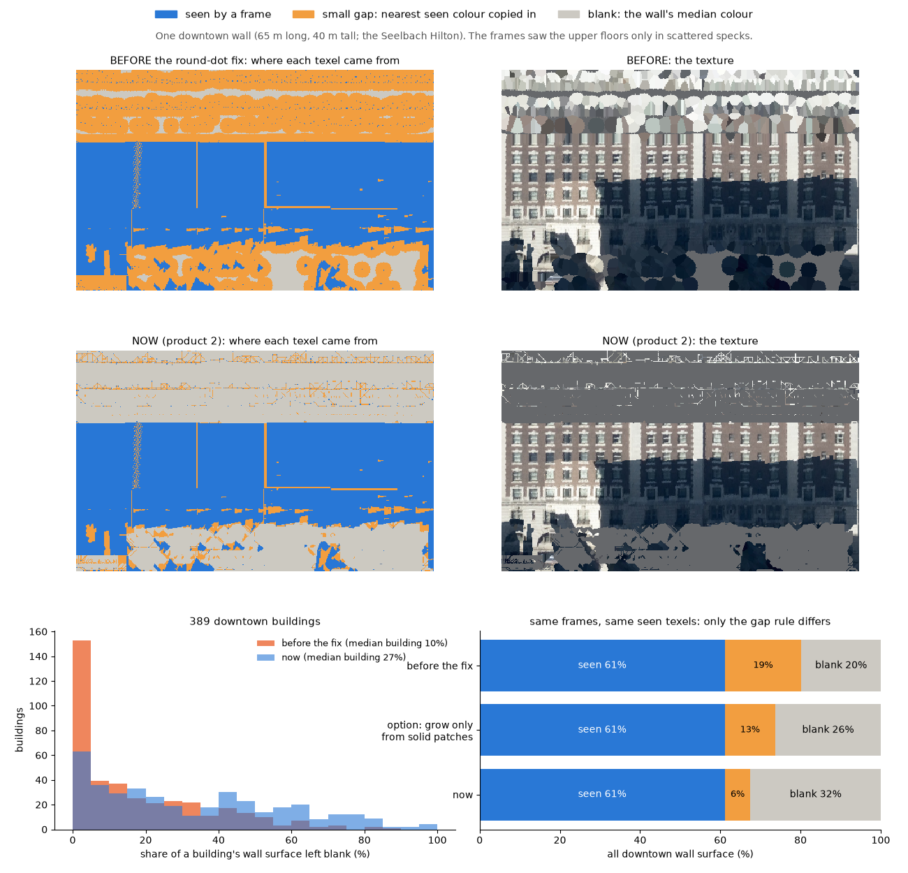
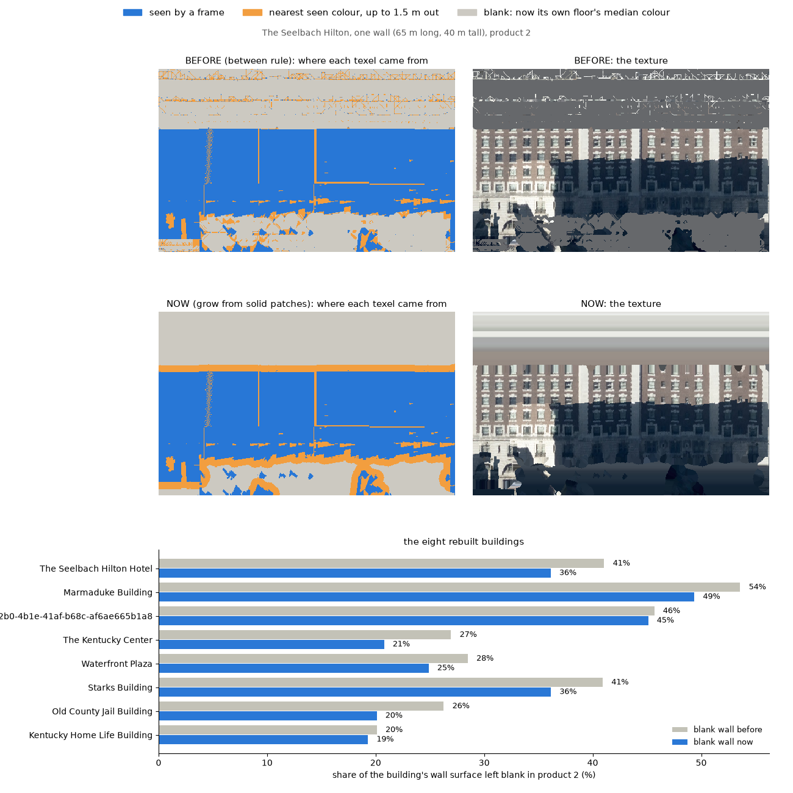
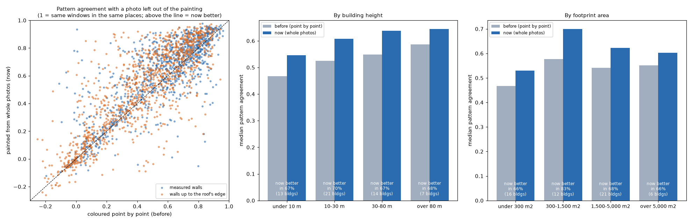
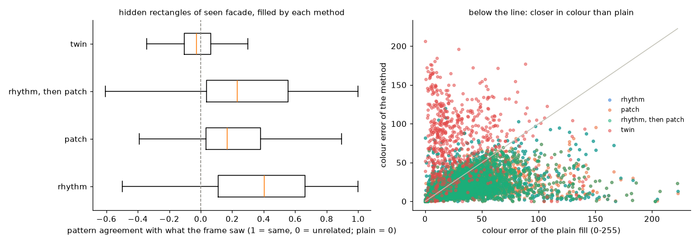

# Four products from KyFromAbove

Each is built only from KyFromAbove data — for each LiDAR tile, the LiDAR
phase and the oblique collection flown closest together in time
(`sources_choice.py`; downtown Louisville pairs Phase 2 LiDAR with the 2024
Season 1 oblique and nadir frames) — on Overture's building footprints, and
each says what it is: measured, or invented.

| | Product | Geometry | Color | Where |
|---|---|---|---|---|
| 1 | Footprints at LiDAR heights | Overture footprints, extruded to the LiDAR's height | none | `outputs/overture_boxes/downtown_lidar/` |
| 2 | Measured 3D Tiles | from the LiDAR | only where a frame saw the texel | `outputs/downtown/` |
| 3 | Completed 3D Tiles | product 2's, unchanged | product 2's, with unseen texels **invented from the building's own frames** | `outputs/downtown_complete/` |
| 4 | Borrowed-fill 3D Tiles | product 2's, unchanged | unseen texels filled from the best-matching seen patches across the building's walls | `outputs/downtown_neural/` |

On `/compare` (and the static viewer in `viewers/s3_compare`) each pane has
a product row — `1 · footprints`, `2 · measured`, `3 · completed`,
`3 · invented shown`, which tints every invented texel magenta,
`4 · borrowed fill` and `4 · borrowed shown`, which tints every borrowed
texel violet.

## 1 · Footprints at LiDAR heights

Overture's building outlines, each with its height measured from the LiDAR:
the 99th percentile of the returns more than 1.5 m inside its outline (a
tall neighbor's wall spills over the edge), above the median of the ground
returns within 15 m. Trees are left out first. The LiDAR carries no tree
label, so the pipeline marks trees itself: rough returns, mostly from
pulses split into several echoes, at most 40 m above the ground
(`lidar.label_trees`). Before that, a tree over a house was its roof. An outline that holds two or three buildings side by
side — roofs at different heights meeting on straight lines — is split
into parts `<gers>-a`, `-b`, `-c` (tallest first) with `parent_gers`. Built
by `scripts/overture_boxes.py lidar-heights`, `split` and `build`; the
records are `data/derived/louisville_downtown_overture_{lidar,split}.json`.
Everything here is measured, except where a footprint has too few returns
(fewer than 20 above its ground): those take Overture's height or 6 m, and
say so.

## 2 · Measured 3D Tiles

The LiDAR gives the geometry: walls where the returns show them (profiled
band by band), prism walls up to the roof's edge where the LiDAR saw the
roof but not the wall, the roof as a height field. Two kinds of geometry
are *inferred* rather than seen, and are part of this product because they
follow from measurements: a prism wall (a roof edge implies a wall under
it), and a hidden face's shape read from its symmetric twin across the
building.

A wall stands on the wall below it: where a band's returns stop short of
the band directly above it, at nearly the same offset, the band runs as far
as the one above (`carry_extents_down`). A neighbor can hide part of a wall
from the scanner while a frame sees it well; the Omni's west tower wall had
a staircase-shaped hole 60 m wide and 25 m tall, 47–72 m up, until this
rule. It only carries a wall downward, never up past a setback, and an open
band (a colonnade) stops it.

A prism wall — the wall under a roof edge the LiDAR saw, where it did not
see the wall — stands to the roof's height read from 0.5–2.5 m *inside*
the edge. It had read 2 m on both sides, the median of whatever cells were
there; a tower's edge stands on its podium's roof, so the two were mixed.
The Omni's L-shaped tower has a 57 m south wing on a 17 m podium: its
south wall read anything from 17 m (no wall at all) to 49 m, and was
mostly missing.

Under a roof that slopes up from its edge — a house's eaves — the strip's
median stands part way up the slope, and a wall drawn to it stood above
where the roof begins: 4333ace3's 13 m side stood to 4.9 m under eaves at
3.6 m, and the frames painted its top with the shingles behind. There the
wall stops at the row of roof cells nearest the edge, where the roof's own
triangles meet the outline (`RoofField.top_along`, `nearest`), when the
roof rises 10-50 degrees from it and no more than 1.5 m across the strip.
A steeper or bigger rise is another roof: the Omni's and Truist Tower's
2-4 m corner edges have their podiums nearest, 8-68 m below, and keep the
median. On the 52 safety-net buildings the walls of 30 changed, and holes
went down (10 m2 in the largest views, 61 m2 over all views).

A wall's crown reaches its roof. The top band of a tall wall often holds
returns at two depths: the crown or parapet at the facade line, and the
roof behind it. Where the front surface continues the wall directly below
it (within 2 m; on a fitted plane, the plane), that band is wall, at its
front (`crown_bands`). PNC Tower's walls had stopped at 152 m under a roof at
155-160 m, a floating lid; the Omni's crown, set 1.5 m back, had gone the
same way. Four limits, each found by the audit on a rebuild: the band must
lie above the face's highest wall band (lower down an open band is a
colonnade); the band directly below it must itself be drawn (a crown over
nothing turned faces the prism path walls to their roof edge into a lone
band — Truist Tower lost 12-71 m of one face, 4a668624 its whole face 1);
its front must be within 2 m of the footprint's edge as well as of the wall
below (Waterfront Plaza's open band 6 m inboard stood a panel on its roof);
and it stops where its own returns stop (Fifth Third's top rose 3 m). Across
downtown 331 faces on 168 buildings got a crown; the median building's
worst-side hole fell from 41 to 28 m².

Two rules keep the roofs honest. The roof height field drops returns
above the building's top only within 2 m of its outline, where a taller
neighbor's wall spills in; anything standing on the roof inside it — a
penthouse, a lantern, a tank — stays (the Kentucky Home Life Building's
rooftop structure had been cut at 77 m and left as a ring of panels). And
an "open" band — returns behind the facade line, a colonnade or loggia — is
drawn as a recessed wall only under a solid band: a colonnade carries
floors above it, and an open band with nothing solid above is the roof seen
over the parapet (746 such bands on 214 buildings had each stood a wall
panel 3–7 m inboard on the roof).

The color is **measured only**. A texel takes its color from a frame that
saw it, through its camera model, not hidden by anything the LiDAR or the
neighbors' footprints put in front of it; which frame is in "How walls are
colored" below.

On a wall, a seen texel counts only where at least half of the meter
around it was seen too: a scattered speck is not trusted. From solidly
seen patches about 2 m across or more, color grows up to 1.5 m (10
texels) into the unseen wall, nearest seen color first; a smaller patch
grows nothing, or it would ring itself in a disc. Any wall texel further
out reads plain: the median color of its own floor (everything seen
within 1.5 m above or below, specks included — untrusted one by one, fair
together), or of the nearest floor seen enough. On a roof, a
small gap *between* seen texels — seen texels within reach on both sides,
across, up or diagonally — takes the nearest seen color, and the rest
reads the roof's median color.

How this was arrived at. Until September 2026 color grew 1.5 m from
*every* seen texel, specks included, so each speck on a sparsely seen wall
became a disc up to 3 m across: round dots. The first fix filled only gaps
*between* seen texels; the dots went, but specks were then bridged by
straight lines, and blank wall across downtown rose from 20% to 32% of all
wall surface. Growing only from solid patches keeps the dots and lines out;
on the eight buildings rebuilt first it cut their blank wall by 1 to 6
points each (the Seelbach Hilton from 41% to 36%), and dropping the specks
costs under 1% of the seen wall. A face-wide median had also painted blank
wall a dark gray wherever shadow covered much of the face; the floor's own
median does not.

Party walls below a neighbor's roof are plain. Each building's
tileset states its own coverage, `texels`: the share seen, filled across a
small gap (`near`), and plain.

Until September 2026 this product also copied color onto a hidden face
from its twin across the building; that is an invention, it moved to
product 3, and the held-out test below turned it off there too.

### How walls are colored

Each flat section of a wall is painted whole from one photograph: the
frame that sees most of it, most squarely, and whose pattern agrees best
with the other frames' (`src/kyfromabove_3d/mesh/paint.py`). What that frame
cannot see is painted from the next, its color matched to the first where
both see, unless its pattern clearly disagrees with what is painted: the
nadir frame, seeing the Hyatt's 4 m pier at a grazing angle, had painted it
half a floor out of step. A wall that steps back (400 West Market's crown)
is one section per depth, so no photograph is warped onto a wall that is not
where the building is. Walls drawn up to the roof's edge are painted the
same way, at the same 0.15 m (they had been sampled at 0.3 m).
Curved walls, and a section no frame sees, keep the older way: each LiDAR
point on the wall colored from its own most face-on frame, the points
rasterized.

What blocks a frame's view is the depth map every color here uses: every
LiDAR return within 250 m, trees included, and each neighbor as a solid
prism. A tree in front of a house is not painted onto the house; the next
frame paints that part, or it stays unseen. `wall_paint.json` records which
frames painted each section, so the texture check never scores a frame
against the wall it painted.

The held-out test (`scripts/eval_wall_paint.py`): for each section and each
frame seeing at least 30% of it, leave that frame out, color the section
both ways without it, and compare with what the left-out frame shows —
pattern agreement, 1 when the same windows sit in the same places. On the
52 safety-net buildings and four St. Matthews houses (2,149 comparisons;
walls up to the roof's edge before at their 0.3 m, shown on the 0.15 m grid
as a viewer sees them):

| walls | before | painted | painted better in |
|---|---|---|---|
| measured | 0.61 | 0.67 | 61-70% of comparisons at every height; 43 of 47 buildings |
| up to the roof's edge | 0.47 | 0.55 | 66-74% of comparisons at every height; 42 of 45 buildings |

On walls up to the roof's edge the gain is the finer texel: at the same
0.3 m the two ways tie (painted better in 53-55% of comparisons, and on 3 or
4 of 11 buildings 30-80 m tall). These are walls the LiDAR did not see,
drawn on the outline under the roof's edge; where the outline is off, no
frame paints them right, and the one nearest the viewer's angle looks least
wrong.

The shape of every building is unchanged (the same triangles, checked on
six); the mesh step takes 5-30% longer on a tower and no longer on a
house. Product 3's fills still beat plain on the painted walls (the same 56
buildings, 8,263 hidden rectangles): rhythm then patch agrees 0.29 on
measured walls and is closer in color than plain in 78%; on walls up to the
roof's edge 0.17 and 70%.

## 3 · Completed 3D Tiles

Product 2, triangle for triangle, with its plain texels filled by
invention — learned only from **the same building's own** frames and LiDAR,
never from other buildings, outside images or a generic model
(`src/kyfromabove_3d/facade_fill.py`, `build_mesh.py --complete`):

- **rhythm** — a facade repeats: its bay width (1–8 m) and story height
  (2.5–6 m) are found from the autocorrelation of its seen texels, and an
  unseen texel takes the seen texel a whole number of bays or stories away;
- **patch** — what is left, within 3 m of the seen part, takes 1 m blocks
  copied from the seen part of the same texture whose borders match best
  (image quilting); deeper stays plain.

The 3 m is measured from wall a frame saw solidly. Until the speck rule
in product 2, a speck counted as seen, so a speckled stretch of wall was
"within 3 m" everywhere and the patch fill covered it all, seeded from
nothing; on the Marmaduke Building that was about a fifth of its surface,
which now reads plain in product 3 too.

Every texel records its source (seen, near, plain, rhythm, patch), the
tileset states the shares (`fill`), and `3 · invented shown` tints the
invented ones.

**A method runs only where it beat plain on the held-out test**
(`scripts/eval_fill.py`): rectangles of facade a frame *did* see are hidden,
invented from the rest, and compared with what the frame saw — pattern
agreement (1 = the same windows in the same places; plain = 0) and color
error against the plain fill.

Over all of downtown — 16,759 hidden rectangles on 342 buildings:

| texture | method | pattern agreement | color closer than plain |
|---|---|---|---|
| fitted wall tile | rhythm, then patch | 0.50 | 79% |
| profiled face | rhythm, then patch | 0.16 | 78% |
| prism face | rhythm, then patch | 0.22 | 64% |
| roof | patch | 0.05 | 67% |
| roof | rhythm | −0.03 | 50% — off |
| hidden face | its twin's texels | −0.03 | 13% — off |

A first test on the sixteen buildings of the curved-wall work (1,658
rectangles) agreed everywhere but on prism faces, where 34 rectangles put
the rhythm below plain; on 165 it is above, and the policy follows the
larger test: rhythm, then patch, on prism faces too.

The twin copy fails worst: the face opposite is lit by the sun from the
other side and its windows do not line up with this face's. The rhythm is
strongest where the facade is a regular grid (the fitted tiles) and adds
little on roofs, which are mostly plain surfaces anyway.

Across downtown the completed product cuts the plain texels from a median
of 16% of each building to 4%; the median building has 11% of its texels
invented, the 90th percentile 23%.

## 4 · Borrowed-fill 3D Tiles

Product 2, triangle for triangle, with its plain texels filled a second
way: each unseen patch of wall takes the seen patches, anywhere on the
building's own walls, whose surroundings look most like the hole's
surroundings (`src/kyfromabove_3d/neural_fill.py`, `build_mesh.py
--neural`). For each hole:

- the seen ring of wall around it is compared, as a pattern of light and
  dark, with every place on the same wall and, when nothing there matches
  well, on the building's other walls;
- the three best matches are brought to the hole's own brightness and
  averaged, a better match counting for more.

Like product 3 it learns only from the same building's own frames. The name
`neural` (in `3dtiles_neural/`) is left from a first version that blended
the matches with a small network trained on each building; on held-out
walls the plain weighted average scored better (pattern agreement 0.56
against 0.43 on 51 buildings), so the network was dropped. It is cheap: a
house takes about 0.07 s, a building over 2,000 m² under a second.

Every borrowed texel is marked in the texture's record of where its color
came from, and `4 · borrowed shown` tints it.

Downtown Louisville was built before product 4 existed. Its 2,361 meshes
were given it on October 28, 2026 by `scripts/backfill_neural.py`, which
runs the same fill (`scripts/build_neural.py`) on each building's stored
product 2 and product 3 texels and stores the result as a build with
`--neural` would; products 2 and 3 were left as they were. How product 4 compares with
product 3 on the same hidden rectangles is not written up yet.

## Related work considered

Four generative methods were looked at for product 3 and not adopted; each
earns its keep where measurements are missing, and this project has them.

- **BuildAnyPoint** (Hua et al., CVPR 2026) — compact meshes (about 16
  faces) from a building's points, with walls completed by a diffusion
  model; trained on 50,000 Dutch buildings. A candidate for sparse-LiDAR
  buildings statewide; its code and weights are not released.
- **FacaDiffy** (Fröch et al., ISPRS 2025) — windows and doors from
  street-level laser rays through an LoD2 facade, hidden parts inpainted by
  Stable Diffusion. Needs street-level scans; airborne LiDAR barely touches
  walls.
- **Hunyuan3D 2.1** (Tencent, 2025) — single-image generation of an object
  with painted materials. Invents shape and color, has no scale or
  position, and its license excludes the EU, UK and South Korea.
- **ReconFusion** (Google, CVPR 2024) — few-view NeRF with a diffusion
  prior learned from close-range photographs. Invents where the views are
  silent; no official code.
