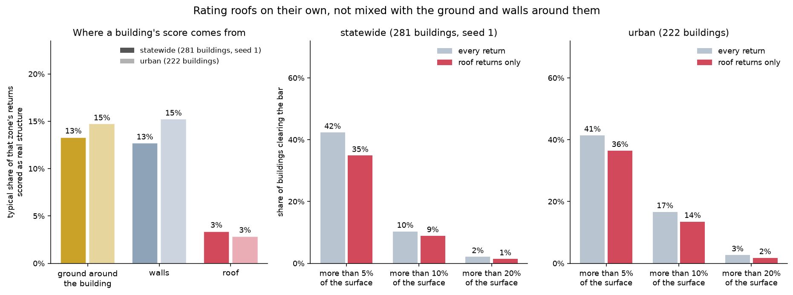

# Two lists: roofs to densify, walls to image

A building's LiDAR is scored on its **roof alone**, because the returns that are
not roof score three times higher on nothing. And because that score cannot see
facades at all, there is a **second list**, selected the opposite way.



## Why roofs are scored alone

It came out of the three case buildings (`docs/CASE_COMPLEXITY.md`). 400 West
Market and PNC Tower are 300 m apart, within 7% of each other in height, flown
by the same aircraft — and on their **walls** they score 36% and 32%. One has a
plain flat facade, the other has ledges and setbacks all the way up, and the
measure cannot tell them apart.

That is not a measurement of the wall. It is the viewing angle: an aerial
scanner sees a vertical surface nearly edge-on, so the returns are sparse and
scattered, and roughly a third read as real shape whether or not there is any.

Median score within each zone:

| | ground around the building | walls | **roof** |
|---|---|---|---|
| statewide (281 buildings) | 13.3% | 12.7% | **3.4%** |
| urban (222 buildings) | 14.7% | 15.2% | **2.8%** |

**Ground scores as high as wall does**, which was not expected — the walls were
the known problem. It is the same edge effect that made the bounding-box survey
overstate: where a wall meets the ground the surface really does step,
coherently. Clipping to the footprint does not remove it, because the polygon
still takes in ground at the building's base.

## The population is not what it was

Every earlier figure described a population defined by a column that did not
mean what its name said.

The building list's `area_m2` was the axis-aligned **bounding box**, not the
footprint polygon — median ratio 1.012 against the bbox, 2.29 against the
polygon. So "12,363 buildings with a footprint over 5,000 m²" was really
*12,363 buildings whose bounding box cleared 5,000*, with a **median true
footprint of 2,180 m²** and some under 700. A bounding box is also
shape-dependent: it admits a diagonal or L-shaped building at half the stated
area and rejects a compact one of the same size.

Measured on the polygon, **4,708** Kentucky buildings clear 5,000 m². That is
the population now, rebuilt by `scripts/fetch_overture_buildings.py`, which
writes `area_m2` *and* `bbox_area_m2` on every row so the two can never be
confused again.

**The floor stands, for a different reason than it was given.** It was justified
by Overture's `roof_shape` coverage jumping at 5,000 m². Re-measured on true
footprint area, `roof_shape` is **under 0.5% in every band** — it is simply not
populated in Kentucky, at any size. The jump was in the `class` column, read
across by mistake, and that one is real: class coverage goes 17.0% → 31.2%
across the 5,000 m² boundary and is the only attribute that responds to size.
Run `--bands` to reproduce it.

## What the roof score says now

| | statewide (281) | urban (222) |
|---|---|---|
| roof median | 3.4% | 2.8% |
| above 5% | 34.9% | 36.5% |
| **above 10%** | **8.9%** | **13.5%** |
| above 20% | 1.4% | 1.8% |

**The statewide target is 419 buildings** of the 4,708.

Two things changed against the old population, both pushing the same way. The
population is 62% smaller, and the rate roughly halves — because a genuinely
large footprint means a wide, low building, and those are flat. A 10,000 m²
distribution warehouse is a plate.

**The urban premium shrank from 2.4× to 1.5×**, and at the median it inverts:
urban large buildings score *lower* than statewide ones. Restricted to real
5,000 m² footprints, an urban building of that size is big-box retail or a
parking structure, which is no more complex than a rural warehouse. The old
premium was carried by the smaller, taller buildings the bounding-box filter let
in — the ones that are now on the facade list instead.

## The facade list

The roof score is blind to facades, and on this population that blindness costs
nothing to fix and everything to ignore: the facade term fires on **2 of 281**
buildings statewide and **7 of 222** urban, adding just one and two buildings
that the roof score had not already picked.

That is correct behavior, not a failure. **A footprint over 5,000 m² is wide
and low by construction**, with a facade-to-roof ratio around 0.4. The buildings
where walls dominate are excluded from this survey entirely — 400 West Market
and PNC Tower have ~1,800 m² footprints and ratios of 16.

So facades get their own list, selected the opposite way:

> A facade candidate is a building at least **12 m** tall (about four stories)
> whose **wall area is at least twice its roof area**, and at least **500 m²** in
> absolute terms.

`scripts/fetch_overture_buildings.py --select facade` builds it: **3,640
Kentucky buildings** over 1,820 tiles.

**The two lists share 9 buildings.** Out of 3,640 and 4,708 — 0.2%. They are not
two views of one population; they select in opposite directions, and neither can
stand in for the other.

| | in the facade list? | height | wall ÷ roof |
|---|---|---|---|
| 400 West Market | yes | 167 m | 15.6 |
| PNC Tower | yes | 156 m | 16.3 |
| Tractor Supply | no | 6 m | 0.5 |

### Where to start

The default 500 m² floor is permissive — the median candidate is a 15 m building
with 688 m² of wall, a four-story downtown block.

| wall area floor | candidates | median height |
|---|---|---|
| ≥ 500 m² | 3,640 | 15 m |
| ≥ 2,000 m² | 585 | 21 m |
| **≥ 5,000 m²** | **134** | **28 m** |
| ≥ 10,000 m² | 38 | 68 m |
| ≥ 20,000 m² | 10 | 108 m |

`--min-facade-m2 5000` gives 134 buildings: tractable, and the level at which
one building carries enough wall to justify its own imagery pass.

**832 candidates (23%) fall in Louisville**, and the three tiles holding the most
— `N077E228`, `N076E228`, `N077E229` — are all downtown. That is the
`2024_Season1` collection, measured at **11 days** between LiDAR and imagery
against 334 days elsewhere (`scripts/survey_temporal_alignment.py`). The facade work
and the temporal alignment point at the same ground.

### What the facade list cannot see

**Buildings with no height.** Unlike footprint area, height cannot be recovered
from the geometry Overture ships, so a tall building with neither `height` nor
`num_floors` is invisible. Where only floors are given, height is estimated at
3.5 m per story — deliberately under the 3.9 and 4.8 m the two Louisville
towers actually have, so the estimate under-selects rather than over-selects.
Only 147 of 3,640 rely on that fallback.

**Occlusion.** Whether a *particular* wall face is visible needs neighboring
geometry. The survey's own `facade_returns_per_m2` is the empirical stand-in
once a building is measured — if the LiDAR reached the wall, something could see
it — but it cannot be computed from Overture alone.

## How much to trust these numbers

**The random arm is a sample, and the seed is part of the answer.** 120 tiles out
of 1,805. On the old population, seed 0 and seed 1 gave medians of 4.5% and 5.6%
over the same population — a full point apart — so read any statewide figure with
sampling spread in mind. The seed is recorded in each output file's `params`
block, which it was not when the first numbers were quoted.

**There is a false-positive floor**, described in `docs/CASE_COMPLEXITY.md`: a
rough point can read coherent by luck, under 20% of rough points on pure noise.
Unchanged by any of this.

**Footprint accuracy still dominates on flat buildings.** Splitting by zone does
not fix a footprint off by a meter; it stops the ground the footprint admits from
being scored as roof.

## Reproducing

```bash
python scripts/fetch_overture_buildings.py --bands
python scripts/fetch_overture_buildings.py --out data/derived/ky_large_tiled_wkt.csv
python scripts/fetch_overture_buildings.py --select facade \
    --out data/derived/ky_facade_tiled_wkt.csv

python scripts/survey_building_complexity.py \
    --buildings data/derived/ky_large_tiled_wkt.csv --tiles 120 --sample random --seed 1
python scripts/survey_building_complexity.py \
    --buildings data/derived/ky_large_tiled_wkt.csv --tiles 10 --sample dense
python scripts/plot_survey_zones.py
```

The Overture release is pinned in the fetch script and matches the one
`measure_case_complexity.py` uses. The numbers here were measured on
`2026-08-19.0`; both scripts now pin `2026-10-21.0`, so a fresh run may not
give them exactly. Footprints are revised between releases and
the footprint clip is the dominant error term, so the release is part of the
measurement.
