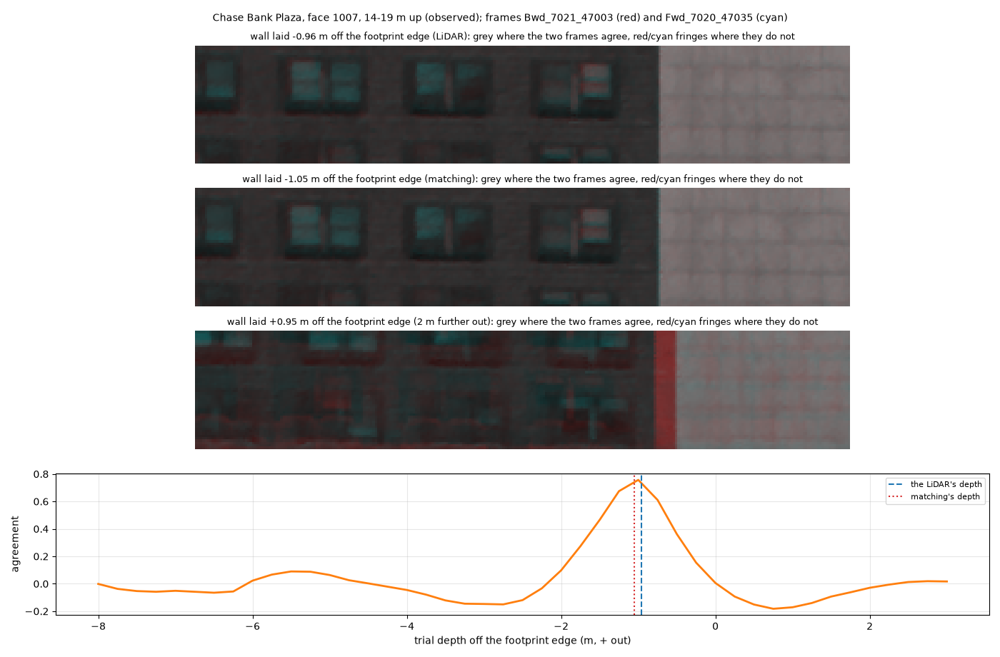
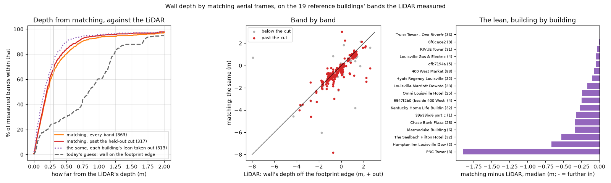
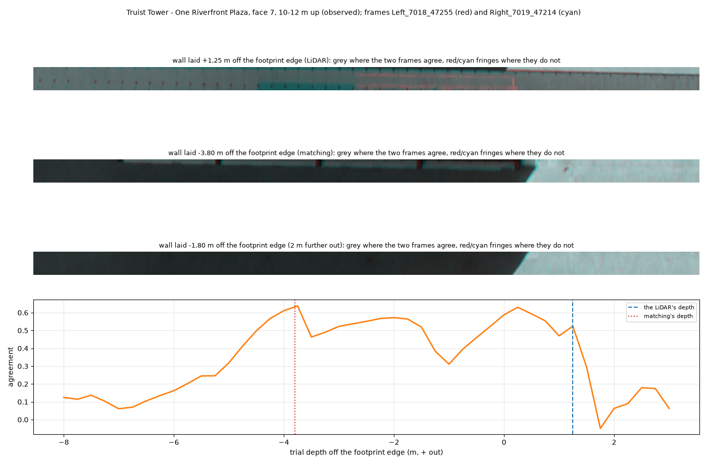
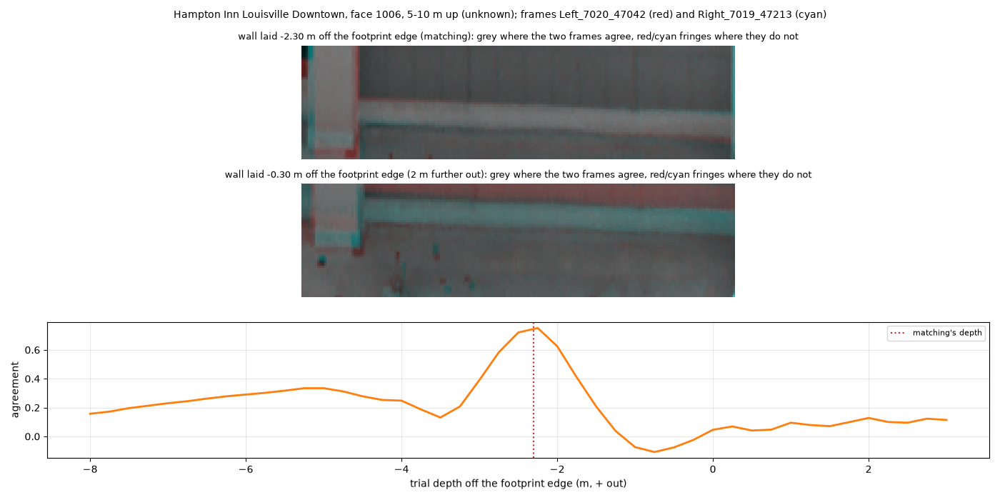

# The walls the LiDAR missed: which frames see them, and how far back they stand

The LiDAR is flown from above and catches few returns on walls. The wall
profile cuts each face into 5 m slices ("bands") and records what the
returns said about each; across the downtown run, 57 % of the 13,192 bands
are *unknown*, the LiDAR having seen nothing usable there, and only 18 % were
measured. Those walls are inferred: a prism at the footprint edge, or a copy
of the face opposite.

The aerial frames are flown at 45 degrees and see walls directly. This
measured, from geometry alone, how well: on the 19 buildings of the audit's
reference set (`configs/audit_reference.yaml`), every band against every one
of the 190 frames of the 2024 flight over downtown, not just the four per
camera head each building keeps (`scripts/wall_visibility.py`).

## What counts as seeing a band

Points a metre apart across and up each band's wall, and for each frame:

- **in the picture**: inside the frame, clear of its edge;
- **not blocked**: the downtown meshes, drawn through the frame's camera,
  show nothing nearer than the point;
- **face-on enough**: the camera within 70 degrees of straight out from the
  wall; past that a wall is a sliver;
- **detail**: centimetres of wall per pixel, from the distance and the angle.

A frame *sees* a band when half its points pass. Two frames that see it from
directions at least 10 degrees apart are what matching between frames needs
to find how far back the wall stands.

A band's wall is only counted where the building stands behind it: its mesh's
roof, just inside the wall, is higher than the point. A face traced along a
podium's edge runs on up past the podium's roof, and the LiDAR rightly found
nothing there: **311 of the 1,097 unknown bands, 28 %, are air, not hidden
wall.** (The same rule drops 20 of 453 measured bands, 4 %: it is a little
too strict, not too loose.)

The test, checked on real frames: green points are counted as seen, red as
facing the camera but blocked. Behind the Marriott, the Omni's walls are
red; its walls in view are green.


And the Seelbach, behind a glass tower on one side and in plain view on the
other:


## What it found


**The frames see the walls the LiDAR missed as well as the ones it
measured.** Of the 786 unknown bands with building behind them, 90 % are
seen by two frames or more (the measured bands: 94 %), 74 % by two from
directions far enough apart to find depth (measured: 85 %), and the median
band by four frames. Only 8 % are seen by none.

- **Low walls are the hard ones.** Up to 15 m above the street, 18 % of the
  unknown bands are seen by no frame; above 40 m, 3 %. Trees are not in the
  meshes, so for the low walls even that is optimistic.
- **The detail is finer than today's textures.** The best frame on an
  unknown band gives 9.9 cm of wall per pixel (the median; nine in ten under
  10.5 cm), against the 15 cm the textures are made at.
- **The pipeline already holds the frames.** On 88 % of the unknown bands,
  at least two of the frames that see them are among the ones the building
  kept. No new imagery is needed to try this.
- **By building**, the walls hidden from every frame are on a few: the
  Kentucky Home Life Building, the building beside 400 West Market and the
  Marmaduke Building (nearly all their unknown bands, a handful each: tight
  between neighbours), and 18 % of the Hyatt's.

## What it does not say

- Whether matching *works* on a given wall: glass that reflects the sky, or
  a plain wall with nothing to match, can be seen and still give no depth.
  That is the next test.
- Trees, and buildings outside the downtown tileset, block nothing here.
- The blockers are the meshes, with their own inferred walls; a wall the
  mesh puts in the wrong place blocks the wrong view.

## Finding the depth by matching

Seen is not the same as measured. A band's direction is the footprint's;
what is unknown is how far in or out of the footprint edge the wall stands.
Two frames laid onto a trial wall at the right depth show the same pattern
in the same place; at the wrong depth they slide apart. The test sweeps the
trial wall from 8 m inside the edge to 3 m out, every 25 cm and then every
5 cm about the best, lays each frame on it at 10 cm a pixel (only where the
measure above found the frame sees it), and scores how well every pair of
frames 10 degrees apart agrees (`scripts/wall_match.py`). Two confidences
come with each depth: how well the frames agree there, and the **margin** by
which it beats the best depth at least 0.75 m away -- a facade of repeated
windows also agrees one bay off. The imagery is 408 windows of 73 frames,
0.3 GB, read once.

Below, two frames of a Chase Bank Plaza wall laid on top of each other, one
in red, one in cyan: grey where they agree. At the LiDAR's depth and at the
depth matching found (9 cm apart) they agree; 2 m out, the windows split
into red and cyan.



**On the 363 bands the LiDAR measured, where the answer is known.** The
cut, a minimum margin, was chosen on half the buildings to keep matches off
by more than a metre rare, and scored on the other half, both ways round:



- **It passes 317 of the 363 bands (87 %), and puts 68 % within 0.3 m of the
  LiDAR, 84 % within 0.5 m, 95 % within 1 m; half are within 0.20 m.**
  Today's guess for a wall the LiDAR missed -- on the footprint edge --
  puts 24 % of the same bands within 0.3 m and 30 % within 0.5 m (half
  within 0.84 m).
- **The margin is what tells a failed match.** The bands it rejects are the
  ones off by metres: a 2 m strip at the Truist Tower's podium edge agrees
  almost as well at three depths 2-4 m apart, and the margin is 0.02.



- **Most of what is left is a lean, not noise.** Matching puts walls a
  little further in than the LiDAR, by a different amount on each building:
  none on the Truist Tower and RIVUE, 0.3-0.5 m on the Seelbach, Chase Bank
  Plaza and the Kentucky Home Life, masonry walls with windows set into
  them. The same frames saw all of them and the lean does not follow the way
  a wall faces, which points to the facades rather than the cameras: the
  likeliest reading is that the pattern matched is the windows, set back
  behind the face the laser hits. Taking out each building's lean, measured on its *other* bands
  as an unknown wall's would be, brings it to 74 % within 0.3 m and 89 %
  within 0.5 m (half within 0.16 m).
- PNC Tower's three measured bands, all in its set-back crown 152 m up, are
  matched 1-2 m further in than the LiDAR has them, and two of the three pass
  the cut. The laser and the frames may be seeing different surfaces of the
  crown; three bands are too few to say.

**On the 575 unknown bands.** With the cut chosen on all the measured bands,
463 get a depth, and on 232 of them -- half -- the wall stands more than
1 m from the footprint edge where the mesh now draws it; the median is
0.85 m inside it. The Hampton Inn's, 5-10 m up, is 2.3 m in:



## So

The obliques can carry the walls the LiDAR missed. Most are seen, in frames
the pipeline already has, and matching between them finds a wall's depth to
within 0.3 m on two bands in three where the LiDAR can check it, and within
0.5 m on five in six -- against one in four for today's guess. What it
leaves is a per-building lean that the building's measured walls can take
out. The next step is to use it: a band status `matched` in the wall
profile, behind a switch, at the matched depth less the building's lean,
and the audit run over the reference set to see what it changes.

```bash
python scripts/register_video.py scene --tileset outputs/downtown --out data/derived/video/downtown_scene.npz
python scripts/wall_visibility.py --scene data/derived/video/downtown_scene.npz --out outputs/wall_visibility/reference
python scripts/wall_match.py fetch      # the frame windows, 0.3 GB, once
python scripts/wall_match.py sweep
python scripts/wall_match.py score
python scripts/wall_match.py show --band 900 --out-png docs/figures/wall_match_good.png
```
