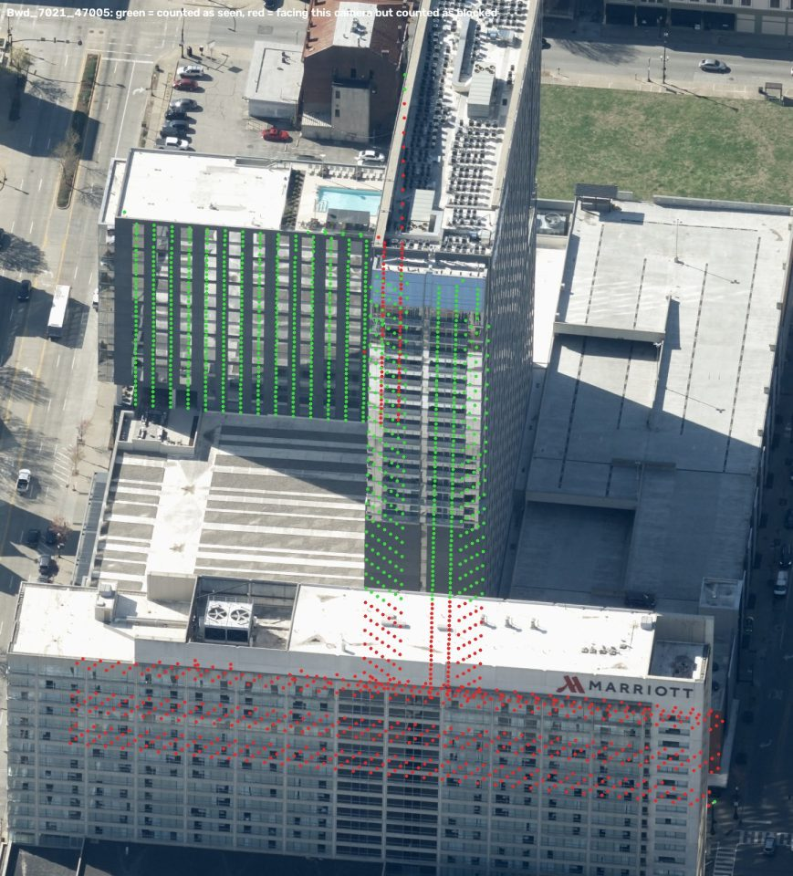
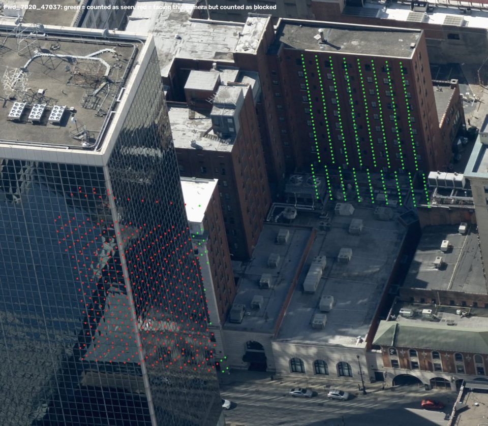
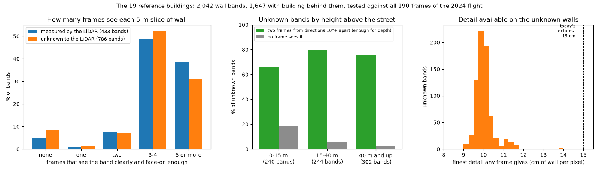

# Which frames see the walls the LiDAR missed

The LiDAR is flown from above and catches few returns on walls. The wall
profile cuts each face into 5 m slices ("bands") and records what the
returns said about each; across the downtown run, 57 % of the 13,192 bands
are *unknown*, the LiDAR having seen nothing usable there, and only 18 % were
measured. Those walls are inferred: a prism at the footprint edge, or a copy
of the face opposite.

The aerial frames are flown at 45 degrees and see walls directly. This
measured, from geometry alone, how well: on the 19 buildings of the audit's
reference set (`configs/audit_reference.yaml`), every band against every one
of the 190 frames of the 2024 flight over downtown, not just the four per
camera head each building keeps (`scripts/wall_visibility.py`).

## What counts as seeing a band

Points a metre apart across and up each band's wall, and for each frame:

- **in the picture**: inside the frame, clear of its edge;
- **not blocked**: the downtown meshes, drawn through the frame's camera,
  show nothing nearer than the point;
- **face-on enough**: the camera within 70 degrees of straight out from the
  wall; past that a wall is a sliver;
- **detail**: centimetres of wall per pixel, from the distance and the angle.

A frame *sees* a band when half its points pass. Two frames that see it from
directions at least 10 degrees apart are what matching between frames needs
to find how far back the wall stands.

A band's wall is only counted where the building stands behind it: its mesh's
roof, just inside the wall, is higher than the point. A face traced along a
podium's edge runs on up past the podium's roof, and the LiDAR rightly found
nothing there: **311 of the 1,097 unknown bands, 28 %, are air, not hidden
wall.** (The same rule drops 20 of 453 measured bands, 4 %: it is a little
too strict, not too loose.)

The test, checked on real frames: green points are counted as seen, red as
facing the camera but blocked. Behind the Marriott, the Omni's walls are
red; its walls in view are green.



And the Seelbach, behind a glass tower on one side and in plain view on the
other:



## What it found



**The frames see the walls the LiDAR missed as well as the ones it
measured.** Of the 786 unknown bands with building behind them, 90 % are
seen by two frames or more (the measured bands: 94 %), 74 % by two from
directions far enough apart to find depth (measured: 85 %), and the median
band by four frames. Only 8 % are seen by none.

- **Low walls are the hard ones.** Up to 15 m above the street, 18 % of the
  unknown bands are seen by no frame; above 40 m, 3 %. Trees are not in the
  meshes, so for the low walls even that is optimistic.
- **The detail is finer than today's textures.** The best frame on an
  unknown band gives 9.9 cm of wall per pixel (the median; nine in ten under
  10.5 cm), against the 15 cm the textures are made at.
- **The pipeline already holds the frames.** On 88 % of the unknown bands,
  at least two of the frames that see them are among the ones the building
  kept. No new imagery is needed to try this.
- **By building**, the walls hidden from every frame are on a few: the
  Kentucky Home Life Building, the building beside 400 West Market and the
  Marmaduke Building (nearly all their unknown bands, a handful each: tight
  between neighbours), and 18 % of the Hyatt's.

## What it does not say

- Whether matching *works* on a given wall: glass that reflects the sky, or
  a plain wall with nothing to match, can be seen and still give no depth.
  That is the next test.
- Trees, and buildings outside the downtown tileset, block nothing here.
- The blockers are the meshes, with their own inferred walls; a wall the
  mesh puts in the wrong place blocks the wrong view.

## So

The obliques can carry the walls the LiDAR missed: most of them are seen,
in frames the pipeline already has, from two directions, at finer detail
than the textures use. The next step is to find each unknown wall's depth by
matching between two of those frames, held to within a few metres of what
the LiDAR measured above and below, and to score the method first where the
answer is known: on bands the LiDAR *did* measure.

```bash
python scripts/register_video.py scene --tileset outputs/downtown --out data/derived/video/downtown_scene.npz
python scripts/wall_visibility.py --scene data/derived/video/downtown_scene.npz --out outputs/wall_visibility/reference
```
